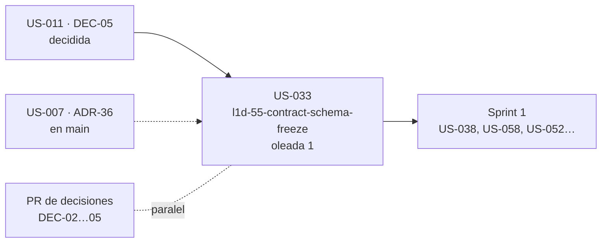

# Pre-S1 · Plan del sprint

> `/sprint-start Pre-S1` · 2026-10-11/12 · proyecto Linear **OncoLens-1**, milestone `Pre-S1` (**17 pts**; capacidad 80–90 según DEC-03). Refinamiento previo: [`Pre-S1-refinamiento.md`](Pre-S1-refinamiento.md). Las decisiones de esta fase continúan la numeración: `[Pre-S1 resp. 18–29]`.

## 1. Historias y changes

| L1D | US | Change | Contexto | Oleada | Depende de | Lote | Est. |
|---|---|---|---|---|---|---|---|
| [L1D-55](https://linear.app/l1der-lab-mjbc/issue/L1D-55) | US-033 | `l1d-55-contract-schema-freeze` | contratos (sync-contracts) → `clinical-platform` (data-model, readme §3.1/§4.1) → `ai-services` (corpus/Milvus, readme §4.2) | 1 | DEC-05 (decidida) | — (historia aislada) | 10 |
| [L1D-50](https://linear.app/l1der-lab-mjbc/issue/L1D-50) | US-007 · ADR-36 | — (sin change) | ADR | ya en `main` (PR #10) | — | — | 3 |
| [L1D-51](https://linear.app/l1der-lab-mjbc/issue/L1D-51) | US-008 · DEC-02 | — | DEC | PR de decisiones | — | — | 1 |
| [L1D-52](https://linear.app/l1der-lab-mjbc/issue/L1D-52) | US-009 · DEC-03 | — | DEC | PR de decisiones | — | — | 1 |
| [L1D-53](https://linear.app/l1der-lab-mjbc/issue/L1D-53) | US-010 · DEC-04 | — | DEC | PR de decisiones | — | — | 1 |
| [L1D-54](https://linear.app/l1der-lab-mjbc/issue/L1D-54) | US-011 · DEC-05 | — | DEC | PR de decisiones | — | — | 1 |

- **Oleada 1:** solo US-033, que hace `sprint-orchestrator` con `clinical-platform-dev`. Las tareas de `ai-services` son documentales (corpus y Milvus en `data-model.md`, readme §4.2) y van en la misma rama, porque es un solo change.
- **PR de decisiones (sin change de OpenSpec):** `docs/decisions/DEC-02-protocolo-vm.md`, `DEC-03-capacidad.md`, `DEC-04-terminos-estandares.md` y `DEC-05-tnm-isup.md`. Se redactan desde los bloques `Decidido` de FEAT-00 en la sesión principal, en una rama `docs/pre-s1-decisiones`, en paralelo con la oleada 1. La validación del oncólogo sobre DEC-05 sigue pendiente antes de US-038.
- **Gate 2 previsto para US-033:**
  - `privacy-guardian` (toca `scripts/` y `contracts/`);
  - `contract-keeper` (OpenAPI y `packages/api-contracts`);
  - `clinical-language-auditor` (descripciones y ejemplos);
  - `design-principles-reviewer` (código del script en `scripts/`).
  - No aplica `ai-eval-runner`.

## 2. Gate 1 · reporte consolidado

| Guardián | Vuelta 1 | Vuelta 2 | Cierre |
|---|---|---|---|
| clinical-language-auditor | FAIL (5 Mayores) | **PASS** (5 Menores) | Menores aplicados |
| privacy-guardian | FAIL (6 Mayores) | FAIL (3 Mayores, 11 Menores) | Corregido sin re-gate `[resp. 26]` |
| contract-keeper | FAIL (2 Bloqueantes, 11 Mayores) | FAIL (0 Bloqueantes, 11 Mayores, 9 Menores) | Corregido sin re-gate `[resp. 26]` |

**Decisión del humano tras la segunda vuelta (`[Pre-S1 resp. 26]`):** se aceptan las correcciones sin una tercera vuelta y el Gate 2 las verificará sobre el código. Todos los hallazgos quedaron resueltos o anotados como vacío con dueño. `openspec validate --changes --strict` pasa.

**Decisiones tomadas en el Gate 1:**

| # | Decisión |
|---|---|
| 18 | El grado se registra siempre como `grading` (`gleason_isup` en próstata, `nottingham` en mama); `grade` es siempre derivado (US-110 AC-2 y AC-3) |
| 19 | El seguimiento usa un endpoint propio en Backend 2, `POST /rag/follow-up`, sin estado. Backend 2 clasifica `fuera_de_contexto` y Backend 1 calcula la marca de fuente nueva. `/rag/query` y AC-9 no cambian |
| 20 | El generador mínimo `contracts:generate` entra en US-033 (AC-16; 8 → 10). `breaking` y `verify-provider` siguen en US-214 (S2) |
| 21 | `licenseClass` tiene 4 valores (incluye `cc_by_nc`) y la ingesta filtra por `CORPUS_ACCEPTED_LICENSES` |
| 22 | La búsqueda por identidad es `POST /platform/patients/search`; la identidad nunca va en la URL (US-048) |
| 23 | La pregunta de seguimiento se guarda y se devuelve enmascarada, cada turno lleva un `pseudoPatientId` nuevo y Backend 2 no guarda estado (US-218 AC-6 y AC-8) |
| 24 | Matriz de permisos con códigos explícitos. El administrador no usa el OCR asistido ni lee la auditoría por paciente |
| 25 | Schemas con `required` y `additionalProperties: false`, `Provenance` no compartido, `disclaimer` como un solo texto con las dos frases de RN-19, y el encabezado de opciones en la UI |
| 26 | Correcciones de la segunda vuelta sin re-gate |
| 27 | El administrador recibe `PatientAdminSummary` (identificación enmascarada, estado y fecha de alta) y `403` en lo clínico. El descifrado para el opt-out solo por la CLI, con auditoría (US-045 AC-6, US-222 AC-4) |
| 28 | El readme §4 conserva un extracto OpenAPI generado de 3 endpoints, verificado por el script |
| 29 | **Valores por defecto:** login `204`; `audit:read_patient` en "no"; score y grupo ISUP opcionales en la entrada; modelo de datos solo en `data-model.md`; `traceId` nuevo por turno; `catalogVersion` en `meta`; `staleness` neutro en un análisis nuevo; referencias `r1…rN` por petición; `x-permission` con códigos concretos y `publico` solo en el login |

**Markdown alineado en la misma fase:** US-033 (AC-8, AC-12, AC-13, AC-16, AC-17 y AC-18, 10 pts), US-110, US-048, US-211, US-045, US-222, US-218, US-214 y US-054, además de PRD FR-31 y §17, `docs/ux/flujo-e2e.md` y `CLAUDE.md` (fuentes: `data-model.md` y `openapi.yaml`). También las referencias "PRD v1.4" en `.claude/`.

## 3. Preguntas abiertas con dueño

| # | Pregunta | Dueño | Cuándo |
|---|---|---|---|
| Q-1 | Validación de DEC-05 (gradación Gleason/ISUP y Nottingham) por el oncólogo asesor | Usuario y oncólogo asesor | Antes de US-038 (S1) |
| Q-2 | ¿`ApplicabilityCriterion.patientValue` enlaza con un dato del paciente (`r1…rN`) o basta la verbalización determinista? | Ingeniería, US-126 (FEAT-08b) | Refinamiento del S5 |
| Q-3 | ¿Los turnos previos del seguimiento viajan en `analysisMemory`? ¿`fuera_de_contexto` cuenta para el límite? | Usuario, US-218 | Refinamiento del S5 |
| Q-4 | `piiScan.findingTypes` como enum (asumido) | ADR-40 (S2) | S2 |
| Q-5 | `extractedData.*` y los códigos `413`/`415` de documentos | FEAT-01b/c | S3 |
| Q-6 | ¿La búsqueda de pacientes deja rastro de auditoría (solo el evento, sin el criterio)? | Usuario, FEAT-T1b | S6 |

## 4. Aprobación humana

**Aprobado por el usuario el 2026-10-12:**
- **(a) Orden por oleadas:** una sola oleada, con US-033.
- **(b) Paralelismo:** como máximo 1 change a la vez; no hay changes independientes que paralelizar.
- **(c) Preguntas del Gate 1:** respondidas con `[Pre-S1 resp. 18–29]`.
- **(d) Historias `si-hay-capacidad`:** no hay en el Pre-S1.
- **(e) Merge:** por oleada.

Los documentos DEC-02…DEC-05 se redactan en la sesión principal, en la rama `docs/pre-s1-decisiones`.
