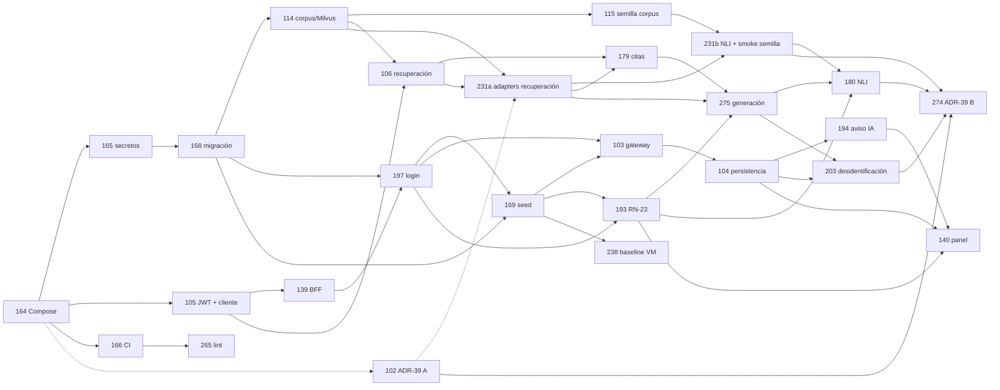

# S1 · Plan del sprint

> `/sprint-start S1` · 2026-10-14 · proyecto Linear **OncoLens-1**, milestone `Sprint 1`. Son **26 historias y 111 pts** (96 más los 2 de la re-estimación de US-054, `[S1 resp. 13]`, los 3 de la ampliación de US-012, `[S1 resp. 38]`, los 2 de la re-estimación de US-224, `[S1 resp. 41]`, y los 8 de US-231a + US-231b, decisión 75); 24 tienen change de OpenSpec y US-231a/US-231b aún no. La capacidad es de 80–90 pts (DEC-03); el exceso está aceptado. Refinamiento previo: [`S1-refinamiento.md`](S1-refinamiento.md). Las decisiones de esta fase continúan la numeración: `[S1 resp. 11–n]`.

## 1. Historias, changes y oleadas

Contextos: **CP** = clinical-platform (incluye los Route Handlers `app/api` y la infra) · **AI** = ai-services · **FE** = frontend.

| L1D | US | Change | Contexto | Oleada | Depende de | Lote | Est. |
|---|---|---|---|---|---|---|---|
| [L1D-164](https://linear.app/l1der-lab-mjbc/issue/L1D-164) | US-034 | `l1d-164-compose-stack` | contratos → CP → AI | 1 | — | R1 | 5 |
| [L1D-102](https://linear.app/l1der-lab-mjbc/issue/L1D-102) | US-012 · ADR-39 A | `l1d-102-adr39-embeddings-reranker-nli` | AI (ADR + mini-dataset + *chunking* e índice) | 1 | 164 (imagen; contenedor provisional si aún no está) | — | **8** (era 5) |
| [L1D-165](https://linear.app/l1der-lab-mjbc/issue/L1D-165) | US-035 | `l1d-165-secrets-setup-scripts` | CP | 2 | 164 | R1 (cierra) | 3 |
| [L1D-105](https://linear.app/l1der-lab-mjbc/issue/L1D-105) | US-054 | `l1d-105-service-jwt-auth` | contratos (cliente generado) → AI → CP | 2 | 164 | — | **5** (era 3) |
| [L1D-166](https://linear.app/l1der-lab-mjbc/issue/L1D-166) | US-036 | `l1d-166-ci-build-contracts-scan` | CP (CI) | 2 | 164 | — | 5 |
| [L1D-168](https://linear.app/l1der-lab-mjbc/issue/L1D-168) | US-038 | `l1d-168-initial-schema-migration` | CP | 3 | 164, 165 | R2 | 5 |
| [L1D-265](https://linear.app/l1der-lab-mjbc/issue/L1D-265) | US-215 | `l1d-265-lint-format-base` | CP → FE → AI | 3 | 164, 166 | — | 2 |
| [L1D-139](https://linear.app/l1der-lab-mjbc/issue/L1D-139) | US-060 | `l1d-139-bff-route-handler-analisis` | contratos (ejemplo) → CP | 3 | 164, 105 | R7 | 3 |
| [L1D-197](https://linear.app/l1der-lab-mjbc/issue/L1D-197) | US-211 | `l1d-197-sesion-login-guard` | CP → FE | 4 | 168, 139, 105, 165 (sin 169: *fixture* local de `doc1`, decisión 56) | R7 | 3 |
| [L1D-114](https://linear.app/l1der-lab-mjbc/issue/L1D-114) | US-058 | `l1d-114-corpus-catalog-milvus` | AI | 4 | 164, 165, 168 (arnés) | R3 | 5 |
| [L1D-169](https://linear.app/l1der-lab-mjbc/issue/L1D-169) | US-039 | `l1d-169-synthetic-demo-seed` | CP | 5 | 168, 197 (hasher y usuario `doc1`, decisión 56), 165 | R2 (cierra) | 3 |
| [L1D-115](https://linear.app/l1der-lab-mjbc/issue/L1D-115) | US-059 | `l1d-115-seed-corpus-licensed` | AI | 5 | 114, 106 (`PassageEmbedder`, decisión 69) · *smoke* 1.13: US-231b (decisión 75; L1D-115 no pasa a Done hasta que corra) | R3 (cierra) | 5 |
| [L1D-106](https://linear.app/l1der-lab-mjbc/issue/L1D-106) | US-055 | `l1d-106-retrieval-threshold-sin-evidencia` | contratos (503) → AI | 6 | 164, 105, 114 · adapters reales: después, en US-231a/US-231b (decisión 75; dependen de 106, no al revés) | R4 | 5 |
| [L1D-103](https://linear.app/l1der-lab-mjbc/issue/L1D-103) | US-052 | `l1d-103-gateway-contexto-clinico` | contratos (422) → CP | 6 | 105, 168, 169, 197 | R6 | 5 |
| [L1D-193](https://linear.app/l1der-lab-mjbc/issue/L1D-193) | US-068 | `l1d-193-terminos-prohibidos-rn23` | contratos → CP → AI | 6 | 164, 166, 169 (catálogo), 197 (`es.json`) | R8 | 3 |
| — (Linear pendiente, límite de issues) | US-231a · ADR-39 | sin change todavía (propuesto: `us-231a-adapters-reales-recuperacion`) | AI | 6b | 106 (puertos y fakes), 114, 102 (ADR-39 A), 164 | — | 5 |
| — (Linear pendiente, límite de issues) | US-231b · ADR-39 | sin change todavía (propuesto: `us-231b-adapter-nli-smoke-semilla`) | AI | 6c | US-231a, 115 (cargador y manifiesto), 102, 164 | — | 3 |
| [L1D-179](https://linear.app/l1der-lab-mjbc/issue/L1D-179) | US-063 | `l1d-179-citas-chunk-recuperado` | AI | 7 | 106, 114, US-231a (decisión 75) | R4 (cierra) | 5 |
| [L1D-104](https://linear.app/l1der-lab-mjbc/issue/L1D-104) | US-053 | `l1d-104-persistencia-analisis-fallos` | contratos (500) → CP | 7 | 103, 105, 168 | R6 | 5 |
| [L1D-238](https://linear.app/l1der-lab-mjbc/issue/L1D-238) | US-075 | `l1d-238-baseline-manual-vm` | AI (cálculo) + humano (sesiones) | 7 | 164, 166, 169; las sesiones, con la demo (140) | — | 3 |
| [L1D-275](https://linear.app/l1der-lab-mjbc/issue/L1D-275) | US-225 | `l1d-275-generacion-opcion-max-options` | AI | 8 | 106, 179, 114, 193, US-231a (decisión 75) | R5 | 3 |
| [L1D-194](https://linear.app/l1der-lab-mjbc/issue/L1D-194) | US-069 | `l1d-194-aviso-ia-etiqueta-academica` | contratos (patch) → CP → FE | 8 | 104, 197 | R8 (cierra) | 2 |
| [L1D-180](https://linear.app/l1der-lab-mjbc/issue/L1D-180) | US-064 | `l1d-180-soporte-nli-descartadas` | contratos (503) → AI | 9 | 275, 179, 193, US-231b (decisión 75: puerto `NliClassifier` y adapter real) | R5 (cierra) | 5 |
| [L1D-203](https://linear.app/l1der-lab-mjbc/issue/L1D-203) | US-049 | `l1d-203-desidentificacion-contexto-ia` | contratos (503) → CP → AI (test) | 9 | 103, 104, 275, 166 | R6 (cierra) | 5 |
| [L1D-140](https://linear.app/l1der-lab-mjbc/issue/L1D-140) | US-061 | `l1d-140-panel-opcion-citas` | contratos (ejemplos) → FE | 9 | 139, 197, 193, 194, 104 | R7 (cierra) | 5 |
| [L1D-274](https://linear.app/l1der-lab-mjbc/issue/L1D-274) | US-224 · ADR-39 B | `l1d-274-adr39-runtime-llm-ocr` | AI (ADR + medición p95) | 10 | 102, 275, 180, 103, 104, US-231a, US-231b (adapters reales para el p95) | — | 5 |

**Reglas del orden:**
- **Nunca dos historias a la vez sobre el mismo módulo.** Por eso 106/179/275/180 (pipeline de evidencia de rag) y 103/104/203 (módulo `evidence-analysis` de clinical-api) van una por oleada, y 139 → 197 → 140 (web) también.
- **Pipeline de rag:** 164 → 105 → 106 → 179 → 275 → 180. Producción falla cerrado (`503`) hasta que se mergea 180.
- **Adapters reales (decisión 75):** 106 → 231a → 231b, antes de 179. 231a y 231b tocan `app/infrastructure/` y el cableado de `app/bootstrap.py`, no el `RAGOrchestratorService`; van en serie porque 231b reutiliza la verificación de modelos y el `PassageEmbedder` real de 231a. 179 y 275 necesitan 231a; 180 necesita 231b (puerto `NliClassifier` y adapter real).
- **Contratos, por el registro de versiones (decisión 58, que actualiza `[S1 resp. 37]`):** clinical-api 164 (1.1.0) → 197 (1.2.0) → 103 (1.3.0) → 104 (1.4.0) → 194 (1.4.1) → 203 (1.5.0); rag 164 → 106 → 180.
- **Archivado:** 103 antes que 203 (delta `REMOVED`).
- **E2E importados:** los de 193 y 194 que necesitan el panel se implementan en la rama de 140, con sus tags `[US-068 AC-n]`/`[US-069 AC-n]`.
- **ADR-39:** las fases A (102) y B (274) bloquean solo los adapters reales; todos los AC se verifican con falsos. Los adapters reales de recuperación y NLI los construyen 231a y 231b.

**Oleadas (3 a la vez como máximo):** O1 164, 102 · O2 165, 105, 166 · O3 168, 265, 139 · O4 197, 114 · O5 169, 115 · O6 106, 103, 193 · O6b 231a · O6c 231b · O7 179, 104, 238 · O8 275, 194 · O9 180, 203, 140 · O10 274. Las sesiones con los oncólogos de 238 se hacen con la demo, después de la O9.

**Lotes de revisión SOLID/CUPID** (los dispara el último change del lote): R1 164+165 · R2 168+169 · R3 114+115 · R4 106+179 · R5 275+180 · R6 103+104+203 · R7 139+197+140 · R8 193+194. Sin lote: 102, 105, 166, 265, 238, 274, 231a y 231b.

## 2. Gate 1 · decisiones del humano (usuario, 2026-10-14)

| # | Decisión | Afecta |
|---|---|---|
| 11 | **El LLM no genera limitaciones en el S1.** Se quita `limitations` de `GenerationOutput`; las limitaciones solo salen de reglas (`estructural`). La regla de US-064 sobre limitaciones del generador se prueba con un fake. Resuelve el Bloqueante RN-01 | L1D-275, L1D-180 |
| 12 | **Familia 503 con códigos propios.** `rag-orchestrator` declara en `/rag/query` un `oneOf` aditivo con `LOCAL_LLM_UNAVAILABLE` (LLM no disponible o salida inválida), `RETRIEVAL_UNAVAILABLE` (Milvus o embeddings caídos; lo crea L1D-106) y `NLI_UNAVAILABLE` (lo añade L1D-180). `clinical-api` tiene una sola tabla de mapeo en L1D-104: `LOCAL_LLM_UNAVAILABLE` → `503`; `RETRIEVAL_UNAVAILABLE`, `NLI_UNAVAILABLE`, `422` de rag y cualquier otro 5xx → `502 ERROR_SERVICIO_IA`, sin persistir y sin eco | L1D-106, L1D-180, L1D-104, L1D-275 |
| 13 | **El cliente HTTP generado se adelanta al S1, en L1D-105 (US-054), que pasa de 3 a 5 pts** (el sprint queda en 98). Hey-api con `fetch` inyectable, para `web → clinical-api` y `clinical-api → rag-orchestrator`, dentro de `contracts:generate:check`. El cliente de rag se construye sobre el transporte JWT. El servicio pasa `X-Request-Deadline` como parámetro tipado de la operación. L1D-103, L1D-104, L1D-139 y L1D-197 usan solo esos clientes | L1D-105, L1D-103, L1D-104, L1D-139, L1D-197 |
| 14 | **Privacidad, se aceptan las cuatro propuestas:** (a) el login verifica `Origin` (`verificarOrigen()` de L1D-139) y exige `Content-Type: application/json`, con escenario `403`. (b) Alembic del corpus corre como **`rag_corpus_migrator`** en un servicio *one-shot*; el runtime `rag_corpus` queda con `USAGE` + DML y desaparece el `GRANT CREATE`; tampoco hay regla de `pg_hba` para el superusuario por red. (c) `/platform/evidence-analyses` exige rol `doctor` en el S1 (`403` para `admin`, PRD E-04) y la sesión caduca por `expires_at`. (d) El desidentificador provisional de L1D-103 falla cerrado si `data_origin ≠ sintetico` o `APP_ENV ∉ {local,test}` | L1D-197, L1D-165, L1D-114, L1D-168, L1D-103 |
| 15 | **RN-23 en dos niveles.** Lista `terminos-prohibidos.json` 1.1.0. Nivel A (salida generada y UI): los 8 actuales más "deben recibir", "debería recibir", "se sugiere iniciar", "tratamiento indicado", "mejor opción", "usted debe", "you should", "the patient should", "indicated for this patient", "probabilidad de éxito" y "chance of success", con casos de plural y género. Nivel B (solo textos propios de la UI y prompts): raíz `recomend*`/`recommend*` | L1D-193, L1D-180, L1D-275 |
| 16 | **Retiro por lenguaje no permitido:** el texto retirado se reemplaza siempre por "[afirmación retirada: formulación no permitida]" (en inglés, "[claim removed: disallowed wording]"), `discardReason = afirmacion_sin_soporte` (sin cambiar el enum) y la UI aclara "o contenía lenguaje no permitido" | L1D-180, L1D-193, L1D-140 |
| 17 | **Registro de versiones y nombres canónicos.** clinical-api: L1D-164 → 1.1.0, L1D-104 → 1.2.0, L1D-194 → 1.2.1 (patch), L1D-203 → 1.3.0. rag-orchestrator: L1D-164 → 1.1.0, L1D-106 → 1.2.0, L1D-180 → 1.3.0. Minor para una operación, respuesta o código nuevo; patch para texto; los changes que solo añaden ejemplos no tocan `info.version`. Quien mergea segundo rebasa. Nombres en rag-orchestrator: `app/api/rag_query.py`, `app/config/settings.py`, `app/bootstrap.py` (raíz de composición) y `EvidenceQueryPort`. L1D-164 aporta el *helper* de validación de respuestas contra el spec (Vitest con Ajv2020 sobre el bundle y su equivalente en Pytest) hasta US-214 | todos los que tocan contrato o rag |
| 18 | **Literales del Markdown y dueños únicos.** Se corrigen sin cambiar IDs: `p-7f3a` → `psd_p7f3a` (FEAT-T4a); `topRelevanceScore` = máximo de los chunks sobre el umbral (US-053, US-225); el E2E de US-061 AC-1 lee `externalId` del ejemplo. Dueños: L1D-194 crea `AiDisclaimer`, `AppHeader` y el layout `(dashboard)`; L1D-197 crea `apps/web/messages/es.json`; L1D-139 crea `contracts/examples/evidence-analysis-request.json`. Las respuestas propias del BFF (`403` por `Origin`, con log `motivo=origen`, y `502`) se declaran en la spec `web-bff` | L1D-194, L1D-140, L1D-197, L1D-139, L1D-203, L1D-104 |

## 3. Gate 1 · reporte consolidado

| Guardián | Vuelta 1 | Vuelta 2 | Cierre |
|---|---|---|---|
| clinical-language-auditor | FAIL (1 Bloqueante, 7 Mayores, 6 Menores) | **PASS** (3 Menores) | Menores aplicados |
| privacy-guardian | FAIL (6 Mayores, 9 Menores) | **PASS** (5 Menores) | Menores aplicados |
| contract-keeper | FAIL (11 Mayores, 4 Menores) | FAIL (1 Mayor nuevo, 9 Menores) | Mayor y Menores corregidos sin tercera vuelta (pendiente de aprobación, paso 6) |

**Cambios de la vuelta 1** (decisiones 11–18 de §2): limitaciones fuera del LLM; familia 503 y tabla única de mapeo en 104; cliente hey-api en 105; Origin y JSON en el login; `rag_corpus_migrator` en un servicio *one-shot*; `403` para `admin`; adaptador provisional que falla cerrado; `traceId` generado en clinical-api; superusuario sin acceso por red; prefijo de las bases de test validado; tmpfs + `read_only` para el OCR; `pii-scan` sobre `git ls-files`; RN-23 en dos niveles con 22 términos; literal de retiro; `assumptions[]` del S1; dueños únicos y ciclo 140↔194 roto; registro de versiones; nombres canónicos de Python; *helper* de validación de respuestas y 422 sin eco en 164.

**Cambios de la vuelta 2:**
- 164 monta `packages/clinical-catalogs` de solo lectura (`CLINICAL_CATALOG_PATH`) y 169 crea `manifest.json`.
- `fake-secrets.sh` genera un par P-256 real.
- `generate` corre antes que `check`.
- Política de versión sin el registro del S1.
- E2E de 193 y 194 en la rama de 140.
- La etiqueta académica del login la crea 197.
- 503 y 504 en el panel.
- `permitirFrases` solo en textos propios.
- Allowlist de `pii-scan` por fixture y valor (sha256) y exclusiones de lista cerrada.
- Prefijo de test distinto de `POSTGRES_DB`.
- `TemporaryDirectory` por request en el OCR.
- `Idempotency-Key` no se reenvía en el S1.
- Fuente única de formatos de PII (`config/pii-formats.json`).
- `exigirEntornoSintetico()` se conserva hasta G-Piloto.
- 409 y 429 de rag → 502.
- Métrica de descartes por lenguaje en `evaluate`.

**Markdown alineado en esta fase:**
- US-054 (AC-6, 3 → 5).
- US-214 (nota de alcance).
- US-053 y readme §2 (`topRelevanceScore`).
- US-049 (`psd_p7f3a`).
- US-061 AC-1 (`externalId` del ejemplo).
- US-058 AC-1 (`rag_corpus_migrator`).
- `backlog/features/README.md` (S1 98, MVP 527, backlog 817).

`openspec validate --changes --strict`: **24/24 en verde**.

## 4. Preguntas abiertas

| # | Pregunta | Dueño | Cuándo |
|---|---|---|---|
| Q1 | ~~¿Publicar en el repo los tiempos seudonimizados de O1/O2 (US-075)?~~ **Sí** `[S1 resp. 23]` | usuario | resuelta |
| Q2 | Checklist (VM-1) y herramientas (VM-2): **aprobados** `[S1 resp. 24]`. Lo que queda (`VM_SESSION_MAX_MINUTES`, casos ficticios, textos de la demo y reglas de lenguaje) va en [`S1-cuestionario-oncologos.md`](S1-cuestionario-oncologos.md) | usuario con los oncólogos | §A antes de las sesiones de 238; §B–C antes de la O9 |
| Q3 | ~~¿Se añaden `npm run lint` y `format:check` al hook?~~ **Sí** `[S1 resp. 25]` en su origen (L1D-265); **enmendada por la decisión 43 y #44**: el hook `pre-commit-gate.sh` ya no ejecuta `lint` ni `format:check`; los cubre el job `quality` de la CI (decisión 67) | usuario | resuelta |
| Q4 | ¿Incluye FEAT-T4d como prerrequisito de G-Piloto la separación `edge-net`/`clinical-net internal` y el cierre de la salida de `ai-net`? | usuario | refinamiento del S5 |
| Q5 | ~~Raya frente a dos puntos del aviso de IA en la prosa~~ **Resuelta:** con el literal nuevo `[S1 resp. 32]`, la prosa de `readme.md`, `CLAUDE.md` y el PRD ya está alineada | sesión principal | resuelta |
| Q6 | `data/eval/` o `data/evaluation/` como raíz única de evaluación | US-072 | S2 |
| Q7 | ¿El login revalida con Zod en el BFF y el análisis no? Asimetría aceptada mientras el login no tenga 422 propio | contract-keeper | Gate 2 de 197 |
| Q8 | **Buckets del corpus en el Compose del S1.** `data-model.md` §4.6 ubica `corpus-raw` y `corpus-normalized` en el MinIO de Milvus (no en `clinical-minio`; Backend 2 no tiene red ni credenciales hacia este último). ¿L1D-164 (US-034) y L1D-165 (US-035) crean ya esos dos buckets y una credencial propia del rol de corpus, aunque el S1 no escriba en ellos, o se difiere a US-117 (S4)? Si se crean, el AC de US-034 lo verifica y el `pii-scan` y la prueba de aislamiento lo cubren | usuario | **Resuelta (usuario, 2026-10-20): se difiere a US-117 (S4)**; L1D-164 y L1D-165 no crean los buckets del corpus ni la credencial del rol de corpus en el S1 |
| Q9 | **Original y copia normalizada de la semilla.** US-059 y el change `l1d-115` dejan fuera persistir originales en `corpus-raw`/`corpus-normalized` (US-117, S4), de modo que en el S1 `object_key_raw`, `object_key_normalized` y `original_format` quedan vacíos y la única copia es `data/raw/seed/` (o la URL del manifiesto si la licencia no permite redistribuir). ¿Se mantiene, o US-059 guarda el original descargado y el texto normalizado desde el S1 (un AC nuevo; sin cambio de contrato; depende de Q8) para no tener documentos de la demo sin copia ni versión de la fuente? Con el original guardado, reindexar por un cambio de ADR-39 no exige volver a descargar | usuario | **Resuelta (usuario, 2026-10-20): se mantiene el diferimiento a US-117 (S4)**; en el S1 la copia es `data/raw/seed/` (o la URL del manifiesto) con checksum, suficiente para reindexar sin descargar de nuevo. L1D-115 mantiene 5 pts. **Lectura revisada por la decisión 68 (2026-10-20)**: `object_key_*` siguen `''` pero `original_format` pasa a ser el real de cada documento |

## 5. Aprobación humana (usuario, 2026-10-14)

| # | Decisión |
|---|---|
| 19 | Se aprueba el orden de **10 oleadas** del §1, con **3 historias a la vez como máximo** y nunca dos sobre el mismo módulo |
| 20 | El Gate 1 se cierra **sin tercera vuelta**: las correcciones de la vuelta 2 se aceptan y las verifica el Gate 2 sobre el código (mismo criterio que `[Pre-S1 resp. 26]`) |
| 21 | Se aceptan las decisiones por defecto de la vuelta 2: (a) L1D-164 monta `packages/clinical-catalogs` de solo lectura (vacío con `.gitkeep` si aún no existe) y L1D-169 es el único que crea `manifest.json`; (b) excepción del Gate 2 para `contract(L1D-105)`: cambia lo generado sin tocar el spec, porque cambia la configuración del generador; (c) `exigirEntornoSintetico()` se conserva hasta G-Piloto (lo retira US-143), `Idempotency-Key` no se reenvía en el S1 y `config/pii-formats.json` es la fuente única de formatos de PII; (d) `/login` muestra "Uso académico/investigación", con la clave creada por L1D-197 |
| 22 | **Merge por oleada:** el orquestador junta los PRs de cada oleada en una sola petición al humano |
| — | No hay historias `si-hay-capacidad` en el S1 |

## 6. Respuestas posteriores (usuario, 2026-10-14)

| # | Decisión |
|---|---|
| 23 | **Consentimiento de O1/O2:** sí. Sus tiempos seudonimizados se versionan en `eval/vm/` (US-075) |
| 24 | **Los oncólogos aprueban** el checklist de "caso reconstruido" (VM-1) y las herramientas de la condición manual (VM-2) de DEC-02. El resto de la validación clínica va en [`S1-cuestionario-oncologos.md`](S1-cuestionario-oncologos.md): el §A antes de las sesiones de US-075 y los §B–C antes de la O9, porque sus respuestas pueden cambiar textos de 104, 106, 140, 180 y 193 |
| 25 | **Lint y formato en el hook previo al commit:** sí. `.claude/hooks/pre-commit-gate.sh` ejecutaba `npm run lint` y `npm run format:check` si había código staged y existían esos scripts (llegan con L1D-265). **Enmendada el 2026-10-20 (decisión 43, #44):** el *hook* ya no corre lint ni formato (ni `format:check`); los cubre el job `quality` de la CI (decisión 67) |

## 7. Validación clínica de los oncólogos asesores (2026-10-14)

Respuestas de los oncólogos asesores A y B al [cuestionario](S1-cuestionario-oncologos.md); el usuario decidió la forma de incorporarlas.

| # | Decisión | Afecta |
|---|---|---|
| 26 | **Protocolo del baseline:** 30 min por tarea, con VM-1 y VM-2 cronometradas por separado (A1). Los casos se validan por **coherencia longitudinal**: diagnóstico, TNM o estadio a la fecha, biomarcadores, intención terapéutica, secuencia previa y línea actual, con una única interpretación razonable (A2). El checklist separa elementos **críticos** y **complementarios**; "reconstruido" exige todos los críticos; cada checklist guarda versión y fecha de validación clínica (A3). La pregunta de referencia de VM-2 incluye **población, contexto clínico, decisión y fecha de corte** de la evidencia (A4); la de la demo (`Q-HER2`) no cambia | L1D-238, DEC-02 |
| 27 | **VM-2 con dos desenlaces** (A5): *autoidentificada* (≥ 1 fuente + justificación breve) y *validada* (un evaluador confirma, después y ciego al tiempo y al participante, que la fuente corresponde al caso y a la pregunta). **La meta de DEC-02 (−50 % de la mediana) se calcula sobre la *validada***: un intento solo cuenta como completado si se valida. El valor de la meta no cambia; DEC-02 se enmienda en el criterio | L1D-238, DEC-02 |
| 28 | **Rótulos de la relevancia** (B1–B3): el rótulo pasa a **"Relevancia de recuperación de evidencia"**, con la nota "no mide eficacia ni solidez clínica". El criterio visible pasa a **"Ordenado por relevancia de recuperación de la búsqueda; no representa prioridad ni aplicabilidad clínica."** El valor por opción se presenta como **"Orden basado en la cita recuperada más relevante asociada a cada opción"**, y la ayuda aclara que no resume la aplicabilidad, la eficacia ni la calidad global de la opción. Supersede el literal de US-061 AC-2 | L1D-140, L1D-275, `docs/ux/S1/` |
| 29 | **Auditoría de descartes** (B4, B5): en el S1, cada descartada muestra su número de orden, el id del análisis y `createdAt` (sin cambio de contrato), y nunca se presenta como contenido clínico utilizable. `rag-orchestrator` registra en el log el `ruleId` y la versión de la política de lenguaje, nunca el texto. La **traza completa** (frase original retirada, regla, versión de la política y `chunkIds` de cada descartada, sin exponerla en la UI) pasa a un **AC nuevo de US-150 (FEAT-T1b, S6)**, con su cambio de contrato y de esquema | L1D-140, L1D-180, US-150 |
| 30 | **Supuesto fijo de la Base del análisis** (B6): "Datos del paciente recibidos como contexto. Esta versión no verifica su completitud ni la ausencia de datos clínicamente relevantes." | L1D-104 |
| 31 | **Errores** (B7): sin resultado parcial; el error técnico queda registrado (log con `traceId`) y el panel permite **reintentar** con la misma pregunta, como una petición nueva que no altera la sesión | L1D-140 |
| 32 | **Aviso de IA** (B8): el literal pasa a **"Generado por IA; requiere validación clínica independiente por el oncólogo tratante."**, con "Uso académico/investigación" visible y permanente. Supersede PRD B-06 y `[S1 resp. 9]`; nueva fila E-11 en el registro de cambios del PRD, RN-19 y US-069 corregidas | L1D-194, PRD, `CLAUDE.md`, `openspec/config.yaml` |
| 33 | **RN-23 ampliada por forma** (C1). **Nivel A** (salida generada, UI, prompts y contratos), con variantes de género, número, conjugación y negación: inicie, administre, prescriba, suspenda, cambie a, elija, escoja, ofrezca, se debe, debe iniciar(se), debe suspender, se debe administrar, no debe recibir, no se debe administrar, es necesario, es imprescindible, se recomienda, se recomienda iniciar, se indica, está indicado, está contraindicado, la mejor opción es, manejo de elección; en inglés, we recommend, is recommended, should be started, must receive, should not receive, is indicated, is contraindicated, preferred treatment, treatment of choice. **Nivel B** (solo textos propios de la UI y prompts): iniciar, administrar, prescribir, suspender, ofrecer, elegir, start, initiate, administer, prescribe, discontinue, offer, choose, switch to, standard of care | L1D-193 |
| 34 | **Falsos positivos y atribución** (C2, C3): la suite `evaluate` mide `false_positive_language_filter_rate`, que se revisa periódicamente. "La guía recomienda X" solo se admite con la población y el escenario explícitos ("…para pacientes con [condición] en [escenario]"), con la cita que abre el fragmento exacto y nunca dirigida al paciente. El prompt lo exige y `evaluate` lo mide (no hay regla determinista) | L1D-180, L1D-275 |
| 35 | **Caso sin diagnóstico** (C4): no es "sin evidencia". `clinical-api` responde **`422 TIPO_CANCER_NO_REGISTRADO`** antes de llamar a la IA, sin generar ni persistir análisis, y el panel muestra **"Análisis no realizado: falta el tipo de cáncer; no fue posible filtrar la evidencia."**. `rag-orchestrator` mantiene la misma defensa (`422` con el mismo código). Es un cambio aditivo del contrato | L1D-103, L1D-106, L1D-140 |
| 36 | **Pregunta de prueba de la UI** (C5): "En pacientes con cáncer de mama HER2 positivo temprano, ¿qué describe la evidencia sobre mortalidad con terapia anti-HER2 adyuvante?" | L1D-140 |
| 37 | **Registro de versiones actualizado por resp. 35** (sustituye al de `[S1 resp. 17]`): clinical-api: L1D-164 → 1.1.0, **L1D-103 → 1.2.0** (422 nuevo), L1D-104 → 1.3.0, L1D-194 → 1.3.1, L1D-203 → 1.4.0 (**actualizado por la decisión 58, 2026-10-20**: 164 → 1.1.0, 197 → 1.2.0, 103 → 1.3.0, 104 → 1.4.0, 194 → 1.4.1, 203 → 1.5.0). rag-orchestrator: L1D-164 → 1.1.0, L1D-106 → 1.2.0 (`RETRIEVAL_UNAVAILABLE` y el 422 `TIPO_CANCER_NO_REGISTRADO` en la misma subida), L1D-180 → 1.3.0 | 103, 104, 106, 194, 203 |

## 8. Ampliación de US-012 y ClinicalTrials.gov (usuario, 2026-10-15)

| # | Decisión | Afecta |
|---|---|---|
| 38 | **Las pruebas de *chunking*, solapamiento, estrategia de *chunking* e índice (T2–T5) amplían US-012** (AC-10 a AC-13 nuevos). 5 → **8 pts, con excepción de tamaño**: la DoR fija ≤ 5 y la historia ya se había partido por eso (`[S1 resp. 6]`). El S1 pasa de 98 a **101** (capacidad 80–90, DEC-03; exceso aceptado). Si la velocidad real lo exige, T5 (HNSW frente a FLAT) es la primera candidata a salir. Un valor por factor, el resto fijo, en secuencia; la etiqueta del golden es por pasaje y no por chunk | L1D-102, L1D-114 (tipo de índice), L1D-115 (tamaño y solapamiento de chunk) |
| 39 | **Los registros de ClinicalTrials.gov se pueden usar**, con fuente `ClinicalTrials.gov / NCTxxxxxxxx`, URL y fecha de consulta; atribución visible a NLM ("Source: ClinicalTrials.gov, National Library of Medicine"); sin sugerir aval de NLM, NIH ni ClinicalTrials.gov; aviso de que el registro puede no reflejar la versión más reciente; uso limitado a metadatos del registro y citas breves. La verificación de los términos la confirma el usuario (la página no pudo leerse con las herramientas de la sesión) | L1D-102, L1D-115 |

**Dataset del ADR-39.** `data/eval/adr39-mini/` (en `main`, PR #21): 75 preguntas (59 con respuesta, 6 sin respuesta, 10 controles en inglés), 39 pares NLI y 27 fuentes con licencia por documento (NCI, PMC CC BY, ClinicalTrials.gov); NCCN y ESMO excluidas (RN-21). Revisado y aprobado por el oncólogo asesor. Los textos completos no se versionan: el script de la ampliación los descarga con checksum.

## 9. Tope de memoria del LLM local y candidatos de ADR-39 fase B (usuario, 2026-10-20)

| # | Decisión | Afecta |
|---|---|---|
| 40 | **Decidido (usuario, 2026-10-20):** el tope máximo del LLM local es **21 GB** y el del stack total sube de 24 a **~30 GB** (equipo de referencia: MacBook Pro M5 de 32 GB). Sustituye el presupuesto de ~16 GB de `[S1 resp. 10]` y el límite de 24 GB de `[S1 resp. 5]`. **Candidatos de US-224 (L1D-274)** ampliados: A `gemma4:26b-a4b-it-qat`, B `gemma4:12b-mlx`, C `qwen3.5:9b-mlx` **más** D `qwen3.6:35b-a3b-q4_K_M` (24 GB publicados), E/F `medgemma1.5:4b-it-q8_0`/`-bf16` (5,0/8,6 GB; licencia HAI-DEF, elección sujeta a aceptación) y G `gemma4:26b-a4b-it-q4_K_M` (18 GB). Reglas de decisión fijadas antes de medir; quien no quepa en 21 GB medidos se descarta con su cifra. La estimación de L1D-274 se re-estima en **5** (ver decisión 41); sin cambios en oleadas, dependencias ni IDs. Afecta también las menciones de 24 GB en L1D-102 (US-012 AC-2), L1D-164 y las Features que citan el tope. **Linear: pendiente de sincronizar** (el Markdown es la fuente) | L1D-274, L1D-102, L1D-164, `backlog/features/FEAT-06a-*.md`, `02-adrs.md`, `01-requisitos.md`, PRD E-12, readme §1.4 |
| 41 | **Decidido (usuario, 2026-10-20), segunda tanda sobre el tope de memoria y US-224 (L1D-274):** (1) el tope se expresa como **stack ≤ ~30 GB sin swap** (confirmado). (2) La máquina de medición actual (48 GB) es también la de la demo; **se mantiene la meta de ~30 GB** del stack y la corrida final en una máquina de 32 GB **no se exige** como condición de G-Piloto (queda como verificación recomendada, no bloqueante). (3) **MedGemma (E, F):** se miden de todos modos; su **elección** sigue condicionada a la aceptación escrita de los términos HAI-DEF (pendiente, ver el change). (4) **Se descarta D** `qwen3.6:35b-a3b-q4_K_M` (24 GB > 21 GB) sin medir y **se añaden H** `qwen3.6:27b-q4_K_M`, **I** `qwen3.5:27b-q4_K_M` y **J** `qwen3.5:27b-int4` (16–17 GB). (5) **US-224 se re-estima de 3 a 5 puntos** (9 candidatos: A, B, C, E, F, G, H, I, J; el total del S1 pasa de 101 a 103; sigue dentro de la DoR de ≤ 5). **Linear: pendiente de sincronizar** (estimación de L1D-274) | L1D-274, `FEAT-06a`, `S1-plan.md` |
| 42 | **Decidido (usuario, 2026-10-20), cierre de pendientes:** Q8 y Q9 se difieren a US-117 (ver Q8/Q9). **MedGemma (E, F):** se miden sin aceptar aún los términos HAI-DEF; su elección queda pendiente de aceptación escrita y de que superen con margen al mejor candidato Apache 2.0. **OL-06:** protocolo P1–P12 aceptado, RN-02 se mantiene (US-113 se enmienda: sin LLM para traducir), oncólogo escalonado (lote A reducido primero) y metas de US-017 provisionales; detalle en ADR-45 (rama `docs/ol06-mejoras-recuperacion`). **Linear: pendiente de sincronizar** | L1D-164, L1D-165, L1D-115, L1D-274, ADR-45 |

## 10. Decisiones del usuario sobre la Oleada 4 (usuario, 2026-10-20)

Registro de las decisiones tomadas al revisar los PR de la Oleada 4. Solo documentación: no reordena oleadas ni añade historias al S1. Las historias de deuda llevan ID **por asignar** (`backlog/features/README.md`, "Deuda registrada, ID por asignar"). **Linear: pendiente de sincronizar** (el Markdown es la fuente).

| # | Decisión | Afecta |
|---|---|---|
| 43 | **Decidido (usuario, 2026-10-20): hook `pre-commit-gate`.** Se quita `format:check` completo del *hook*; lint y formato los cubre la CI (job `quality`). Enmienda `[S1 resp. 25]` solo en lo de `format:check`. La edición de `.claude/hooks/pre-commit-gate.sh` es un chore aparte | L1D-265 (US-215) |
| 44 | **Decidido (usuario, 2026-10-20): AC-5 de US-211 pasa a L1D-103, opción (b).** El test de integración "la sesión no llega a rag-orchestrator" `[US-211 AC-5]` (y su par E2E de logs) deja de ser tarea de L1D-197 (se quitan 2.8 y 2.12 y el escenario de su delta de spec) y se escribe en L1D-103 (US-052), con cambio de spec de ambos changes y `Test-Removal:` en el commit del código de L1D-197. No se mergea con test rojo. **Efecto de orden (sin reordenar oleadas):** L1D-197 (oleada 4) ya no espera a L1D-103 ni a L1D-139 para cerrar su AC-5; L1D-103 (oleada 6, depende de 105, 168, 169 y 197) hereda el test y lo cierra con el guard de 197 y el seed de 169 (L1D-169, oleada 5, sigue dependiendo de 197 solo por el *hasher*); el AC-5 de US-211 queda verificado en integración cuando L1D-103 esté en `main`; el E2E de logs queda en D-3 (AC-5 verificado en integración; E2E en D-3, decisión 60; la mitad de logs de `rag-orchestrator` es un test de integración en el change de L1D-103, decisión 61) | L1D-197, L1D-103, L1D-169 |
| 45 | **Decidido (usuario, 2026-10-20): el login se monta en `server.ts` de `clinical-api` dentro de L1D-197** (pool PostgreSQL y variables en Compose) | L1D-197 |
| 46 | **Decidido (usuario, 2026-10-20): repository con `pg` (a).** L1D-197 implementa `auth.repository.ts` sobre `pg`; Prisma 7 exige `@prisma/adapter-pg` y un cliente generado que no están en el repo. Deuda D-1: "`clinical-api`: repositories sobre Prisma Client (auth)", ID por asignar | L1D-197 (D11) |
| 47 | **Decidido (usuario, 2026-10-20): Tailwind v4 + shadcn/ui** como chore pequeño nuevo (deuda D-2, ID por asignar) **antes de L1D-140**. L1D-197 mergea con CSS Modules, provisional | L1D-197, L1D-140 |
| 48 | **Decidido (usuario, 2026-10-20): contrato.** Se añaden un `500` genérico y un código propio de login para el `502` en `apps/clinical-api/openapi.yaml` / spec `web-bff`, contract-first (`sync-contracts`), como tarea de contratos de L1D-197. `info.version` 1.2.0 según el registro de la decisión 58 (quien mergea segundo rebasa); `ErrorInterno` lo posee L1D-197 (decisión 59) | L1D-197 |
| 49 | **Decidido (usuario, 2026-10-20): Playwright y perfil de test en Compose** como historia de deuda (D-3, ID por asignar). El `visual-check` de L1D-197 y sus tareas E2E quedan **pendientes** hasta entonces | L1D-197 |
| 50 | **Decidido (usuario, 2026-10-20): `auth.session.ip_address` y `user_agent` son `nullable`.** Se corrige `docs/architecture/data-model.md`; la migración va en el mismo PR de L1D-197 como tarea 2.0 (decisión 63, que sustituye a «otro agente»); D4 de L1D-197 queda en `null` (revierte la nota de cadena vacía) | L1D-197, L1D-168, data-model |
| 51 | **Decidido (usuario, 2026-10-20): `WEB_HOME_PATH`** con el UUID del paciente semilla en `/login`, aceptado como deuda hasta US-048 | L1D-197 |
| 52 | **Decidido (usuario, 2026-10-20): CSP y cabeceras de seguridad (clickjacking) en `/login`:** excepción nombrada hasta US-216 (S6) | L1D-197, L1D-266 (US-216) |
| 53 | **Decidido (usuario, 2026-10-20): PR de L1D-114.** Validar `MILVUS_DENSE_METRIC_TYPE ∈ {COSINE, IP}` y, si es barato, que `assert_schema_matches` compare métrica y tipo de índice: tarea nueva en el change; la tarea del job de CI sigue | L1D-114 |
| 54 | **Decidido (usuario, 2026-10-20): PR #41.** Medir la duración de `build-test` tras el merge (torch CPU solo con `--index-url` si hace falta); nota en `docs/process/ci.md` | L1D-166 |
| 55 | **Decidido (usuario, 2026-10-20): PR #39.** El booleano propio `ALLOW_CC_BY_NC` se acepta por ahora | L1D-102 (US-012) |
| 56 | **Decidido (usuario, 2026-10-20): L1D-197 crea su usuario `doc1@test.local` con un *fixture* local de tests (`tests/support/usuarios.ts`) usando el *hasher* de 197 (`createPasswordHasher()`), **sin depender del seed de L1D-169**; L1D-169 adopta después el seed usando ese mismo *hasher* y el mismo usuario `doc1`. Rompe la circularidad 197 ↔ 169 sin reordenar oleadas: 197 (oleada 4) ya no usa el seed y 169 (oleada 5) sigue dependiendo de 197 solo por el *hasher* y el usuario. Ya se puede despachar L1D-169 cuando le toque. Linear: pendiente de sincronizar | L1D-197, L1D-169 |
| 57 | **Decidido (usuario, 2026-10-20): cierre de los Mayores del Gate 1 de `clinical-language-auditor`** sobre 197, 103 y 114: clave `login.errorServicio` y código propio `ERROR_SERVICIO_AUTENTICACION` para el `502` del login (197); "Correo o contraseña incorrectos." en `docs/ux/` (3 archivos); test de `proxy.ts` y 4.2 sin declarar cubiertos AC-1 (navegador) ni AC-4 por 3.1, diferidos a D-3 (197); el chequeo del literal "Uso académico/investigación" excluye los archivos de test (197); aviso neutro del panel también para el fallo cerrado del desidentificador, y `TIPO_CANCER_NO_REGISTRADO` como imposibilidad técnica con cómo continuar (103). Los Mayores de privacy y contract llegan aparte | L1D-197, L1D-103 |
| 58 | **Decidido (usuario, 2026-10-20): registro de versiones de `clinical-api`** tras el Gate 1 de 197/103/114 (sustituye al de `[S1 resp. 37]`, que añadió 103 sin contar el contrato de 197): L1D-164 → 1.1.0, **L1D-197 → 1.2.0**, L1D-103 → 1.3.0, L1D-104 → 1.4.0, L1D-194 → 1.4.1, L1D-203 → 1.5.0; `rag-orchestrator` sin cambio. L1D-197 sube a 1.2.0 en su tarea de contrato 1.2 (se elimina «`info.version` no se toca»). Se editan los literales de los changes 103, 104, 194, 203 y 197 | L1D-197, L1D-103, L1D-104, L1D-194, L1D-203 |
| 59 | **Decidido (usuario, 2026-10-20): `ErrorInterno` lo posee L1D-197** (mismo `ERROR_INTERNO` y mensaje fijo que usaba 104). L1D-104 (tarea 1.1) pasa a referenciar el `ErrorInterno` existente y solo añade el `500` a `POST /platform/evidence-analyses`. Ejemplos: `error-interno.json` (target `#/paths/~1platform~1auth~1login/post/responses/500`, de 197) y `error-interno-analisis.json` (target `#/paths/~1platform~1evidence-analyses/post/responses/500`, de 104). L1D-104 pasa a depender de L1D-197 por el contrato | L1D-197, L1D-104 |
| 60 | **Decidido (usuario, 2026-10-20): la tarea 2.8g de L1D-103 y su escenario E2E pasan a la deuda D-3** (no se archiva un change con una tarea pendiente). Corrige la frase de la decisión 44: **AC-5 verificado en integración; E2E en D-3** | L1D-103, D-3 |
| 61 | **Decidido (usuario, 2026-10-20): la mitad de logs del AC-5 de US-211 se prueba en `rag-orchestrator`** con un test de integración (`TestClient` + `caplog`: ningún registro contiene el valor de la cookie `oncolens_session` ni el nombre de la cookie, con `Authorization` válido). Va como tarea 3.1 de una **sección nueva `## ai-services` del change de L1D-103**: es el change que hereda el AC-5 y ningún otro cubre esa mitad (L1D-105 ya está mergeado y L1D-106 es el pipeline de evidencia). **Regla:** US-211 (L1D-197) **no pasa a Done hasta que la tarea 2.8f de L1D-103 esté en `main`** (FEAT-T4a y este plan) | L1D-103, L1D-197 (US-211) |
| 62 | **Decidido (usuario, 2026-10-20): conexión de `clinical-api` a PostgreSQL.** `CLINICAL_DATABASE_URL` **sin credenciales** + `PG_CLINICAL_API_PASSWORD_FILE`; TLS con `rejectUnauthorized: true` y la CA del servidor; **un pool inyectado en `server.ts`** (197, 2.6b y D11b) que reutiliza L1D-103 (tarea 2.10: repository sobre el pool `pg`, deuda D-1); sin `DATABASE_URL` con contraseña en el servicio `clinical-api` de Compose (`prisma migrate` solo en un *one-shot*). Aplica a L1D-197, L1D-103 y a L1D-169 (`clinical-seed`, tarea 3.9c) | L1D-197, L1D-103, L1D-169 |
| 63 | **Decidido (usuario, 2026-10-20): la migración `nullable` de `auth.session` (`ip_address`, `user_agent`) va en el MISMO PR de L1D-197**, como tarea 2.0 antes del código de login; nunca se guarda la IP ni el user agent reales en el S1. Sustituye a «la hará otro agente» de la decisión 50 | L1D-197, L1D-168 |
| 64 | **Decidido (usuario, 2026-10-20): `APP_ENV` obligatorio en Compose** (`${APP_ENV:?APP_ENV obligatorio}`) en `clinical-api` y `clinical-seed`. Tareas: 197 (2.6b, montaje de `server.ts` y Compose), 169 (3.9d, `clinical-seed`) y escenario «Compose no levanta el servicio sin APP_ENV» en 103 (spec y tarea 2.1) | L1D-197, L1D-169, L1D-103 |
| 65 | **Decidido (usuario, 2026-10-20): `sslmode=verify-full` con la CA del servidor para `rag_corpus`** (L1D-114 ya está en `main` con `sslmode=require`): se registra como deuda **D-4** (ID por asignar) en `backlog/features/README.md`. No se edita `l1d-115/tasks.md` (lo toca su implementador) | L1D-114, D-4 |
| 66 | **Decidido (usuario, 2026-10-20): contraseñas `SINT-*` de respaldo solo bajo `tests/`**; fuera de `tests/` no hay valores por defecto y, si faltan, el proceso falla nombrando la variable (nunca su valor). Aplica al design de 197 (datos de prueba) y a 169 | L1D-197, L1D-169 |
| 67 | **Decidido (usuario, 2026-10-20): menores.** (a) Este plan (Q3, `[S1 resp. 25]`) ya no dice que el hook corre `lint` y `format:check`: desde #44 lo cubre el job `quality` de la CI. (b) La fecha «2026-10-20» del comentario de `.claude/hooks/pre-commit-gate.sh` **no es una errata**: es la fecha de la decisión 43 del usuario (los commits del hook llevan la fecha del reloj del repositorio, 2026-10-16); no se cambia | `S1-plan.md`, hook |
| 68 | **Decidido (usuario, 2026-10-20): L1D-115, esquema (opción A).** `object_key_raw` y `object_key_normalized` = `''`, **`original_format` real por documento** y `metadata_source = 'fuente_estructurada'`. Lectura revisada de Q9 (el diferimiento a US-117 se mantiene) y de D4 del change | L1D-115 (US-059) |
| 69 | **Decidido (usuario, 2026-10-20): L1D-115 depende de L1D-106** (`PassageEmbedder` + *fake*). El *smoke* 1.13 de L1D-115 pasa a ser tarea del change de **L1D-106**; **L1D-115 no pasa a Done hasta que ese *smoke* corra**. La edición de `l1d-115/tasks.md` y de `l1d-106/tasks.md` la hace su implementador, no este chore. Efecto de orden (oleada 5 → espera a la 6) por resolver en el planning/orquestador | L1D-115, L1D-106 |
| 70 | **Decidido (usuario, 2026-10-20): `CORPUS_CUTOFF_DATE = 2026-10-15`** (fecha de corte de la semilla de L1D-115, configuración RN-22) | L1D-115 |
| 71 | **Decidido (usuario, 2026-10-20): la regla de licencias de L1D-115 se duplica por ahora** (`evaluar_admisibilidad()` / `clase_de_licencia()`) con **deuda D-5** para unificarla con el `dataset_loader` (ID por asignar, `backlog/features/README.md`) | L1D-115, L1D-102, D-5 |
| 73 | **Decidido (usuario, 2026-10-20): ADR-39 fase A aceptado** (`docs/architecture/adr/ADR-39-modelos-locales.md`, estado «aceptado»; L1D-102 / US-012). Puntos del ADR: **2** aceptado tal como se midió (chunk de 1024, `RERANKER_MAX_LENGTH` = 512; 768 y 1280 sin medir en la VM de 7,75 GB; repetir con una VM mayor es una medición nueva que no bloquea); **3** resuelto por referencia a ADR-45 y US-226…US-230, con las metas de OL-06 provisionales en US-017 y sin cambiar metas hoy; **4** aceptado (HNSW por la regla; equivalente a FLAT con 522 vectores). Se mantienen las salvedades y el riesgo de latencia alto (se cierra en L1D-274; VM de Docker ≥ 10 GB, requisito de la fase B). La tarea 2.1 del change de L1D-102 queda marcada. Mediciones y reportes congelados. (Numerada 73 porque el PR #50 toma la 72) | L1D-102, L1D-274, ADR-39 |
| 72 | **Decidido (usuario, 2026-10-20): mejora del hook `pre-commit-gate` para commits de merge y robustez** (deuda **D-6**, ID por asignar, `backlog/features/README.md`). **M1:** comparación a 3 vías con `merge-base`: esperado = max(0, cHEAD + cOTRA − cBASE) apariciones de cada nombre de test en todos los archivos de test; se considera eliminado si cÍNDICE < esperado. Cubre H1/H1b/H1c (tests añadidos en una sola rama que la resolución descarta; `MERGE_HEAD` forjado = punta de `main`), H2 (duplicados de nombre entre archivos) y H5 (pérdida de la detección por archivo en merges: `it.concurrent`, `test.for`, `it.each(f(1))`). **Rendimiento:** un `git grep -z -I -E` por árbol o `git cat-file --batch` en lugar de 3N `git show` (21 s con 1500 archivos; riesgo de morir por el *timeout* de 120 s de `.claude/settings.json`). **Rutas no ASCII:** `-c core.quotePath=false` o `-z`. **Modelo de amenaza:** `git commit-tree`, `update-ref` y la escritura en `.git/MERGE_HEAD` no pasan por el hook; **Decidido: la barrera real es la CI y el Gate 2; el hook es una ayuda local.** **M2** (fallo cerrado + bytes) se corrige aparte en el PR `chore/hook-falla-cerrado`; el #46, ya mergeado, tiene esa deuda conocida (Gate 2 de `privacy-guardian` en FAIL en la vuelta 2, mergeado por decisión del usuario) | `.claude/hooks/pre-commit-gate.sh`, D-6 |
| 74 | **Decidido (usuario, 2026-10-17): historia nueva US-231, adapters reales de recuperación (ADR-39 fase A aceptado).** Redactada en `FEAT-06a` (Linear: pendiente (límite de issues del workspace); sin `L1D-nn`): *embeddings* BGE-M3 int8, *reranker* bge-reranker-v2-m3 int8 (`RERANKER_MAX_LENGTH` = 512), detector de idioma y NLI mDeBERTa, detrás de los puertos de `app/application/ports.py`, locales y sin red (RN-12). **Dependencia:** va **antes** de L1D-179, L1D-275 y L1D-180, que los necesitan, y absorbe el *smoke* 1.13 de L1D-115 y la tarea 2.13b trasladada; los AC de L1D-106 siguen verificándose con adapters falsos. **No cambia todavía el alcance ni los puntos del S1** (101 + exceso aceptado): estimación propuesta 8 y slicing (S1 o S2) por decidir en el refinamiento. Se anota la dependencia en las filas de L1D-106, L1D-115, L1D-179, L1D-275 y L1D-180 de este plan y en los changes de 179, 275 y 180; los implementadores de 106 y 115 la anotan en su rama. No hay change de OpenSpec para US-231 | US-231, L1D-106, L1D-115, L1D-179, L1D-275, L1D-180, L1D-274 |
| 75 | **Decidido (usuario, 2026-10-17): US-231 se divide en US-231a (5) y US-231b (3), ambas en el S1, entre las oleadas 6 y 7** (actualiza la decisión 74, que la dejaba fuera del recuento y con el sprint por decidir). Corte por adapter y consumidor: **US-231a** = *embeddings* BGE-M3 (`QueryEmbedder` y `PassageEmbedder`), *reranker* bge-reranker-v2-m3 y detector de idioma reales detrás de los puertos de recuperación, más el mecanismo común de verificación de modelos (ruta + SHA-256, RN-22) y la batería de contrato real/fake; **US-231b** = puerto `NliClassifier` (firma de la D7 del design de L1D-180) y adapter real mDeBERTa, memoria conjunta de los tres modelos, sustitución de `fabricar_embedder_real` y del tokenizer de la semilla y *smoke* 1.13 / 2.13b de US-059 AC-1. IDs **US-231a/US-231b** mientras no existan issues (Linear bloqueado por el límite de issues del plan gratuito); US-231 queda como lápida y no suma. **Oleadas:** O6b 231a · O6c 231b (en serie: 231b reutiliza la verificación y el `PassageEmbedder` real de 231a). **Dependencias:** 179 y 275 → 231a; 180 → 231b; 115 no pasa a Done hasta el *smoke* de 231b; 274 → ambas. **Puntos:** +0 frente a la propuesta de 8 (5 + 3); como US-231 estaba fuera del recuento, el S1 pasa de 103 a **111** (exceso sobre DEC-03 aceptado). Sin lote SOLID/CUPID. **Pendiente:** crear los changes de OpenSpec de 231a y 231b y los issues de Linear cuando haya cupo; las tareas 2.11 (parte `NliClassifier`) y 2.14 del change de L1D-180 pasan a consumir lo que entrega 231b | US-231, US-231a, US-231b, L1D-106, L1D-115, L1D-179, L1D-275, L1D-180, L1D-274, `FEAT-06a`, `backlog/features/README.md` |
| 76 | **Decidido (usuario, 2026-10-17): cierre de tareas menores en un solo chore** (`chore/cierre-tareas-s1`, solo `tasks.md` y documentación, sin gates). Cierra 105 (3.6, 4.2), 165 (4.3), 169 (4.1), 114 (2.3) y 197 (4.1); difiere 114/2.4 a L1D-103/106 y 265/4.2 a la deuda **D-7** (`ruff format` y dependencias de `tests/evaluation`, después de la oleada). L1D-139, 166 y 115 siguen en In Review por dependencias reales (140/103/104, administrador, adapter de 106). L1D-164 y 168 no tienen tareas abiertas: el orquestador las mueve a Done tras revisar los criterios | L1D-105, 165, 169, 114, 197, 265, 164, 168 |
| 77 | **Decidido (usuario, 2026-10-17): el `422` `TIPO_CANCER_NO_REGISTRADO` de `POST /platform/evidence-analyses` (L1D-103) se declara como excepción E-2** del detector de cambios incompatibles (`response-property-enum-value-added`), en `scripts/ci/contracts-breaking-excepciones.json` y en el ADR-26, igual que la E-1 de `rag-orchestrator` | L1D-103, L1D-106 |
| 78 | **Decidido (usuario, 2026-10-17): L1D-193, Nivel A en inglés ya; en español, deuda.** Entran ya *best option*, *preferred option* y *success rate* (lista `terminos-prohibidos.json` 1.4.0, rama `feat/l1d-193-nivel-a-ingles`). La ampliación del Nivel A en español (Recomendamos, Se recomendaría, Opción recomendada, Se aconseja, Se debería, Considere iniciar) queda como deuda del MVP **D-8** (`backlog/features/README.md`) | L1D-193, L1D-180, L1D-275, D-8 |
| 79 | **Decidido (usuario, 2026-10-17): L1D-180 aplica el Nivel A de RN-23 solo a campos generados**, no a los copiados del corpus (`chunkTextSnapshot` y `citedSources` copiados; RN-04, RN-25) | L1D-180, L1D-193 |
| 80 | **Decidido (usuario, 2026-10-17): el S1 queda en 111 puntos** con US-231a (5) y US-231b (3) (decisión 75); la cabecera de este plan ya lo recoge | `S1-plan.md`, US-231a, US-231b |
| 81 | **Decidido (usuario, 2026-10-17): calendario de L1D-238.** Se acepta el orden 3.1 (sesión conjunta de validación clínica) → 3.2 y 3.3 (sesiones y registro del CSV) → 3.3b (validación ciega de VM-2) justo después → 3.4 y 3.5 antes de `/sprint-close`. El calendario puede tardar más de una semana y no tiene plazo fijo. L1D-238 queda en In Review con las tareas humanas 3.1 a 3.5 abiertas y **no bloquea** ninguna otra historia ni el avance del sprint; si al llegar `/sprint-close` siguen abiertas, se propondrá diferirlas por escrito con ID | L1D-238 |
| 82 | **Decidido (usuario, 2026-10-17): `RETRIEVAL_TOP_K=30` y corte previo a `RERANKER_MAX_PAIRS=12` según el puntaje de recuperación**, ambos en configuración (RN-22); el código va en el PR #70 | L1D-106, US-231a, L1D-179, L1D-275 |
| 83 | **Decidido (usuario, 2026-10-17): defaults de US-231a confirmados:** `MODEL_PROVIDER` `fake`\|`local` (Compose=`local`, CI=`fake`), SHA-256 por archivo en entorno, idioma indeterminado a `es` vía `DEFAULT_QUERY_LANGUAGE` | US-231a, US-231b |
| 84 | **Decidido (usuario, 2026-10-17): la seguridad web de `apps/web` no entra en el S1.** CSP, `frame-ancestors`, `nosniff`, `Referrer-Policy` y `Permissions-Policy` quedan como deuda **D-9** (`backlog/features/README.md`) para el S2, condición previa a G-Piloto. Origen: pregunta de `privacy-guardian` en el Gate 2 de L1D-140. Dueña: US-216 (L1D-266, FEAT-PL1; hoy en el S6, la historia de cabeceras de seguridad y anti-clickjacking, sin equivalente en FEAT-T4); adelantarla o partirla para el S2 lo decide el planning del S2 | L1D-140, L1D-266 (US-216), D-9 |
| 85 | **Decidido (usuario, 2026-10-18), cierre de ejecución: RN-23 y «La guía recomienda X» / «The guideline recommends X».** Se mantiene el hueco en el Nivel A de la salida generada: dos tests de US-068 (AC-2 y AC-5) declaran esa forma como no-Nivel A. **Mitigación:** (a) un caso nuevo en la suite `evaluate` (US-072, L1D-235) con guías que recomiendan; (b) un seguimiento para forzar en el prompt la forma «La fuente [cita] describe que…», con test del prompt. Los términos concretos de «recomendado» ya están en el Nivel A de la lista `terminos-prohibidos.json` 1.5.0 (PR #87) | L1D-180, L1D-193, US-072 (L1D-235) |
| 86 | **Decidido (usuario, 2026-10-18), cierre de ejecución: D-8, términos pendientes del Nivel A.** «Se recomendaría», «Se aconseja», «Se debería», «Considere iniciar», «We suggest», «Trastuzumab should be considered» y «Consider X» quedan como seguimiento del Nivel A, registrado como **deuda** (no se hace ahora; sin issue en Linear) | L1D-193, L1D-180, D-8 |
| 87 | **Decidido (usuario, 2026-10-18), cierre de ejecución: «standard of care» y «recommended treatment» en el corpus citado** (`data/raw/seed/docs/nci-*`, `pmc-prostata-mhsp-nma.txt`). Solo se mide con OL-06 cuántas opciones legítimas retira el verificador; **sin cambio de lista** | L1D-180, US-072 (L1D-235) |

**Cierre de ejecución del S1 (usuario, 2026-10-18): tareas humanas diferidas por escrito.** L1D-274: tareas 1.4–1.6. L1D-238: tareas 3.1–3.5 (decisión 81). L1D-180: tareas 3.1 y 4.4 (evaluación OL-06 con NLI real), diferidas a US-072 (L1D-235). El detalle y el estado de cada historia figuran en `backlog/sprints/S1-status.md` (sección «Cierre»; registro del orquestador, aún sin versionar en `main`).
