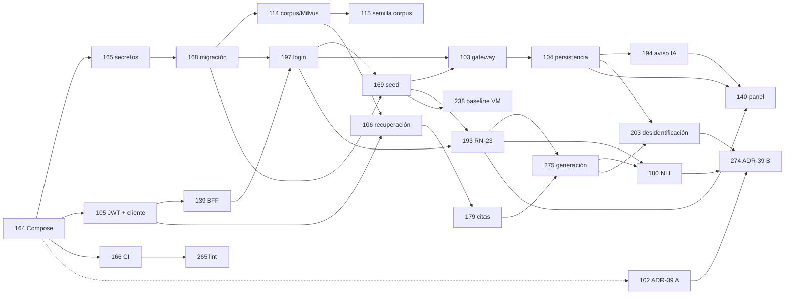

# S1 · Plan del sprint

> `/sprint-start S1` · 2026-10-14 · proyecto Linear **OncoLens-1**, milestone `Sprint 1`. Son **24 changes y 101 pts** (96 más los 2 de la re-estimación de US-054, `[S1 resp. 13]`, y los 3 de la ampliación de US-012, `[S1 resp. 38]`). La capacidad es de 80–90 pts (DEC-03); el exceso está aceptado. Refinamiento previo: [`S1-refinamiento.md`](S1-refinamiento.md). Las decisiones de esta fase continúan la numeración: `[S1 resp. 11–n]`.

## 1. Historias, changes y oleadas

Contextos: **CP** = clinical-platform (incluye los Route Handlers `app/api` y la infra) · **AI** = ai-services · **FE** = frontend.

| L1D | US | Change | Contexto | Oleada | Depende de | Lote | Est. |
|---|---|---|---|---|---|---|---|
| [L1D-164](https://linear.app/l1der-lab-mjbc/issue/L1D-164) | US-034 | `l1d-164-compose-stack` | contratos → CP → AI | 1 | — | R1 | 5 |
| [L1D-102](https://linear.app/l1der-lab-mjbc/issue/L1D-102) | US-012 · ADR-39 A | `l1d-102-adr39-embeddings-reranker-nli` | AI (ADR + mini-dataset + *chunking* e índice) | 1 | 164 (imagen; contenedor provisional si aún no está) | — | **8** (era 5) |
| [L1D-165](https://linear.app/l1der-lab-mjbc/issue/L1D-165) | US-035 | `l1d-165-secrets-setup-scripts` | CP | 2 | 164 | R1 (cierra) | 3 |
| [L1D-105](https://linear.app/l1der-lab-mjbc/issue/L1D-105) | US-054 | `l1d-105-service-jwt-auth` | contratos (cliente generado) → AI → CP | 2 | 164 | — | **5** (era 3) |
| [L1D-166](https://linear.app/l1der-lab-mjbc/issue/L1D-166) | US-036 | `l1d-166-ci-build-contracts-scan` | CP (CI) | 2 | 164 | — | 5 |
| [L1D-168](https://linear.app/l1der-lab-mjbc/issue/L1D-168) | US-038 | `l1d-168-initial-schema-migration` | CP | 3 | 164, 165 | R2 | 5 |
| [L1D-265](https://linear.app/l1der-lab-mjbc/issue/L1D-265) | US-215 | `l1d-265-lint-format-base` | CP → FE → AI | 3 | 164, 166 | — | 2 |
| [L1D-139](https://linear.app/l1der-lab-mjbc/issue/L1D-139) | US-060 | `l1d-139-bff-route-handler-analisis` | contratos (ejemplo) → CP | 3 | 164, 105 | R7 | 3 |
| [L1D-197](https://linear.app/l1der-lab-mjbc/issue/L1D-197) | US-211 | `l1d-197-sesion-login-guard` | CP → FE | 4 | 168, 139, 105, 165 | R7 | 3 |
| [L1D-114](https://linear.app/l1der-lab-mjbc/issue/L1D-114) | US-058 | `l1d-114-corpus-catalog-milvus` | AI | 4 | 164, 165, 168 (arnés) | R3 | 5 |
| [L1D-169](https://linear.app/l1der-lab-mjbc/issue/L1D-169) | US-039 | `l1d-169-synthetic-demo-seed` | CP | 5 | 168, 197 (hasher), 165 | R2 (cierra) | 3 |
| [L1D-115](https://linear.app/l1der-lab-mjbc/issue/L1D-115) | US-059 | `l1d-115-seed-corpus-licensed` | AI | 5 | 114 | R3 (cierra) | 5 |
| [L1D-106](https://linear.app/l1der-lab-mjbc/issue/L1D-106) | US-055 | `l1d-106-retrieval-threshold-sin-evidencia` | contratos (503) → AI | 6 | 164, 105, 114 | R4 | 5 |
| [L1D-103](https://linear.app/l1der-lab-mjbc/issue/L1D-103) | US-052 | `l1d-103-gateway-contexto-clinico` | contratos (422) → CP | 6 | 105, 168, 169, 197 | R6 | 5 |
| [L1D-193](https://linear.app/l1der-lab-mjbc/issue/L1D-193) | US-068 | `l1d-193-terminos-prohibidos-rn23` | contratos → CP → AI | 6 | 164, 166, 169 (catálogo), 197 (`es.json`) | R8 | 3 |
| [L1D-179](https://linear.app/l1der-lab-mjbc/issue/L1D-179) | US-063 | `l1d-179-citas-chunk-recuperado` | AI | 7 | 106, 114 | R4 (cierra) | 5 |
| [L1D-104](https://linear.app/l1der-lab-mjbc/issue/L1D-104) | US-053 | `l1d-104-persistencia-analisis-fallos` | contratos (500) → CP | 7 | 103, 105, 168 | R6 | 5 |
| [L1D-238](https://linear.app/l1der-lab-mjbc/issue/L1D-238) | US-075 | `l1d-238-baseline-manual-vm` | AI (cálculo) + humano (sesiones) | 7 | 164, 166, 169; las sesiones, con la demo (140) | — | 3 |
| [L1D-275](https://linear.app/l1der-lab-mjbc/issue/L1D-275) | US-225 | `l1d-275-generacion-opcion-max-options` | AI | 8 | 106, 179, 114, 193 | R5 | 3 |
| [L1D-194](https://linear.app/l1der-lab-mjbc/issue/L1D-194) | US-069 | `l1d-194-aviso-ia-etiqueta-academica` | contratos (patch) → CP → FE | 8 | 104, 197 | R8 (cierra) | 2 |
| [L1D-180](https://linear.app/l1der-lab-mjbc/issue/L1D-180) | US-064 | `l1d-180-soporte-nli-descartadas` | contratos (503) → AI | 9 | 275, 179, 193 | R5 (cierra) | 5 |
| [L1D-203](https://linear.app/l1der-lab-mjbc/issue/L1D-203) | US-049 | `l1d-203-desidentificacion-contexto-ia` | contratos (503) → CP → AI (test) | 9 | 103, 104, 275, 166 | R6 (cierra) | 5 |
| [L1D-140](https://linear.app/l1der-lab-mjbc/issue/L1D-140) | US-061 | `l1d-140-panel-opcion-citas` | contratos (ejemplos) → FE | 9 | 139, 197, 193, 194, 104 | R7 (cierra) | 5 |
| [L1D-274](https://linear.app/l1der-lab-mjbc/issue/L1D-274) | US-224 · ADR-39 B | `l1d-274-adr39-runtime-llm-ocr` | AI (ADR + medición p95) | 10 | 102, 275, 180, 103, 104 | — | 3 |

**Reglas del orden:**
- **Nunca dos historias a la vez sobre el mismo módulo.** Por eso 106/179/275/180 (pipeline de evidencia de rag) y 103/104/203 (módulo `evidence-analysis` de clinical-api) van una por oleada, y 139 → 197 → 140 (web) también.
- **Pipeline de rag:** 164 → 105 → 106 → 179 → 275 → 180. Producción falla cerrado (`503`) hasta que se mergea 180.
- **Contratos, por el registro de versiones `[S1 resp. 37]`:** clinical-api 164 → 103 → 104 → 194 → 203; rag 164 → 106 → 180.
- **Archivado:** 103 antes que 203 (delta `REMOVED`).
- **E2E importados:** los de 193 y 194 que necesitan el panel se implementan en la rama de 140, con sus tags `[US-068 AC-n]`/`[US-069 AC-n]`.
- **ADR-39:** las fases A (102) y B (274) bloquean solo los adapters reales; todos los AC se verifican con falsos.

**Oleadas (3 a la vez como máximo):** O1 164, 102 · O2 165, 105, 166 · O3 168, 265, 139 · O4 197, 114 · O5 169, 115 · O6 106, 103, 193 · O7 179, 104, 238 · O8 275, 194 · O9 180, 203, 140 · O10 274. Las sesiones con los oncólogos de 238 se hacen con la demo, después de la O9.

**Lotes de revisión SOLID/CUPID** (los dispara el último change del lote): R1 164+165 · R2 168+169 · R3 114+115 · R4 106+179 · R5 275+180 · R6 103+104+203 · R7 139+197+140 · R8 193+194. Sin lote: 102, 105, 166, 265, 238 y 274.

## 2. Gate 1 · decisiones del humano (usuario, 2026-10-14)

| # | Decisión | Afecta |
|---|---|---|
| 11 | **El LLM no genera limitaciones en el S1.** Se quita `limitations` de `GenerationOutput`; las limitaciones solo salen de reglas (`estructural`). La regla de US-064 sobre limitaciones del generador se prueba con un fake. Resuelve el Bloqueante RN-01 | L1D-275, L1D-180 |
| 12 | **Familia 503 con códigos propios.** `rag-orchestrator` declara en `/rag/query` un `oneOf` aditivo con `LOCAL_LLM_UNAVAILABLE` (LLM no disponible o salida inválida), `RETRIEVAL_UNAVAILABLE` (Milvus o embeddings caídos; lo crea L1D-106) y `NLI_UNAVAILABLE` (lo añade L1D-180). `clinical-api` tiene una sola tabla de mapeo en L1D-104: `LOCAL_LLM_UNAVAILABLE` → `503`; `RETRIEVAL_UNAVAILABLE`, `NLI_UNAVAILABLE`, `422` de rag y cualquier otro 5xx → `502 ERROR_SERVICIO_IA`, sin persistir y sin eco | L1D-106, L1D-180, L1D-104, L1D-275 |
| 13 | **El cliente HTTP generado se adelanta al S1, en L1D-105 (US-054), que pasa de 3 a 5 pts** (el sprint queda en 98). Hey-api con `fetch` inyectable, para `web → clinical-api` y `clinical-api → rag-orchestrator`, dentro de `contracts:generate:check`. El cliente de rag se construye sobre el transporte JWT. El servicio pasa `X-Request-Deadline` como parámetro tipado de la operación. L1D-103, L1D-104, L1D-139 y L1D-197 usan solo esos clientes | L1D-105, L1D-103, L1D-104, L1D-139, L1D-197 |
| 14 | **Privacidad, se aceptan las cuatro propuestas:** (a) el login verifica `Origin` (`verificarOrigen()` de L1D-139) y exige `Content-Type: application/json`, con escenario `403`. (b) Alembic del corpus corre como **`rag_corpus_migrator`** en un servicio *one-shot*; el runtime `rag_corpus` queda con `USAGE` + DML y desaparece el `GRANT CREATE`; tampoco hay regla de `pg_hba` para el superusuario por red. (c) `/platform/evidence-analyses` exige rol `doctor` en el S1 (`403` para `admin`, PRD E-04) y la sesión caduca por `expires_at`. (d) El desidentificador provisional de L1D-103 falla cerrado si `data_origin ≠ sintetico` o `APP_ENV ∉ {local,test}` | L1D-197, L1D-165, L1D-114, L1D-168, L1D-103 |
| 15 | **RN-23 en dos niveles.** Lista `terminos-prohibidos.json` 1.1.0. Nivel A (salida generada y UI): los 8 actuales más "deben recibir", "debería recibir", "se sugiere iniciar", "tratamiento indicado", "mejor opción", "usted debe", "you should", "the patient should", "indicated for this patient", "probabilidad de éxito" y "chance of success", con casos de plural y género. Nivel B (solo textos propios de la UI y prompts): raíz `recomend*`/`recommend*` | L1D-193, L1D-180, L1D-275 |
| 16 | **Retiro por lenguaje no permitido:** el texto retirado se reemplaza siempre por "[afirmación retirada: formulación no permitida]" (en inglés, "[claim removed: disallowed wording]"), `discardReason = afirmacion_sin_soporte` (sin cambiar el enum) y la UI aclara "o contenía lenguaje no permitido" | L1D-180, L1D-193, L1D-140 |
| 17 | **Registro de versiones y nombres canónicos.** clinical-api: L1D-164 → 1.1.0, L1D-104 → 1.2.0, L1D-194 → 1.2.1 (patch), L1D-203 → 1.3.0. rag-orchestrator: L1D-164 → 1.1.0, L1D-106 → 1.2.0, L1D-180 → 1.3.0. Minor para una operación, respuesta o código nuevo; patch para texto; los changes que solo añaden ejemplos no tocan `info.version`. Quien mergea segundo rebasa. Nombres en rag-orchestrator: `app/api/rag_query.py`, `app/config/settings.py`, `app/bootstrap.py` (raíz de composición) y `EvidenceQueryPort`. L1D-164 aporta el *helper* de validación de respuestas contra el spec (Vitest con Ajv2020 sobre el bundle y su equivalente en Pytest) hasta US-214 | todos los que tocan contrato o rag |
| 18 | **Literales del Markdown y dueños únicos.** Se corrigen sin cambiar IDs: `p-7f3a` → `psd_p7f3a` (FEAT-T4a); `topRelevanceScore` = máximo de los chunks sobre el umbral (US-053, US-225); el E2E de US-061 AC-1 lee `externalId` del ejemplo. Dueños: L1D-194 crea `AiDisclaimer`, `AppHeader` y el layout `(dashboard)`; L1D-197 crea `apps/web/messages/es.json`; L1D-139 crea `contracts/examples/evidence-analysis-request.json`. Las respuestas propias del BFF (`403` por `Origin`, con log `motivo=origen`, y `502`) se declaran en la spec `web-bff` | L1D-194, L1D-140, L1D-197, L1D-139, L1D-203, L1D-104 |

## 3. Gate 1 · reporte consolidado

| Guardián | Vuelta 1 | Vuelta 2 | Cierre |
|---|---|---|---|
| clinical-language-auditor | FAIL (1 Bloqueante, 7 Mayores, 6 Menores) | **PASS** (3 Menores) | Menores aplicados |
| privacy-guardian | FAIL (6 Mayores, 9 Menores) | **PASS** (5 Menores) | Menores aplicados |
| contract-keeper | FAIL (11 Mayores, 4 Menores) | FAIL (1 Mayor nuevo, 9 Menores) | Mayor y Menores corregidos sin tercera vuelta (pendiente de aprobación, paso 6) |

**Cambios de la vuelta 1** (decisiones 11–18 de §2): limitaciones fuera del LLM; familia 503 y tabla única de mapeo en 104; cliente hey-api en 105; Origin y JSON en el login; `rag_corpus_migrator` en un servicio *one-shot*; `403` para `admin`; adaptador provisional que falla cerrado; `traceId` generado en clinical-api; superusuario sin acceso por red; prefijo de las bases de test validado; tmpfs + `read_only` para el OCR; `pii-scan` sobre `git ls-files`; RN-23 en dos niveles con 22 términos; literal de retiro; `assumptions[]` del S1; dueños únicos y ciclo 140↔194 roto; registro de versiones; nombres canónicos de Python; *helper* de validación de respuestas y 422 sin eco en 164.

**Cambios de la vuelta 2:**
- 164 monta `packages/clinical-catalogs` de solo lectura (`CLINICAL_CATALOG_PATH`) y 169 crea `manifest.json`.
- `fake-secrets.sh` genera un par P-256 real.
- `generate` corre antes que `check`.
- Política de versión sin el registro del S1.
- E2E de 193 y 194 en la rama de 140.
- La etiqueta académica del login la crea 197.
- 503 y 504 en el panel.
- `permitirFrases` solo en textos propios.
- Allowlist de `pii-scan` por fixture y valor (sha256) y exclusiones de lista cerrada.
- Prefijo de test distinto de `POSTGRES_DB`.
- `TemporaryDirectory` por request en el OCR.
- `Idempotency-Key` no se reenvía en el S1.
- Fuente única de formatos de PII (`config/pii-formats.json`).
- `exigirEntornoSintetico()` se conserva hasta G-Piloto.
- 409 y 429 de rag → 502.
- Métrica de descartes por lenguaje en `evaluate`.

**Markdown alineado en esta fase:**
- US-054 (AC-6, 3 → 5).
- US-214 (nota de alcance).
- US-053 y readme §2 (`topRelevanceScore`).
- US-049 (`psd_p7f3a`).
- US-061 AC-1 (`externalId` del ejemplo).
- US-058 AC-1 (`rag_corpus_migrator`).
- `backlog/features/README.md` (S1 98, MVP 527, backlog 817).

`openspec validate --changes --strict`: **24/24 en verde**.

## 4. Preguntas abiertas

| # | Pregunta | Dueño | Cuándo |
|---|---|---|---|
| Q1 | ~~¿Publicar en el repo los tiempos seudonimizados de O1/O2 (US-075)?~~ **Sí** `[S1 resp. 23]` | usuario | resuelta |
| Q2 | Checklist (VM-1) y herramientas (VM-2): **aprobados** `[S1 resp. 24]`. Lo que queda (`VM_SESSION_MAX_MINUTES`, casos ficticios, textos de la demo y reglas de lenguaje) va en [`S1-cuestionario-oncologos.md`](S1-cuestionario-oncologos.md) | usuario con los oncólogos | §A antes de las sesiones de 238; §B–C antes de la O9 |
| Q3 | ~~¿Se añaden `npm run lint` y `format:check` al hook?~~ **Sí** `[S1 resp. 25]`: el paso 5 de `pre-commit-gate.sh` los ejecuta cuando hay código staged y existen los scripts (L1D-265) | usuario | resuelta |
| Q4 | ¿Incluye FEAT-T4d como prerrequisito de G-Piloto la separación `edge-net`/`clinical-net internal` y el cierre de la salida de `ai-net`? | usuario | refinamiento del S5 |
| Q5 | ~~Raya frente a dos puntos del aviso de IA en la prosa~~ **Resuelta:** con el literal nuevo `[S1 resp. 32]`, la prosa de `readme.md`, `CLAUDE.md` y el PRD ya está alineada | sesión principal | resuelta |
| Q6 | `data/eval/` o `data/evaluation/` como raíz única de evaluación | US-072 | S2 |
| Q7 | ¿El login revalida con Zod en el BFF y el análisis no? Asimetría aceptada mientras el login no tenga 422 propio | contract-keeper | Gate 2 de 197 |
| Q8 | **Buckets del corpus en el Compose del S1.** `data-model.md` §4.6 ubica `corpus-raw` y `corpus-normalized` en el MinIO de Milvus (no en `clinical-minio`; Backend 2 no tiene red ni credenciales hacia este último). ¿L1D-164 (US-034) y L1D-165 (US-035) crean ya esos dos buckets y una credencial propia del rol de corpus, aunque el S1 no escriba en ellos, o se difiere a US-117 (S4)? Si se crean, el AC de US-034 lo verifica y el `pii-scan` y la prueba de aislamiento lo cubren | usuario | antes de la O1 (afecta 164 y 165) |
| Q9 | **Original y copia normalizada de la semilla.** US-059 y el change `l1d-115` dejan fuera persistir originales en `corpus-raw`/`corpus-normalized` (US-117, S4), de modo que en el S1 `object_key_raw`, `object_key_normalized` y `original_format` quedan vacíos y la única copia es `data/raw/seed/` (o la URL del manifiesto si la licencia no permite redistribuir). ¿Se mantiene, o US-059 guarda el original descargado y el texto normalizado desde el S1 (un AC nuevo; sin cambio de contrato; depende de Q8) para no tener documentos de la demo sin copia ni versión de la fuente? Con el original guardado, reindexar por un cambio de ADR-39 no exige volver a descargar | usuario | antes de la O5 (afecta 115; si cambia, se ajusta la estimación de 5 pts) |

## 5. Aprobación humana (usuario, 2026-10-14)

| # | Decisión |
|---|---|
| 19 | Se aprueba el orden de **10 oleadas** del §1, con **3 historias a la vez como máximo** y nunca dos sobre el mismo módulo |
| 20 | El Gate 1 se cierra **sin tercera vuelta**: las correcciones de la vuelta 2 se aceptan y las verifica el Gate 2 sobre el código (mismo criterio que `[Pre-S1 resp. 26]`) |
| 21 | Se aceptan las decisiones por defecto de la vuelta 2: (a) L1D-164 monta `packages/clinical-catalogs` de solo lectura (vacío con `.gitkeep` si aún no existe) y L1D-169 es el único que crea `manifest.json`; (b) excepción del Gate 2 para `contract(L1D-105)`: cambia lo generado sin tocar el spec, porque cambia la configuración del generador; (c) `exigirEntornoSintetico()` se conserva hasta G-Piloto (lo retira US-143), `Idempotency-Key` no se reenvía en el S1 y `config/pii-formats.json` es la fuente única de formatos de PII; (d) `/login` muestra "Uso académico/investigación", con la clave creada por L1D-197 |
| 22 | **Merge por oleada:** el orquestador junta los PRs de cada oleada en una sola petición al humano |
| — | No hay historias `si-hay-capacidad` en el S1 |

## 6. Respuestas posteriores (usuario, 2026-10-14)

| # | Decisión |
|---|---|
| 23 | **Consentimiento de O1/O2:** sí. Sus tiempos seudonimizados se versionan en `eval/vm/` (US-075) |
| 24 | **Los oncólogos aprueban** el checklist de "caso reconstruido" (VM-1) y las herramientas de la condición manual (VM-2) de DEC-02. El resto de la validación clínica va en [`S1-cuestionario-oncologos.md`](S1-cuestionario-oncologos.md): el §A antes de las sesiones de US-075 y los §B–C antes de la O9, porque sus respuestas pueden cambiar textos de 104, 106, 140, 180 y 193 |
| 25 | **Lint y formato en el hook previo al commit:** sí. `.claude/hooks/pre-commit-gate.sh` ejecuta `npm run lint` y `npm run format:check` si hay código staged y existen esos scripts (llegan con L1D-265) |

## 7. Validación clínica de los oncólogos asesores (2026-10-14)

Respuestas de los oncólogos asesores A y B al [cuestionario](S1-cuestionario-oncologos.md); el usuario decidió la forma de incorporarlas.

| # | Decisión | Afecta |
|---|---|---|
| 26 | **Protocolo del baseline:** 30 min por tarea, con VM-1 y VM-2 cronometradas por separado (A1). Los casos se validan por **coherencia longitudinal**: diagnóstico, TNM o estadio a la fecha, biomarcadores, intención terapéutica, secuencia previa y línea actual, con una única interpretación razonable (A2). El checklist separa elementos **críticos** y **complementarios**; "reconstruido" exige todos los críticos; cada checklist guarda versión y fecha de validación clínica (A3). La pregunta de referencia de VM-2 incluye **población, contexto clínico, decisión y fecha de corte** de la evidencia (A4); la de la demo (`Q-HER2`) no cambia | L1D-238, DEC-02 |
| 27 | **VM-2 con dos desenlaces** (A5): *autoidentificada* (≥ 1 fuente + justificación breve) y *validada* (un evaluador confirma, después y ciego al tiempo y al participante, que la fuente corresponde al caso y a la pregunta). **La meta de DEC-02 (−50 % de la mediana) se calcula sobre la *validada***: un intento solo cuenta como completado si se valida. El valor de la meta no cambia; DEC-02 se enmienda en el criterio | L1D-238, DEC-02 |
| 28 | **Rótulos de la relevancia** (B1–B3): el rótulo pasa a **"Relevancia de recuperación de evidencia"**, con la nota "no mide eficacia ni solidez clínica". El criterio visible pasa a **"Ordenado por relevancia de recuperación de la búsqueda; no representa prioridad ni aplicabilidad clínica."** El valor por opción se presenta como **"Orden basado en la cita recuperada más relevante asociada a cada opción"**, y la ayuda aclara que no resume la aplicabilidad, la eficacia ni la calidad global de la opción. Supersede el literal de US-061 AC-2 | L1D-140, L1D-275, `docs/ux/S1/` |
| 29 | **Auditoría de descartes** (B4, B5): en el S1, cada descartada muestra su número de orden, el id del análisis y `createdAt` (sin cambio de contrato), y nunca se presenta como contenido clínico utilizable. `rag-orchestrator` registra en el log el `ruleId` y la versión de la política de lenguaje, nunca el texto. La **traza completa** (frase original retirada, regla, versión de la política y `chunkIds` de cada descartada, sin exponerla en la UI) pasa a un **AC nuevo de US-150 (FEAT-T1b, S6)**, con su cambio de contrato y de esquema | L1D-140, L1D-180, US-150 |
| 30 | **Supuesto fijo de la Base del análisis** (B6): "Datos del paciente recibidos como contexto. Esta versión no verifica su completitud ni la ausencia de datos clínicamente relevantes." | L1D-104 |
| 31 | **Errores** (B7): sin resultado parcial; el error técnico queda registrado (log con `traceId`) y el panel permite **reintentar** con la misma pregunta, como una petición nueva que no altera la sesión | L1D-140 |
| 32 | **Aviso de IA** (B8): el literal pasa a **"Generado por IA; requiere validación clínica independiente por el oncólogo tratante."**, con "Uso académico/investigación" visible y permanente. Supersede PRD B-06 y `[S1 resp. 9]`; nueva fila E-11 en el registro de cambios del PRD, RN-19 y US-069 corregidas | L1D-194, PRD, `CLAUDE.md`, `openspec/config.yaml` |
| 33 | **RN-23 ampliada por forma** (C1). **Nivel A** (salida generada, UI, prompts y contratos), con variantes de género, número, conjugación y negación: inicie, administre, prescriba, suspenda, cambie a, elija, escoja, ofrezca, se debe, debe iniciar(se), debe suspender, se debe administrar, no debe recibir, no se debe administrar, es necesario, es imprescindible, se recomienda, se recomienda iniciar, se indica, está indicado, está contraindicado, la mejor opción es, manejo de elección; en inglés, we recommend, is recommended, should be started, must receive, should not receive, is indicated, is contraindicated, preferred treatment, treatment of choice. **Nivel B** (solo textos propios de la UI y prompts): iniciar, administrar, prescribir, suspender, ofrecer, elegir, start, initiate, administer, prescribe, discontinue, offer, choose, switch to, standard of care | L1D-193 |
| 34 | **Falsos positivos y atribución** (C2, C3): la suite `evaluate` mide `false_positive_language_filter_rate`, que se revisa periódicamente. "La guía recomienda X" solo se admite con la población y el escenario explícitos ("…para pacientes con [condición] en [escenario]"), con la cita que abre el fragmento exacto y nunca dirigida al paciente. El prompt lo exige y `evaluate` lo mide (no hay regla determinista) | L1D-180, L1D-275 |
| 35 | **Caso sin diagnóstico** (C4): no es "sin evidencia". `clinical-api` responde **`422 TIPO_CANCER_NO_REGISTRADO`** antes de llamar a la IA, sin generar ni persistir análisis, y el panel muestra **"Análisis no realizado: falta el tipo de cáncer; no fue posible filtrar la evidencia."**. `rag-orchestrator` mantiene la misma defensa (`422` con el mismo código). Es un cambio aditivo del contrato | L1D-103, L1D-106, L1D-140 |
| 36 | **Pregunta de prueba de la UI** (C5): "En pacientes con cáncer de mama HER2 positivo temprano, ¿qué describe la evidencia sobre mortalidad con terapia anti-HER2 adyuvante?" | L1D-140 |
| 37 | **Registro de versiones actualizado por resp. 35** (sustituye al de `[S1 resp. 17]`): clinical-api: L1D-164 → 1.1.0, **L1D-103 → 1.2.0** (422 nuevo), L1D-104 → 1.3.0, L1D-194 → 1.3.1, L1D-203 → 1.4.0. rag-orchestrator: L1D-164 → 1.1.0, L1D-106 → 1.2.0 (`RETRIEVAL_UNAVAILABLE` y el 422 `TIPO_CANCER_NO_REGISTRADO` en la misma subida), L1D-180 → 1.3.0 | 103, 104, 106, 194, 203 |

## 8. Ampliación de US-012 y ClinicalTrials.gov (usuario, 2026-10-15)

| # | Decisión | Afecta |
|---|---|---|
| 38 | **Las pruebas de *chunking*, solapamiento, estrategia de *chunking* e índice (T2–T5) amplían US-012** (AC-10 a AC-13 nuevos). 5 → **8 pts, con excepción de tamaño**: la DoR fija ≤ 5 y la historia ya se había partido por eso (`[S1 resp. 6]`). El S1 pasa de 98 a **101** (capacidad 80–90, DEC-03; exceso aceptado). Si la velocidad real lo exige, T5 (HNSW frente a FLAT) es la primera candidata a salir. Un valor por factor, el resto fijo, en secuencia; la etiqueta del golden es por pasaje y no por chunk | L1D-102, L1D-114 (tipo de índice), L1D-115 (tamaño y solapamiento de chunk) |
| 39 | **Los registros de ClinicalTrials.gov se pueden usar**, con fuente `ClinicalTrials.gov / NCTxxxxxxxx`, URL y fecha de consulta; atribución visible a NLM ("Source: ClinicalTrials.gov, National Library of Medicine"); sin sugerir aval de NLM, NIH ni ClinicalTrials.gov; aviso de que el registro puede no reflejar la versión más reciente; uso limitado a metadatos del registro y citas breves. La verificación de los términos la confirma el usuario (la página no pudo leerse con las herramientas de la sesión) | L1D-102, L1D-115 |

**Dataset del ADR-39.** `data/eval/adr39-mini/` (rama `chore/S1-adr39-dataset`): 75 preguntas (59 con respuesta, 6 sin respuesta, 10 controles en inglés), 39 pares NLI y 27 fuentes con licencia por documento (NCI, PMC CC BY, ClinicalTrials.gov); NCCN y ESMO excluidas (RN-21). Revisado y aprobado por el oncólogo asesor. Los textos completos no se versionan: el script de la ampliación los descarga con checksum.
