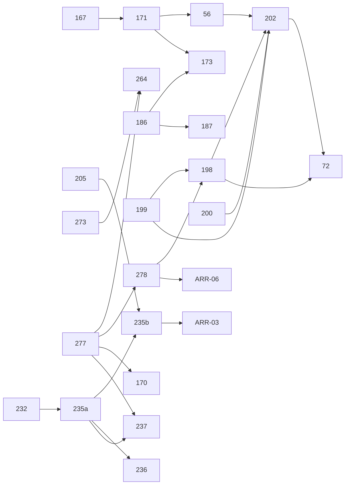

# S2 · Plan de ejecución

> `/sprint-start S2` · 2026-10-21 · Fuente: `backlog/sprints/S2-refinamiento.md` (PR #120, **sin mergear**: este plan está encadenado sobre esa rama). Milestone **Sprint 2** de OncoLens-1.
> **Estado: aprobado por el usuario (2026-10-21, `[S2 resp. 8]`).** Respuestas P-1…P-6 y G-1…G-4 registradas en `S2-refinamiento.md` §7 (`[S2 resp. 1…14]`) y aplicadas a los changes.
> Changes creados en el checkout de `sprint/S2-planning`; `openspec validate --changes --strict`: **37/37** (23 nuevos + 14 del S1 que pasan al S2).

## 1. Historias y changes

| L1D | US | Change | Contexto | Oleada | Depende de | Lote | Pts |
|---|---|---|---|---|---|---|---|
| L1D-273 | US-223 | `l1d-273-bundle-redocly` | clinical-platform | O1 | — | R6 | 2 |
| L1D-277 | ARR-01 | `l1d-277-ci-integracion-servicios-reales` | clinical-platform · ai-services | O1 | — | — | 5 |
| L1D-200 | US-046 | `l1d-200-identidad-cifrada-indice-ciego` | clinical-platform | O1 | — | R1 | 5 |
| L1D-264 | US-214 | `l1d-264-verificacion-proveedor` | clinical-platform · ai-services | O2 | 273, 277 | R6 | 3 |
| L1D-167 | US-037 | `l1d-167-config-validada-logs-json` | los tres + contratos | O2 | — (clinical 1.6.0 / rag 1.4.0) | R3 | 3 |
| L1D-199 | US-045 | `l1d-199-usuarios-cli-rbac` | clinical-platform | O2 | L1D-197 (S1, en `main`) | R2 | 3 |
| L1D-278 | ARR-02 resto | `l1d-278-e2e-ci-login-tailwind` | frontend · clinical-platform | O2 | 277 | — | 3 |
| L1D-171 | US-041 | `l1d-171-catalogo-montaje-version` | los tres + contratos | O3 | 167 (1.7.0 / 1.5.0) | R3 | 5 |
| L1D-198 | US-044 | `l1d-198-sesion-expiracion-bloqueo` | clinical-platform · frontend | O3 | 278, 199 (`revocarSesiones`) | R2 | 3 |
| L1D-186 | US-066 | `l1d-186-base-analisis-builder` | clinical-platform | O3 | — | R4 | 5 |
| L1D-232 | US-014 · ADR-41 | `l1d-232-adr41-framework-evaluacion` (`skip_specs`) | ai-services | O3 | P-3 | R5 | 3 |
| L1D-56 | US-076 | `l1d-56-carga-documento-api` | clinical-platform + contratos | O4 | 171 (1.8.0), **G-1** (E-4/E-5) | — | 5 |
| L1D-173 | US-043 | `l1d-173-tipos-cancer-habilitados` | los tres | O4 | 171, 186, 167, **G-3** | R3 | 3 |
| L1D-187 | US-067 | `l1d-187-panel-base-analisis` | frontend | O4 | 186 (E2E) | R4 | 3 |
| L1D-235 | US-072a | `l1d-235-suite-evaluate` (bloque 072a) | ai-services · clinical-platform | O4 | 232 | R5 | 5 |
| L1D-202 | US-048 | `l1d-202-listado-busqueda-pacientes` | clinical-platform · frontend + contratos | O5 | 200, 199, 198, 56 (1.9.0), **P-4** | R1 | 5 |
| L1D-205 | US-013 · ADR-40 | `l1d-205-adr40-deteccion-pii` (`skip_specs`) | ai-services · clinical-platform | O5 | P-2 | — | 5 |
| L1D-170 | US-040 | `l1d-170-rol-rag-corpus-permisos` | clinical-platform · ai-services | O5 | 277 | — | 5 |
| L1D-235 | US-072b | `l1d-235-suite-evaluate` (bloque 072b) | ai-services | O5 | 072a, 232, 205 (AC-6) | R5 | 3 |
| L1D-72 | US-051 | `l1d-72-ficha-minima-paciente` | clinical-platform · frontend | O6 | 202, 200, 198 | R1 | 5 |
| L1D-236 | US-073 | `l1d-236-calibracion-umbral-baseline` | ai-services | O6 | 072a, 232 | R5 | 3 |
| L1D-237 | US-074 | `l1d-237-eval-required-ci` | clinical-platform · ai-services | O6 | 072a, 232, 277 | R5 | 3 |
| L1D-267 | US-217 | `l1d-267-auditoria-dependencias` | clinical-platform · ai-services | O6 | — (al final por conflictos en `ci.yml`) | — | 2 |
| L1D-279 | ARR-03 | sin change (reporte sobre los changes de 180, 275, 115, 193) | ai-services | O6 | 072b | — | 3 |
| L1D-282 | ARR-06 | sin change (conciliación y archivo de los 14 changes del S1) | — | O6 | 277, 278 | — | 3 |
| L1D-234 | US-017 · DEC-07 | sin change (decisión al cierre) | — | cierre | 236 | — | 1 |
| L1D-263 | US-213a | `l1d-263-calidad-capas-umbrales` (AC-1…AC-7) | clinical-platform | O6 | — | — | 5 |

**Total: 99 pts** pendientes (+24 ya Done del arrastre). Fuera del S2 (`[S2 resp. 1]`): US-078 y US-079 (→ S3), US-213b (→ S3), DEC-06, DEC-08, DEC-09 y ARR-05 (→ S4).

## 2. Grafo



**Paralelismo:** 3 historias a la vez (4 en O2–O5 cuando una es documento: ADR-41, ADR-40), nunca dos sobre el mismo módulo. Los changes que suben la versión de un `openapi.yaml` (167 → 171 → 56 → 202) van **en serie** y en ese orden de números.

**Lotes SOLID/CUPID** (los dispara el último del lote): R1 identidad (200, 202, **72**) · R2 sesión (199, **198**) · R3 configuración y catálogo (167, 171, **173**) · R4 Base (186, **187**) · R5 evaluación (232, 235, 236, **237**) · R6 contratos (273, **264**).

## 3. Gate 1 en lote

```
## Gate 1 · S2 (22 changes) · 2026-10-21
Veredicto global: PASS (tras la vuelta 2 acotada)
| Guardián | Vuelta 1 | Vuelta 2 | Bloqueantes | Mayores | Menores | Preguntas |
| clinical-language-auditor | PASS | — | 0 | 2 → corregidos | 3 → corregidos | 3 (resueltas) |
| privacy-guardian | FAIL | PASS | 0 | 7 → corregidos | 7 → corregidos (+1 de la v2, aplicado) | 3 |
| contract-keeper | FAIL | PASS | 2 → corregidos | 6 → corregidos | 4 → corregidos (2 abiertos, no bloquean) | 4 |
```

**Cambios hechos tras la vuelta 1** (detalle en los `design.md`):
- **Privacidad:** `web` escribe la IP del socket y descarta el `X-Forwarded-For` del cliente (198); el arnés de no-fuga busca también el nombre normalizado y los HMAC (200, 202); lista de redacción de *logs* cerrada en código, solo aditiva (167); `pii-mini` por *allowlist* de valor y rangos reservados (205); ninguna identidad ni *hash* hacia Backend 2 (205); proveedores locales cerrados en código y la suite aborta con datasets no sintéticos (232, 235); `no-store` en las páginas con identidad (72, 202); `issuing_country` fuera del HMAC (200); máscara de longitud fija (202); `original_filename` tratado como identidad (56); secretos mínimos y trazas sin cuerpos en la CI (277, 278).
- **Contratos:** el admin recibe `200 PatientAdminSummary` en `getPatient` como dicta el contrato (72, 199); UUID inválido → `404` (72); `500 ErrorInterno` declarado en las tres operaciones de pacientes (202); deltas MODIFIED del *health* (167, 171) y un único `health-ok.json`; evento único `configuracion_invalida` con `valorInvalido` para enums no sensibles; versiones explícitas en serie (167 1.6.0/1.4.0 → 171 1.7.0/1.5.0 → 56 1.8.0 → 202 1.9.0).
- **Lenguaje:** los faltantes no calculados ya no se muestran como «0» (supuesto declarado «Los faltantes críticos aún no se calculan en esta versión», 186/187); Base de `tipo_no_habilitado` definida (173: «No se consultó el corpus: tipo fuera de alcance»); aviso agregado «[n] datos sin verificar · no bloquean el análisis» (72); métrica de prescriptivas sobre la salida cruda y la mostrada (235).

**Change añadido tras el Gate 1 (2026-10-21):** `l1d-263-calidad-capas-umbrales` (US-213a). Es configuración de CI: no toca datos, contratos ni texto visible, así que no se relanzaron los guardianes del Gate 1. Lo cubre su Gate 2, con `privacy-guardian` por tocar `scripts/` y `ci.yml`.

**Abiertos menores (no bloquean):** `CORPUS_CUTOFF_DATE` se valida en 167 solo si 167 se implementa antes que 173 (lo garantiza el orden); 72 depende de que 202 mergee antes.

## 4. Notas para el orquestador

- Claves nuevas de `.env.example` que el orquestador **no** puede tocar sin mensaje expreso del usuario: `SESSION_TOUCH_SECONDS`, `LOGIN_*`, `TRUST_PROXY_HOPS` (198); `IDENTITY_AES_KEY_V<n>_FILE` (200); `MAX_UPLOAD_MB`, `CLINICAL_MINIO_ENDPOINT`, `CLINICAL_DOCUMENTS_BUCKET` (56); `CORPUS_CUTOFF_DATE` (173); `LOG_REDACT_EXTRA_FIELDS` (167); `RELEVANCE_THRESHOLD` calibrado (236); retirar `ANALYSIS_BASIS_S1_ASSUMPTION_TEXT` (186). Se aplican con el procedimiento de la memoria (bloques idempotentes, PR aparte).
- `main` tiene 4 avisos `high` en dependencias de desarrollo (`@next/eslint-plugin-next` → `braces`): 267 decide actualizar o registrar excepción con caducidad.
- Reglas de eficiencia vigentes: 1 Gate 2 + 1 re-gate acotado; bloquea solo un invariante del MVP; guardianes por ruta; deuda menor al Markdown.

## 5. Preguntas abiertas

Ninguna. Todas resueltas el 2026-10-21 (`S2-refinamiento.md` §7). Aprobación del paso 6: **sí** (`[S2 resp. 8]`).
Siguen requiriendo mensaje expreso del usuario: las claves de `.env.example` de §4.
