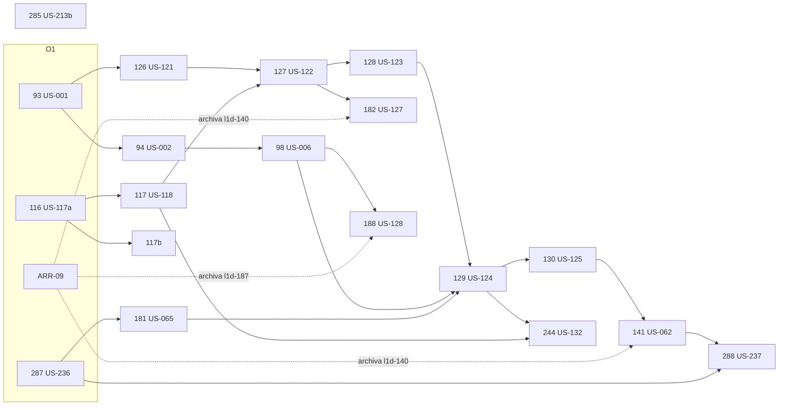

# S3 · Plan de ejecución

> `/sprint-start S3` · 2026-10-24 · Fuente: [`S3-refinamiento.md`](S3-refinamiento.md) (PR #189, en `main`). Milestone **Sprint 3** de OncoLens-1.
> **Estado: aprobado por el usuario (2026-10-24, `[S3 resp. 20]`).** Respuestas del Gate 1 y del plan en `S3-refinamiento.md` §4 (`[S3 resp. 15…20]`), ya aplicadas a los changes.
> Changes creados en el checkout de `sprint/S3-planning`; `openspec validate --changes --strict`: **29/29** (19 nuevos + 10 del S1/S2 que siguen activos). Antes de crearlos se archivaron 8 changes ya cumplidos (l1d-115, 180, 193, 238, 275, 277, 278, us-231a), con sus destinos re-anotados (L1D-280 → US-233, ARR-05, ARR-09).

## 1. Historias y changes

| L1D | US | Change | Contexto | Oleada | Depende de | Lote | Pts |
|---|---|---|---|---|---|---|---|
| L1D-93 | US-001 | `l1d-93-catalogo-datos-criticos-validado` | clinical-platform (+ versión del catálogo en ai-services) | O1 | — | R1 | 5 |
| L1D-116 | US-117a | `l1d-116-ingesta-reanudable-licencia` | ai-services | O1 | — | R5 | 5 |
| L1D-287 | US-236 | `l1d-287-alias-chunks-cita` (prompt `rag-query@0.3.0`) | ai-services | O1 | — | R4 | 3 |
| — | ARR-09 | sin change: tareas abiertas de l1d-140, 166, 173, 187, 194, 197, 202 y 72; re-anota us-231b | frontend · CI | O1 | — (archiva **l1d-140** al terminar: lo exigen 141, 182 y 288) | — | 8 |
| L1D-126 | US-121 | `l1d-126-criterios-aplicabilidad-catalogo` | clinical-platform · ai-services | O2 | 93 | R1 | 3 |
| L1D-94 | US-002 | `l1d-94-checklist-determinista` | clinical-platform | O2 | 93 | R6 | 5 |
| L1D-117 | US-118 | `l1d-117-metadatos-poblacion-verificados` | ai-services | O2 | 116 · `studyKey` de 126 (el fixture se alinea al rebasar) | R5 | 5 |
| L1D-285 | US-213b | `l1d-285-higiene-tests-ci` (patch 1.9.1) | clinical-platform · ai-services · CI | O2 | — (tarea 1.1 en la **sesión principal**: regla AC-17) | — | 3 |
| L1D-127 | US-122 | `l1d-127-estado-criterio-estructurado` | ai-services | O3 | 126, 117 | R2 | 5 |
| L1D-98 | US-006 | `l1d-98-faltantes-al-analisis` | clinical-platform | O3 | 94 | R6 | 3 |
| — | US-117b | `us-117b-versionado-sparse-semilla` | ai-services | O3 | 116 | R5 | 3 |
| L1D-181 | US-065 | `l1d-181-procedencia-contexto-ia` (prompt `rag-query@0.4.0`) | clinical-platform · ai-services | O3 | 287 | R4 | 3 |
| L1D-128 | US-123 | `l1d-128-aplicabilidad-textual-citada` | ai-services | O4 | 127 | R2 | 5 |
| L1D-188 | US-128 | `l1d-188-base-faltantes-declarados` (minor: `missingCriticalDataLabels`) | clinical-platform · frontend + contratos | O4 | 98, 187 archivado | R6 | 3 |
| L1D-129 | US-124 | `l1d-129-aplicabilidad-causas-avisos` | ai-services (+ test de persistencia en clinical-platform) | O5 | 128, 98, 181 | R2 | 5 |
| L1D-130 | US-125 | `l1d-130-herencia-aplicabilidad-recorte` | ai-services | O6 | 129 | R3 | 5 |
| L1D-244 | US-132 | `l1d-244-eval-aplicabilidad-metadatos` | ai-services | O6 | 127, 128, 129, 117 | — | 5 |
| L1D-141 | US-062 | `l1d-141-estados-panel-criterio` | frontend | O7 | 130 (AC-7), 140 archivado | R3 | 4 |
| L1D-182 | US-127 | `l1d-182-metadatos-fuente-catalogo` | ai-services · frontend | O7 | 127, 140 archivado | R3 | 3 |
| L1D-288 | US-237 | `l1d-288-motivos-solo-descartadas` | frontend · ai-services | O8 | 287, 141 | R4 | 2 |
| L1D-125 · L1D-92 | US-021 · DEC-11 · DEC-01 | sin change: `propuesta_revisada` en el catálogo (126, 93); cierre con los oncólogos en el S4 | — | cierre | 126, 93 | — | 2 |

**Total: 85 pts** (77 de historias + 8 de ARR-09). DEC-03 da 80–90.

**Changes activos que no se tocan en el S3:**
- `l1d-205-adr40-deteccion-pii`: la medición de ADR-40 pasa al S5 como prerrequisito de US-083 (`[S3 resp. 7]`). Sigue activo con destino escrito.
- L1D-282 (ARR-06): AC-3 y AC-5 se cumplen con la conciliación de ARR-09.

**Linear:** L1D-233 (DEC-06) y L1D-234 (DEC-07) movidas al milestone Sprint 4, L1D-188 (US-128) al Sprint 3 y L1D-141 a 4 pts (2026-10-24).

## 2. Grafo de dependencias

**Camino crítico:** 93 → 126 → 127 → 128 → 129 → 130 → 141 → 288, ocho oleadas. Lo demás corre en paralelo a esa cadena. **Demo del S3:** aplicabilidad por criterio sobre el paciente semilla, con la opción elegida por aplicabilidad, la línea de conteos y la Base con faltantes.

## 3. Paralelismo y lotes de diseño

- Por defecto, como mucho **3 historias a la vez** y nunca dos sobre el mismo módulo. En O1 se propone **4**, porque ARR-09 es solo *visual-check*, E2E y conciliación, sin módulo de dominio compartido.
- **Lotes SOLID/CUPID**: los dispara el último de cada lote.
  - **R1**: catálogo (93, 126).
  - **R2**: reglas de aplicabilidad (127, 128, 129).
  - **R3**: recorte y panel (130, 141, 182).
  - **R4**: prompt y citas (287, 181, 288).
  - **R5**: ingesta (116, 117b, 117).
  - **R6**: completitud y Base (94, 98, 188).
- **Orden de archivo** para el bulk-archive, según contract-keeper:
  - `clinical-catalogs`: 93 → 126.
  - `applicability`: 127 → 128 → 129 → 130 → 182.
  - `evidence-analysis` y el gateway: 98 → 287 → 181 → 288.
  - `evidence-panel`: 140 → 141 → 182 → 288.
  - `analysis-basis`: 187 → 188.
- **Prompt:** 287 sube a 0.3.0 y 181 rebasa a 0.4.0 (`[S3 resp. 15]`). `run-ai-eval` es obligatorio en 287, 181, 128, 117, 126 y 93.
- **Tareas humanas:**
  - l1d-285, tarea 1.1: la exención de AC-17 la aplica la sesión principal y la revisa `privacy-guardian`.
  - l1d-117, AC-5: la revisión de la muestra la hace el usuario con una plantilla (`[S3 resp. 13]`).

## 4. Gate 1 consolidado

| Guardián | Vuelta 1 | Re-gate acotado (vuelta 2) |
|---|---|---|
| `privacy-guardian` | PASS · 0 Bloqueantes · 0 Mayores · 5 Menores | PASS: Menores 1 y 2 cerrados (destinos solo clínicos en 93; exención AC-17 `^P\. S\.( \d\.)?$` en 285); 1 Menor nuevo en 188 (log del 500), aplicado |
| `contract-keeper` | PASS · 5 Mayores · 4 Menores | PASS: los 9 resueltos; 3 Menores nuevos aplicados; Q1 de 188: campo aditivo `missingCriticalDataLabels` (oasdiff: 0 incompatibles) |
| `clinical-language-auditor` | PASS · 3 Mayores · 3 Menores | PASS: todos resueltos; textos de 188 (contador, singular y plural, «no evaluados» en tipo no habilitado, «Solo informa; no bloquea») aplicados |

**Cambios principales por el Gate 1:**
- `studyKey` en el catálogo de aplicabilidad (126), que lo liga con `population_criteria`.
- `validation` con forma única (93/126).
- Ante un Desconocido gana `falta_en_paciente`.
- 127 es dueña de `contar_estados`.
- 129 es dueña de los ejemplos de contrato.
- `studyPopulationValue` en `camposGenerados`.
- `metadata_source = pendiente` cuando el LLM o el NLI fallan.
- El AiDisclaimer aparece también en tipo no habilitado.
- Texto del criterio: «Orden por aplicabilidad: primero…».
- US-128 adelantada (`[S3 resp. 15…18]`, en `S3-refinamiento.md` §4).

## 5. Preguntas abiertas con dueño

| # | Pregunta | Dueño | Escenario por defecto |
|---|---|---|---|
| A-1 | Destinos supuestos de `psa_serie`, BRCA/HRR, `tratamientos_previos` (93) y claves `estado_menopausico`, `estado_castracion`, `grado` (126) | oncólogos, S4 | Los del change; un cambio solo toca el catálogo |
| A-2 | Con dos HER2 en conflicto, ¿se fuerza `desconocido`? (129) | oncólogos, S4 | Fixture de test, no en el seed de demo |
| A-3 | ~~ClinicalTrials.gov en el AC-1 de US-117a frente a ADR-36~~ | **Resuelta** `[S3 resp. 19]` | Se admite: ADR-36, Enmienda 1 (registro de ensayo ≠ evidencia de eficacia; la atribución de NLM se verifica antes de US-120) |
| A-4 | `coverage.changedLinesWarn = 80` (285) | ingeniería | 80, solo como alerta |

## 6. Aprobación

**Aprobado por el usuario el 2026-10-24** (`[S3 resp. 20]`, en `/sprint-start S3`):
- **Oleadas** O1…O8 tal como figuran arriba.
- **Paralelismo:** 4 en O1 (con ARR-09) y después como mucho 3, nunca dos sobre el mismo módulo.
- **Merges** por oleada: el orquestador junta los PR de cada oleada, con los checks en 0, en una sola petición.
- **Gate 1:** las preguntas quedaron respondidas en `[S3 resp. 15…19]`.
- **Historias `si-hay-capacidad`:** ninguna entra en el S3.
- **ADR-36, Enmienda 1:** ClinicalTrials.gov se admite en el MVP.

Siguiente paso: el usuario mergea el PR de planificación y después ejecuta `/sprint-run S3`, cuyos worktrees salen de `main`.
