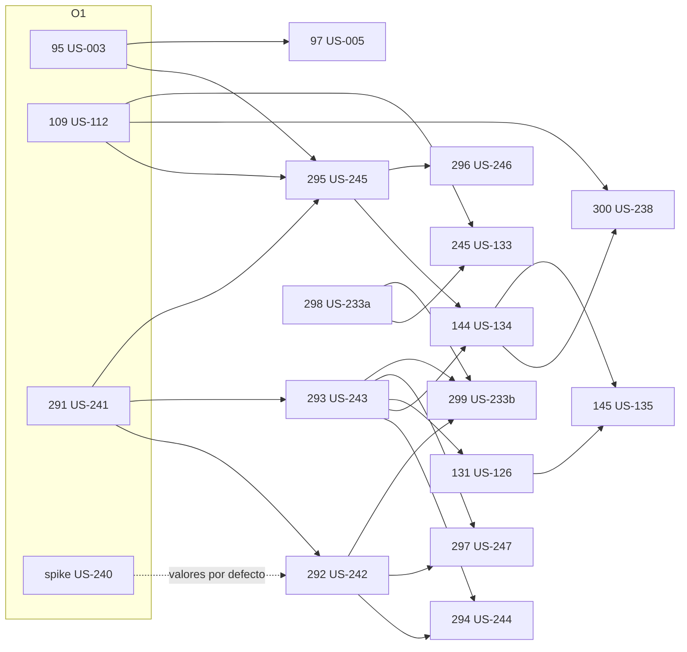

# S4 · Plan de ejecución

> `/sprint-start S4` · 2026-10-30 · Fuente: [`S4-refinamiento.md`](S4-refinamiento.md) (PR #239, #240 y #241, en `main`). Milestone **Sprint 4** de OncoLens-1.
> **Estado: aprobado por el usuario (2026-10-30, §5).**
> Changes creados en `main` (sin commitear) y publicados en `sprint/S4-planning`. `openspec validate --changes --strict`: **31/31** (17 nuevos y 14 activos de sprints anteriores).
> Modelo: los 17 changes se escribieron con Sonnet 5.5. Gate 1, correcciones y plan, con Opus 5.5 (decisión del usuario, 2026-10-30).

## 1. Historias y changes

| L1D | US | Change | Contexto | Oleada | Depende de | Lote | Pts |
|---|---|---|---|---|---|---|---|
| L1D-291 | US-241 | `l1d-291-poblacion-lista-contrato-migracion` (Alembic 0005) | contratos · ai-services · clinical-platform | O1 | — (ADR-47, DEC-11) | R1 | 3 |
| L1D-109 | US-112 | `l1d-109-busqueda-hibrida-retrieval-mode` (`RETRIEVAL_MODE=dense` por defecto) | contratos · ai-services · clinical-platform (verificación) | O1 | 291 (versión de contrato) · US-117b mergeada | R4 | 5 |
| L1D-95 | US-003 | `l1d-95-completeness-endpoint-ficha` | contratos · clinical-platform | O1 | 291 (versión de contrato) · l1d-94 y l1d-95a archivados | R5 | 3 |
| L1D-292 | US-242 | `l1d-292-poblacion-abanico-ingesta` | ai-services | O2 | 291 · spike US-240 (valores por defecto) | — | 5 |
| L1D-293 | US-243 | `l1d-293-estado-criterio-lista-poblacion` (TDD estricto) | contratos (solo ejemplos) · ai-services | O2 | 291 | R1 | 5 |
| L1D-295 | US-245 | `l1d-295-afirmaciones-atomicas-por-papel` (adapta `web` lo mínimo) | contratos · ai-services · clinical-platform · frontend | O2 | 291, 109, 95 (versiones) | R2 | 5 |
| L1D-294 | US-244 | `l1d-294-respaldo-poblacion-consulta` | ai-services | O3 | 292, 293 | R1 | 3 |
| L1D-144 | US-134 | `l1d-144-hasta-3-opciones-orden-aplicabilidad` (`ANALYSIS_MAX_OPTIONS` 1 → 3) | contratos · ai-services · clinical-platform | O3 | 293, 295 | R2 | 5 |
| L1D-298 | US-233a | `l1d-298-evaluate-modelos-locales` | ai-services (evaluación) | O3 | — (pesos locales en el MacBook) | R3 | 3 |
| L1D-300 | US-238 | `l1d-300-reescritura-consulta-segundo-loop` (RN-02 enmendada) | contratos · ai-services · clinical-platform · frontend | O4 | 109, 144 | R4 | 5 |
| L1D-296 | US-246 | `l1d-296-motivo-descarte-separado` | frontend | O4 | 295 | R6 | 2 |
| L1D-97 | US-005 | `l1d-97-aviso-faltantes-panel` (crea el BFF `/api/patients/[id]/completeness`) | clinical-platform (BFF) · frontend | O4 | 95 | R5 | 5 |
| L1D-131 | US-126 | `l1d-131-tabla-aplicabilidad-fuente` (10 AC, excepción a la DoR) | contratos (solo ejemplos) · clinical-platform (fixtures) · frontend | O5 | 291, 293 | R6 | 5 |
| L1D-245 | US-133 | `l1d-245-hibrida-vs-dense-misma-corrida` | ai-services (evaluación) | O5 | 109, 298 | R3 | 3 |
| L1D-297 | US-247 | `l1d-297-demo-datos-levantar-verificacion` | contratos (solo ejemplos) · ai-services · clinical-platform | O5 | 291, 292, 293 | — | 7 |
| L1D-145 | US-135 | `l1d-145-panel-hasta-3-opciones` | frontend | O6 | 144, 131 | R6 | 3 |
| L1D-299 | US-233b | `l1d-299-poblacion-dorado-suite` | ai-services (evaluación) | O6 | 292, 293, 298 | R3 | 3 |
| L1D-290 | US-240 | sin change: *spike* de capacidad y paralelismo, informe en `reports/`; su código no se mergea | ai-services | O1 | — | — | 2 |
| L1D-125 | US-021 · DEC-11 | sin change: firma en la sesión de oncólogos (supuestos `(asumido)` hasta entonces; no bloquea) | — | O1 → cierre | — | — | 1 |
| L1D-302 | US-117b | sin change nuevo: conciliar y archivar `us-117b-versionado-sparse-semilla` | — | O1 | — | — | 0 |

**Total: 73 pts** (69 + 2 de L1D-97 reestimada de 3 a 5 + 2 de L1D-297 de 5 a 7; ver la nota del 2026-10-31), que son las 20 tarjetas del refinamiento. El usuario aceptó el riesgo frente a la meta de cierre del 80 % `[S4 resp. 1]` `[S4 resp. 17…20]`. **Orden de recorte** si no alcanza: US-003 y US-005, luego US-238, US-133 y US-112 `[S4 resp. 20]`.

**Fuera del S4:** US-119 (L1D-118, `si-hay-capacidad`) tiene milestone Sprint 4 en Linear, pero el refinamiento no la comprometió. Se propone sacarla del milestone.

**Changes activos de sprints anteriores** (`movido-S4` y arrastres con destino, según [`S3-cierre.md`](S3-cierre.md) §1): l1d-116, 117, 126, 285, 244, us-117b y us-231b, más l1d-72, 166, 173, 194, 197, 202 y 205. **Orden de archivado:** l1d-117 va antes que l1d-292 (comparten `corpus-ingestion`) y l1d-72 antes que l1d-95 (comparten `patients-identity`).

### Cadena de versiones de contrato

El orden de merge fija la versión de cada contrato. Cada change rebasa sobre el anterior:

| Contrato | Cadena |
|---|---|
| `rag-orchestrator` (hoy 1.5.0) | 291 → 1.6.0 · 109 → 1.7.0 · 295 → 1.8.0 · 144 → 1.9.0 · 300 → 1.10.0 |
| `clinical-api` (hoy 1.10.0) | 291 → 1.11.0 · 95 → 1.12.0 · 295 → 1.13.0 · 144 → 1.14.0 · 300 → 1.15.0 |
| `contracts/schemas/evidence.yaml` (hoy 1.0.0) | 291 → 1.1.0 · 295 → 1.2.0 |

En la O1, 291 mergea primero y después 109 y 95 rebasan sobre él. Si se recorta un change de la cadena, los siguientes toman la siguiente versión libre al rebasar.

## 2. Grafo de dependencias

**Paralelismo:** como máximo 3 historias a la vez y nunca dos sobre el mismo módulo.

| Oleada | Changes |
|---|---|
| O1 | 291 · 109 · 95, más el spike US-240 |
| O2 | 292 · 293 · 295 |
| O3 | 294 · 144 · 298 |
| O4 | 300 · 296 · 97 |
| O5 | 131 · 245 · 297 |
| O6 | 145 · 299 |

**Lotes de revisión de diseño** (SOLID/CUPID, `gate-review` modo lote al llegar el último change):

| Lote | Changes | Tema | Dispara |
|---|---|---|---|
| R1 | 291, 293, 294 | población y aplicabilidad | 294 |
| R2 | 295, 144 | pipeline del análisis | 144 |
| R3 | 298, 245, 299 | evaluación | 299 |
| R4 | 109, 300 | recuperación | 300 |
| R5 | 95, 97 | faltantes | 97 |
| R6 | 296, 131, 145 | panel | 145 |

292 y 297 no van en ningún lote.

## 3. Gate 1 (2 vueltas)

| Guardián | Vuelta 1 | Vuelta 2 | Resultado tras la corrección final |
|---|---|---|---|
| privacy-guardian | PASS: 0 B · 0 M · 13 m · 4 P | PASS acotado a 95, 97, 297 y 300: 0 B · 0 M · 4 m · 1 P | 4 m aplicados; P1 resuelta en 300 D9 |
| contract-keeper | FAIL: 2 B · 7 M · 10 m · 7 P | FAIL: 0 B · 3 M · 7 m · 3 P | N1–N3 y m1–m7 corregidos |
| clinical-language-auditor | FAIL: 1 B · 8 M · 7 m · 7 P | FAIL: 0 B · 2 M · 5 m · 3 P | M1–M2 y m1–m5 corregidos |

(B = Bloqueante, M = Mayor, m = Menor, P = Pregunta.)

**Cierre:** las 2 vueltas máximas se agotaron. Los últimos Mayores eran ediciones de texto (ejemplos que faltaban y literales). Los corrigió una pasada final, que la sesión principal verificó con `openspec validate --changes --strict` en 31/31 y con comprobaciones puntuales de cada hallazgo, sin una tercera vuelta de guardianes. Cualquier residuo lo vuelve a ver el Gate 2 de cada historia.

**Correcciones principales:**
- Bloqueante de lenguaje: 293 D1 ya solo admite valores de los fragmentos que cita la opción (ADR-47 §Consulta).
- B1 de contrato: 295 adapta `INDICE_DE_MOTIVO` y `es.json` en su propio PR.
- B2 de contrato: 144 edita cada `openapi.yaml` proveedor, no `evidence.yaml`.
- Tope de valores por fragmento y criterio (ADR-47).
- Unificados el formato del resumen por conteos, el texto del criterio de orden (clave existente) y los literales de relevancia por modo.
- Nuevo `unknownReason = sin_regla_de_comparacion`; ningún «Desconocido» queda sin causa.
- Marca `{status: "pendiente", values: []}` por criterio en `population_criteria`.
- Ejemplos `rag-query-*` con su propio request para los MSW de `clinical-api`.
- `CompletenessView` con su YAML completo.
- La reescritura de consulta se declara en la Base, en «Qué se buscó».
- Política única de `retrievalParams`.
- Regla común de logs: `chunkId` sí; nunca texto, prompt ni salida del LLM.

**Decisiones del usuario en el Gate 1 (2026-10-30):**
- **D-a:** una afirmación con modal normativo descarta la opción con `afirmacion_sin_soporte`, en cualquier papel, y su texto nunca se expone: aparece como «(texto no mostrado)». `lenguaje_no_permitido` queda para la lista prohibida (RN-23).
- **D-b:** 295 adapta `web` lo mínimo y 296 hace la UI completa.
- **D-c:** `queryRewrite`, `fusion` y `fusionParam` son obligatorios y sin `null`, también en `/rag/follow-up`. Ahí `queryRewrite` vale `no_aplica`: el segundo loop solo corre en `/rag/query`.
- **D-d:** el rescate por reescritura se declara en la Base del análisis («Qué se buscó»). Al navegador solo llega el booleano `queryRewritten`.

**Decisiones por defecto de la sesión principal** (se mantienen salvo objeción):
- 296: un `discardReason` fuera del enum es una respuesta no válida y se muestra el estado de error existente, sin relajar el Zod.
- 95: `origin` admite `seed`. Sin diagnóstico activo, `cancerTypeEnabled = false`, `items = []` y el contador vale 0. Si falla el checklist en la ficha, la respuesta es `200` con `completenessAvailable = false`.
- 131: un Desconocido de un análisis histórico sin causa muestra «? Desconocido · causa no registrada en este análisis».
- 291: `studyPopulationValue` (deprecado) lleva el primer valor de elegibilidad de los fragmentos citados, o `null`.
- `varios_valores_en_la_fuente` queda reservado: ningún change del S4 lo produce.

## 4. Preguntas abiertas

| # | Pregunta | Dueño | Cuándo |
|---|---|---|---|
| Q1 | 295: un esquema interno inválido del LLM (por ejemplo, dos afirmaciones `principal`) hoy responde `503 LOCAL_LLM_UNAVAILABLE`, y el mensaje es inexacto. **Resuelta (usuario, 2026-10-30):** código propio `LLM_OUTPUT_INVALID`, aditivo en ambos contratos (dentro de `contract(L1D-295)`), con mensaje propio en `web`. | usuario | ✓ |
| Q2 | 95/97: con el checklist caído, la ficha diría «sin faltantes» con 0. **Resuelta (usuario, 2026-10-30):** 97 pinta en la ficha «No se pudieron verificar los datos críticos» (no bloquea, RN-26). El listado y la búsqueda quedan sin cambios en el S4, sin cálculo por fila, y `completenessAvailable` solo se añade a `PatientSummary`. | usuario | ✓ |
| Q3 | 144: ¿Parcial cuenta en el comparador? Por defecto es neutro, como dice RN-28 («más Coincide»). | usuario y oncólogos | sesión de oncólogos (no bloquea) |
| Q4 | 144 y 300: `AnalysisBasis.optionsNotShown` y `maxOptions` son opcionales por los registros históricos, y `queryRewritten` es obligatorio. ¿Se acepta la diferencia hasta que exista un GET de historial? | usuario | no bloquea |
| Q5 | 292: la lista de marcadores de relleno y la regla de subcadena normalizada (D4) son propuestas del change. | usuario | revisión del PR |
| Q6 | US-247: separar AC-5…AC-7 en una historia hermana si el AC-2 se complica (requiere aprobación). | usuario | durante la O5 |
| Q7 | DEC-11: firma de los estados (F-20…F-24) en la sesión de oncólogos; los changes usan los supuestos `(asumido)`. | oncólogos | antes del cierre del S4 |

## 5. Aprobación

**Aprobado por el usuario (hatrickmario), 2026-10-30, en la sesión principal de `/sprint-start S4`:**
- **(a) Orden:** las seis oleadas de §2.
- **(b) Paralelismo:** como máximo 3 historias a la vez, nunca dos sobre el mismo módulo.
- **(c) Preguntas del Gate 1:**
  - D-a…D-d, tomadas durante el Gate 1.
  - Q1 y Q2, resueltas en §4 y aplicadas a l1d-295, l1d-97 y l1d-95.
  - Q3…Q7 siguen abiertas, con dueño y sin bloquear.
- **(d) `si-hay-capacidad`:** no entra ninguna. US-119 (L1D-118) sale del milestone Sprint 4.
- **(e) Merge:** por oleada. El orquestador junta los PRs de cada oleada en una sola petición, con CI en verde (0 fallos, 0 pendientes y 0 alertas) y en el orden de la cadena de versiones (§1).

## 6. Ajustes del 2026-10-31 (O2)

**Decidido (usuario, 2026-10-31):**

- **Puntos del sprint: 73** (69 + 2 de L1D-97 reestimada de 3 a 5 + 2 de L1D-297 de 5 a 7). Las columnas Pts de §1 reflejan L1D-97 = 5 y L1D-297 = 7. El orden de las oleadas no cambia. **Actualización del 2026-10-31: con D4-18 el sprint es de 74 y con D4-19 de 76 (ver §7).**
- **L1D-97 (US-005)** se aprueba reestimada a 5 y se entrega en **dos partes**: primero las 4 deudas de `clinical-api` con `clinical-platform-dev`, luego el BFF y la UI.
- **L1D-297 (US-247)** absorbe la deuda 1.1 de L1D-293 (`poblacion-reglas.json`, D4-03) con +2 puntos. Sin ese archivo, «mezclada» no aparece en producción. Detalle en su `design.md`.
- **Orden de recorte** si hace falta (el aprobado del 2026-10-29, sin cambios): US-003/US-005, US-238, US-133, US-112.
- La deuda del S4 (D4-01…D4-18) queda registrada en [`S4-deuda.md`](S4-deuda.md); sus dueños quedaron **aprobados por el usuario el 2026-10-31** (D4-09 sigue propuesto).

## 7. Decisiones del usuario del 2026-10-31 (tercera tanda, tras la O3)

- **Estimaciones:** L1D-97 = 5 pts (era 3) y L1D-297 = 7 pts (era 5), ya reflejadas en las columnas Pts de §1.
  **Cuenta explícita.** Antes (plan del 2026-10-30): 69 = 3+5+3+5+5+5+3+5+3+5+2+3+5+3+5+3+3+2+1+0 (L1D-97 = 3, L1D-297 = 5).
  Después: 69 + 2 + 2 = **73** = 3+5+3+5+5+5+3+5+3+5+2+5+5+3+7+3+3+2+1+0. El total de 73 no cambia con esta tanda.
  **Actualización posterior (usuario, 2026-10-31): D4-18 cuenta en el sprint.** Antes: 73. Después: 73 + 1 (D4-18) = **74** pts.
- **D4-18** (bug del sprint, `stack-smoke` intermitente; arreglo = nombre de proyecto Compose único por ejecución y fase): 1 pt, `clinical-platform-dev`, PR aparte. **No se suma a los 73:** es un bug del sprint, no una tarjeta del refinamiento (si el usuario prefiere contarlo, el S4 pasa a 74).
  **Actualización:** el usuario decidió que D4-18 SÍ cuenta (S4 = **74**); ver la cuenta arriba.
- **D4-01 -> US-249** (S5, 3 pts, antes del G-Demo): el S5 pasa de 168 a **171** (ver `features/README.md`). El AC-2 de L1D-298 (juez acotado A+B bloqueante con el generador real) pasa a US-249; el AC-7 de L1D-298 (RSS en régimen estable) pasa a L1D-297 (D4-02). L1D-298 conserva sus 3 pts.
- **L1D-294:** `POPULATION_FALLBACK_DEADLINE_MS=10000` ms se deja hasta US-233b (calibración). Q2 de la deuda, cerrada.
- **L1D-131:** las tareas 1.1 y 2.9 (perfil E2E con `RAG_ADAPTERS=fake`, seed A-M1/A-M2, catálogo `test-apl-1.2.0`, Playwright contra Compose, extensión de `aviso-ia.spec.ts`) se difieren a L1D-297; sin cambio de puntos.
- **Discrepancia entre documentos:** `S4-refinamiento.md` y `features/README.md` guardaban «MVP comprometido = 610» (calculado con S4 = 69). Con S4 = 73 son 614, y con US-249 son **617**. La cifra de 610 estaba marcada «pendiente de recalcular»; ver `features/README.md`.
- **Cuenta del MVP comprometido tras D4-18:** partiendo de 614 (610 + 2 de L1D-97 + 2 de L1D-297, cifra de este documento) sumando D4-18: 614 + 1 = **615**; con US-249: 617 + 1 = **618**. Discrepancia a vigilar: `features/README.md` atribuye los +4 a US-005 y US-247, mientras que este plan los atribuye a L1D-97 y L1D-297; la suma es la misma (+4) y no se ha recontado el backlog entero.
- **D4-19 cuenta en el sprint (usuario, 2026-10-31).** Cuenta explícita. Antes: 74. Después: 74 + 2 (D4-19) = **76** pts. MVP comprometido: antes 618 (cifra de este documento tras D4-18), después 618 + 2 = **620**. Discrepancia a vigilar: `features/README.md` guardaba 617 sin D4-18; se ajustó a 620 (617 + 1 + 2) y no se ha recontado el backlog entero. D4-19 se entregó en el PR #269 (comportamiento de `unsupportedClaims` mantenido y documentado).
- **D4-22 queda FUERA del sprint S4:** pasa al Sprint 5 (ver [ADR-49](../../docs/architecture/adr/ADR-49-alias-turbopack-temporal-clinical-language.md), propuesto). No suma puntos al S4.
- **Otras decisiones:** D4-09 -> L1D-299; D4-20 -> L1D-144; D4-21 -> inicio del Sprint 5; US-249 = L1D-305 (S5, 3 pts). Detalle en `S4-deuda.md`.

## 8. Regla de recorte vigente y orden de despacho (usuario, 2026-10-31)

- **Despacho:** L1D-144 se despacha en cuanto #269 se mergee (con D4-20), luego L1D-300 y L1D-145. L1D-299 y L1D-297 solo si el uso del límite de la suscripción sigue por debajo del 80 %.
- **Regla de recorte vigente:** si el uso pasa del 80 %, se recorta por el orden de prioridad del Roadmap: RAG de conocimiento -> búsqueda por los datos del paciente -> OCR -> gestión de usuarios (lo último se recorta primero). El orden de recorte de tarjetas del 2026-10-29 (US-003/US-005, US-238, US-133, US-112) sigue como referencia dentro del sprint.
- **L1D-296:** se acepta la lista RN-23 horneada en el build y el filtro de cliente de nivel A (pin de versión -> D4-23).
