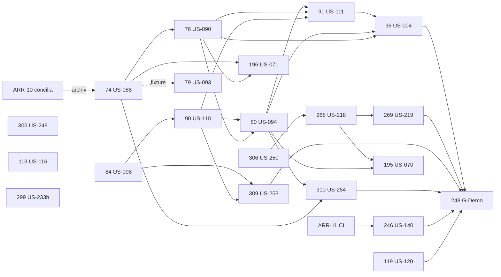

# S5 · Plan de ejecución

> `/sprint-start S5`, sesión principal, 2026-11-03, rama `sprint/S5-planning` desde `main` (con #288 mergeado). Refinamiento: [`S5-refinamiento.md`](S5-refinamiento.md). Diseño: [`docs/ux/S5/pantallas-s5.md`](../../docs/ux/S5/pantallas-s5.md).
> **Plazo:** 3 días con la Demo 5 dentro. **Compromiso: 90 pts** (meta ≥ 80 % = 72 pts cerrados) `[S5 resp. 3]` `[S5 resp. 7]` `[S5 resp. 14]`.
> `openspec validate --changes --strict`: **33/33** (21 changes nuevos del S5 + `l1d-299` arrastrado + 11 activos de sprints anteriores que concilia ARR-10).

## 1. Historias, changes y oleadas

| L1D | US | change | contexto | oleada | depende de (⛔) | lote SOLID | pts |
|---|---|---|---|---|---|---|---|
| — | ARR-11 | `arr-11-ci-rapida` (incluye D-11 y D5-02) | plataforma (CI) | **O1 (primero)** | — | — | 5 |
| — | ARR-10 | sin change: concilia y archiva l1d-202, 72, 194 (completos) y cierra con ID destino 205, 285, 116, 126, us-231b, 197, 166, 173 | docs | O1 | — (archivar `l1d-72` antes del archivo de `l1d-74`) | — | 2 |
| L1D-306 | US-250 | `l1d-306-pregunta-nfc` | contratos · clinical-platform · ai-services · frontend | O1 | — | — | 2 |
| L1D-84 | US-098 | `l1d-84-normalizacion-final-manual` | clinical-platform | O1 | — | R1 | 3 |
| L1D-74 | US-088 | `l1d-74-vista-caso-timeline` | contratos · clinical-platform | O1 | (archivo: l1d-72 vía ARR-10) | R2 | 5 |
| L1D-305 | US-249 | `l1d-305-rn23-voz-propia-nivel-b` | ai-services · catálogo · evaluación | O1 | — | R5 | 3 |
| L1D-119 | US-120 | `l1d-119-corpus-ampliado-calibracion` | ai-services · evaluación | O1 (curaduría e ingesta; barridos en la corrida nocturna) | ↪ l1d-116 (tarea 1.10, ARR-10) | — | 5 |
| L1D-268 | US-218 | `l1d-268-seguimiento-analisis` | contratos · clinical-platform · ai-services | O2 | l1d-306 | R3 | 5 |
| L1D-90 | US-110 | `l1d-90-registro-manual-biomarcador-diagnostico` | clinical-platform · catálogo | O2 | l1d-84 | R1 | 5 |
| L1D-76 | US-090 | `l1d-76-vista-caso-pagina` | clinical-platform (BFF) · frontend | O2 | l1d-74 | R2 | 5 |
| L1D-113 | US-116 | `l1d-113-faltantes-desconocido-prompt` | ai-services · evaluación | O2 | — | R5 | 3 |
| L1D-80 | US-094 | `l1d-80-tratamientos-atributos-manuales` | contratos · clinical-platform · frontend · catálogo | O3 | l1d-74, l1d-76, l1d-84, l1d-90 | R1 | 5 |
| L1D-309 | US-253 | `l1d-309-correccion-con-historico` | contratos · migración · clinical-platform · frontend | O3 | l1d-84, l1d-90 | R4 | 5 |
| L1D-269 | US-219 | `l1d-269-hilo-seguimiento-ui` | clinical-platform (BFF) · frontend | O3 | l1d-268 | R3 | 3 |
| L1D-79 | US-093 | `l1d-79-contexto-trayectoria-caso` | clinical-platform | O3 | (fixture de l1d-74) | — | 3 |
| L1D-299 | US-233b (arrastre) | `l1d-299-poblacion-dorado-suite` (activo) | ai-services · evaluación | O3 | — | — | 3 |
| L1D-91 | US-111 | `l1d-91-formularios-registro-manual` | contratos · clinical-platform (BFF) · frontend | O4 | l1d-76, l1d-80, l1d-90 | R4 | 3 |
| L1D-310 | US-254 | `l1d-310-pacientes-momentos-enfermedad` | clinical-platform (seed) · contratos (ejemplos) | O4 | l1d-80, l1d-74 | — | 5 |
| L1D-195 | US-070 | `l1d-195-analisis-sin-escrituras` | clinical-platform · frontend | O4 | l1d-268, l1d-80, l1d-90 (l1d-309 para su paso) | — | 2 |
| L1D-196 | US-071 | `l1d-196-avisos-no-bloquean` | clinical-platform · frontend | O4 | l1d-74, l1d-76 | — | 3 |
| L1D-246 | US-140 | `l1d-246-suite-hasta-3-opciones` | ai-services · evaluación | O4 | ↪ arr-11 (eval-required) | — | 5 |
| L1D-96 | US-004 | `l1d-96-datos-criticos-vista-caso` | frontend · contratos (ejemplo) | O5 | l1d-76, l1d-80, l1d-91 | R2 | 3 |
| L1D-248 | US-142 | `l1d-248-g-demo-verificacion` | todos | O6 (cierre) | l1d-74, 76, 90, 91, 96, 119, 246, 268, 269, 309, 310 | — | 5 |
| L1D-92 | DEC-01 | sin change (firma del oncólogo; escenario `propuesta_revisada` vigente) | humano | — | — | — | 1 |
| L1D-125 | DEC-11 | sin change (firma) | humano | — | — | — | 1 |
| | | | | | | **Total** | **90** |

**Corrida nocturna de `evaluate` con modelos locales (fin del día 2):** US-120 AC-5/AC-6 (barridos de `NLI_ENTAILMENT_THRESHOLD`, `RETRIEVAL_TOP_K` y `RELEVANCE_THRESHOLD`, baseline por tipo), US-249 AC-4 (juez A+B), US-140 (medición real), US-116, D4-21 (US-133 AC-1) y D4-30 (US-238 AC-9). La lanza `ai-eval-runner` desde `main` tras el merge de O3/O4; sus reportes van a `reports/eval/`.

**Ritmo previsto:** día 1 (2026-11-03) O1–O2 · día 2 O3–O4 + corrida nocturna · día 3 O5–O6, G-Demo y Demo 5.

### Cadena de versiones de contrato (orden de merge) `[S5 resp. 10]`

- **clinical-api** 1.15.0 → l1d-306 **1.15.1** → l1d-268 **1.16.0** → l1d-74 **1.17.0** → l1d-80 **1.18.0** → l1d-309 **1.19.0** → l1d-91 **1.20.0**. Sin cambio de `openapi.yaml`: l1d-269, 76, 96, 90, 84, 79, 310, 195, 196.
- **rag-orchestrator** 1.10.0 → l1d-306 **1.10.1** → l1d-268 **1.11.0**.
- **Catálogo** 1.2.0 → l1d-90 manifest **1.3.0** (LOINC mínimo) → l1d-80 manifest **1.4.0** (ATC, `atributos.json` 1.2.0, `sensible_castracion`). Misma versión en ambos backends (409 si difiere).
- Si dos changes paralelos reclaman versión, **quien rebasa renumera y regenera** `packages/api-contracts`; nunca se fusionan generados a mano. `contracts/examples/index.json`: conflictos solo de orden.

## 2. Grafo de dependencias



## 3. Lotes de revisión SOLID/CUPID (`gate-review lote`, en el Gate 2 del último del lote)

| Lote | Changes | Último (dispara el lote) |
|---|---|---|
| R1 | l1d-84 → l1d-90 → l1d-80 (normalización y registro manual) | l1d-80 |
| R2 | l1d-74 → l1d-76 → l1d-96 (vista de caso) | l1d-96 |
| R3 | l1d-268 → l1d-269 (seguimiento) | l1d-269 |
| R4 | l1d-309 → l1d-91 (correcciones y formularios; comparten `Dialog` y `lib/server/registro-manual.ts`) | l1d-91 |
| R5 | l1d-305 → l1d-113 (filtro RN-23 y prompt de rag-orchestrator) | l1d-113 |

## 4. Agrupación de PR (D-12, `[S5 resp. 7]`)

- **PR individual** (cambian `openapi.yaml`, esquema o privacidad): 306, 268, 74, 80, 309, 91, ARR-11.
- **PR de lote** (≤ 5 pts, mismo contexto, sin contrato ni migración ni RN de privacidad; requiere ARR-11 mergeado por la regla de `higiene-proceso`): **L-a** l1d-79 + l1d-195 (clinical-platform, 5 pts).
- **Un PR `docs` por oleada** con conciliaciones de `tasks.md`, deuda, status y los bloques humanos `H-n`.
- **Nunca PR apilados**; si ocurre, retargetear el hijo antes de mergear el padre.

## 5. Gate 1 · consolidado

```
## Gate 1 · 21 changes del S5 · 2026-11-03
Veredicto global: PASS (vuelta 2, acotada). Vuelta 1: FAIL → correcciones con /opsx:update → vuelta 2
| Guardián                  | V1   | Bloq. | Mayores | Menores | Preguntas | V2 |
| privacy-guardian          | FAIL | 0     | 1       | 4       | 3         | resuelto por DEC-22 (decisión humana) |
| contract-keeper           | FAIL | 0     | 7       | 5       | 2         | PASS (7 Mayores resueltos; 2 Menores) |
| clinical-language-auditor | PASS | 0     | 7 (cond.)| 6      | 7         | PASS (decisiones 11 y 12 aplicadas; 1 Menor) |
```

**Cambios hechos tras la vuelta 1** (decisiones `[S5 resp. 8]`…`[S5 resp. 14]`, registro en `S5-refinamiento.md` §4):
- **Privacidad:** `403` por opt-out diferido al S6 → [DEC-22](../../docs/decisions/DEC-22-opt-out-403-diferido-s6.md); `trace_id` del turno persistido (se corrige US-218 AC-8); `description` del timeline sin enmascarar con `Cache-Control: no-store`; notas fuera de la IA; detector de ARR-11 con `--no-renames` y falla cerrado; test de `consumidos_por_codigo`.
- **Contratos:** cadena de versiones (§1); `maxFollowUps` en l1d-268; H-2 (E-18/E-19, solo fila de ADR-26: oasdiff da solo WARN); `field` opcional string sin enum; ATC reales `L02AE02`/`L02BB03`; manifest del catálogo 1.3.0/1.4.0; ejemplo de `/case` creado y verificado por el proveedor (l1d-74); YAML de l1d-309 completo y migración en commit propio; quitado el falso conflicto l1d-113 ↔ l1d-79.
- **Lenguaje:** «Generado por IA · Sin verificar», «Documento», «Carga inicial», «Ir a ‹etiqueta› en el caso clínico», fechas relativas, cita textual solo atribuida (+ escenario de rechazo), nota de citas con dato del paciente, l1d-196 con D1 y diálogos reales, «sin dato registrado (desconocido)», escenario de pregunta comparativa legítima, Base del análisis en G-Demo.
- **Catálogo:** subconjunto mínimo LOINC (l1d-90) y ATC (l1d-80) con avisos de DEC-04 `[S5 resp. 9]`.

**Menores abiertos (no bloquean; los ve el Gate 2):** (1) l1d-309: copiar en el diff la descripción literal de `field` o test que compare las cuatro descripciones; (2) l1d-268 H-2: aclarar que la fila E-18/E-19 de ADR-26 es declarativa (oasdiff da solo WARN y no hay entrada en el JSON de excepciones); (3) l1d-305: la suite verifica que la atribución usa el título del catálogo (RN-25) en todos los `CAMPOS_GENERADOS`.

## 6. Tareas humanas `H-n` del sprint

| ID | Qué | Change | Cuándo |
|---|---|---|---|
| H-1 | Bloques de `.env.example` (`ANALYSIS_FOLLOWUP_MAX`, valores por defecto de US-120) en un PR `chore` al inicio de su oleada | l1d-268, l1d-119 | O1–O2 |
| H-2 | Fila E-18/E-19 en la tabla de ADR-26, subida a la rama justo tras `contract(L1D-268)` | l1d-268 | O2 |
| H-3 | Añadir al orquestador la regla de re-ejecutar `contracts` contra `main` antes del merge (ARR-11) | arr-11 | O1 |
| H-4 | Firma del PO del registro de G-Demo | l1d-248 | O6 |
| H-5 | Quitar el hito «Sprint 5» a L1D-78 y L1D-143 (Post-MVP) en Linear | — | cuando puedas |
| H-6 | Firmas de DEC-01 y DEC-11 (oncólogo) | L1D-92, L1D-125 | no bloquean |

## 7. Preguntas abiertas con dueño

- Ninguna bloqueante. Los supuestos de los changes quedaron decididos `[S5 resp. 13]`.

## 8. Aprobación

**Aprobado por el usuario el 2026-11-03** `[S5 resp. 15]`: (a) orden por oleadas O1…O6 de §1; (b) **máximo 4 historias en paralelo**, nunca dos sobre el mismo módulo (una por contexto + una de evaluación o CI); (c) las preguntas del Gate 1 quedaron respondidas en `[S5 resp. 8]`…`[S5 resp. 14]`; (d) sin historias `si-hay-capacidad`: todo el alcance está comprometido; (e) **merge por oleada**, en el orden de la cadena de versiones (§1).
