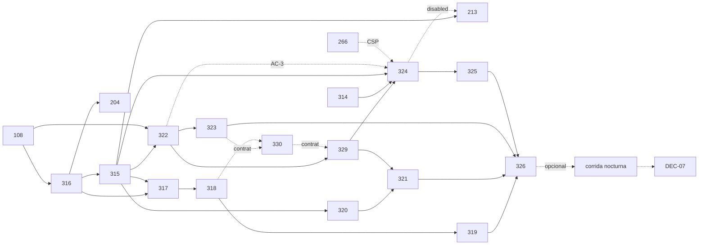

# S6 · Plan de ejecución

> `/sprint-start S6`, sesión principal, 2026-11-06, rama `sprint/S6-planning` desde `main` 40e669a4 (#352 mergeado). Refinamiento: [`S6-refinamiento.md`](S6-refinamiento.md). Vocabulario del contrato del chat: [`S6-glosario-chat.md`](S6-glosario-chat.md). Diseño: [`docs/ux/S6/pantallas-s6.md`](../../docs/ux/S6/pantallas-s6.md) (variante B).
> **Plazo:** **3 días con la Demo 6 dentro** y con el **50 % restante del presupuesto semanal de tokens** `[S6 resp. 22]`. **Compromiso: 85 pts de desarrollo** (70 + 9 de las altas del 2026-11-06: US-271 +4, US-272 +2, L1D-324 5 → 8; + 6 de US-273, US-274 y US-275, `[S6 resp. 24]`; meta ≥ 80 % = 68 pts cerrados); DEC-07 (1 pt) y la corrida nocturna pasan a **opcionales al final**.
> **Changes:** 20 nuevos (18 + `segundo-loop-contextual` y `relative-end-day`, 2026-11-06) más los 7 `movido-S6` (L1D-113, 116, 119, 126, 205, 246 y 299), que se cierran con la corrida nocturna `[S6 resp. 12]`. Los 12 changes heredados se archivan en el PR #353 (conciliación), con su deuda en [`S6-deuda.md`](S6-deuda.md).
> **Sin change:** US-256 · ADR-51 (L1D-313; AC-1…AC-3 ya cumplidos, AC-4 se cierra con L1D-314), DEC-07 (L1D-234, opcional: solo si se ejecuta la corrida nocturna) y las firmas DEC-01 (L1D-92) y DEC-11 (L1D-125).

## 1. Historias, changes y oleadas

| L1D | US | change | contexto | oleada | depende de (⛔/↪) | lote | pts |
|---|---|---|---|---|---|---|---|
| L1D-108 | US-057 | `l1d-108-prompt-instrucciones-datos` | ai-services (prompts) | **O1** | — | — | 3 |
| L1D-266 | US-216 | `l1d-266-cabeceras-seguridad-web` | frontend · CI | O1 | — | — | 3 |
| L1D-327 | US-270 | `l1d-327-log-corte-reranker` | ai-services (recuperación) | O1 | — | — | 1 |
| L1D-314 | US-257 | `l1d-314-spike-assistant-ui` (spike; **no se mergea**) | frontend (rama desechable) | O1 | ↪ ejemplos de 316 (usa copia local si aún no están), CSP de 266 | — | 3 |
| L1D-316 | US-259 | `l1d-316-chat-turn-langgraph` | contratos (rag 1.12.0) · ai-services | **O2** | ⛔ 108 | R1 | 5 |
| L1D-315 | US-258 | `l1d-315-conversacion-paciente` | contratos (clinical 1.24.0) · migración · clinical-platform · BFF · seed `P-CHAT` | **O3** | ⛔ 316 (contrato) | R4 | 5 |
| L1D-204 | US-050 | `l1d-204-llm-local-sin-nube` | ai-services · clinical-platform | O3 | ⛔ 316 · ↪ 315 (tareas del chat) | — | 3 |
| L1D-317 | US-260 | `l1d-317-chat-caso-situacion` | ai-services · clinical-platform | O3 | ⛔ 316 · ↪ 315 (seed) | R1 | 5 |
| L1D-320 | US-263 | `l1d-320-faltantes-tipo-vacio` | contratos (clinical 1.25.0) · catálogo 1.6.0 · clinical-platform · ai-services | **O4** | ⛔ 315, 316 | R5 | 5 |
| L1D-322 | US-265 | `l1d-322-chat-evidencia-seguimiento` | contratos (rag 1.13.0, clinical 1.29.0) · ai-services · clinical-platform | O4 | ⛔ 315, 316, 108 | R2 | 5 |
| L1D-213 | US-148 | `l1d-213-opt-out-generacion-ia` (9 AC, excepción) | contratos (clinical 1.27.0) · clinical-platform · frontend | O4 | ⛔ 315 · ↪ 324 (prop `disabled`; su parte de UI va tras 324) | R4 | 5 |
| L1D-318 | US-261 | `l1d-318-chat-examen-tratamiento-periodo` | ai-services | O4 | ⛔ 317 | R1 | 3 |
| L1D-329 | US-271 | `l1d-329-segundo-loop-contextual` | ai-services · catálogo (`lenguaje/marcos-de-pregunta.json`) · evaluate | **O5, antes de L1D-321** | ↪ 322 (mergeado), 108, 316 · ADR-52 | R2 | 4 |
| L1D-330 | US-272 | `l1d-330-relative-end-day` | contratos (rag y clinical, aditivo) · clinical-platform · ai-services | O5 | ↪ 318 (en integración) | R1 | 2 |
| L1D-321 | US-264 | `l1d-321-chat-relevancia-faltante` | ai-services · evaluate | **O5** | ⛔ 320 · ↪ 108, 316 | R5 | 3 |
| L1D-323 | US-266 | `l1d-323-chat-fuentes-limitaciones` | ai-services · clinical-platform | O5 | ⛔ 322 | R2 | 3 |
| L1D-324 | US-267 | `l1d-324-panel-conversacional` (11 AC; +3 por las preguntas guiadas) | frontend · docs (tokens) | O5 | ⛔ 314 (ADR-51 §8), 315, **329 (fixture compartido)** · ↪ 322 (AC-3), 266 | R3 | 8 |
| L1D-319 | US-262 | `l1d-319-chat-contradicciones` | clinical-platform · ai-services | O5 | ⛔ 317 · secuencial tras 318 (mismo nodo `caso`) | R1 | 3 |
| L1D-331 | US-273 | `l1d-331-composicion-terminos-prostata` | ai-services · catálogo (`lenguaje/marcos-de-pregunta.json`) · evaluate | **O5** (tras 329, mergeado) | ↪ 329 (mergeado) · ADR-52 | R2 | 2 |
| l1d-<B> (pendiente de Linear) | US-274 | `l1d-<B>-aviso-ampliacion-visible` | frontend (`apps/web`) · E2E sobre el fake | O5, en paralelo con 331 | ↪ 324, 329 (mergeados) · ADR-52 | R3 | 2 |
| l1d-<C> (pendiente de Linear) | US-275 | `l1d-<C>-defaults-expansion-max-pairs` (PR separado) | ai-services (config) · humano (`.env.example`, Compose, reporte H-3) | **O8**, tras 331 y `<B>` | ↪ US-273, US-274 · ⛔ ninguna dura; `L1D-326` la espera solo por orden | — | 2 |
| L1D-325 | US-268 | `l1d-325-chat-fuentes-sin-perder-contexto` | frontend | **O6** | ⛔ 324 | R3 | 3 |
| L1D-326 | US-269 | `l1d-326-chat-e2e-evaluate` | evaluación · E2E | **O7** | ⛔ 315…325 | — | 5 |
| L1D-234 | DEC-07 | sin change | decisión | **opcional, al final** | corrida N | — | (1) |
| L1D-113, 116, 119, 126, 205, 246, 299 | — | changes `movido-S6` | evaluación | **N, opcional, al final** (tras O7, si quedan tokens y tiempo) | `main` con O7 | — | 0 |
| | | | | | | **Total comprometido** | **85** |

**Paralelismo:** como máximo 4 a la vez, y nunca dos sobre el mismo módulo.
- En O3, 315 (módulo `conversation`) y 204 (gateway y selector de proveedor) tocan `clinical-api`, pero en módulos distintos. 317 trabaja en rag (nodo `caso`).
- En O4, 320 (`completeness`), 322 (`conversation` y `evidence-analysis`) y 213 (guard de opt-out) también son módulos distintos.
- 318 y 319 tocan el mismo nodo, por eso 318 va en O4 y 319 en O5.
- **Orden en O5 (Gate 1 de 329/330/324):** **330 → 319** (mismo `hechos-del-caso.ts` y `traduccion.py`) y, por contratos, **323 → 330 → 329** (rag 1.14.0 → 1.15.0 → 1.16.0, «siguiente menor libre»; el segundo rebasa y regenera `packages/api-contracts/`). **329 antes de 324**: crea el fixture compartido caso → tema y el catálogo 1.7.0 (324 toma 1.8.0).

**Altas del 2026-11-07 (`[S6 resp. 24]`), orden A, B, C** (US-273 = L1D-331, US-274, US-275). Sin corridas reales durante el desarrollo (el `evaluate` con adapters o fake en CI sí). **Una sola corrida real final combinada** (L1D-326 chat-local + US-273 + US-275, p95 en máquina limpia, reporte H-3) solo si alcanza el presupuesto, sin Docker en paralelo. US-275 va como **PR separado**: su merge (defaults de `RERANKER_MAX_PAIRS` y activación del indicador) se pide solo tras la corrida final; sin corrida, se cierra sin merge y queda como deuda con la decisión en D6-44. L1D-326 espera a US-275 solo por orden. Regla de parada de US-275: si el p95 de consulta completa con `RERANKER_MAX_PAIRS=20` supera 15 s, se detiene y pregunta. **Recorte si falta presupuesto:** corrida final, US-275, US-274, US-273 (en ese orden).

**Corrida nocturna N: opcional, al final** `[S6 resp. 22]`. Corre en la máquina de referencia con modelos locales y reúne D5-08, D5-24, D5-26, D5-28, D4-21, D4-30 y las tareas 1.0, 1.11, 1.12 y 4.2 de us-231b (D6). Se lanza desde `main` **solo después de O7** y solo si quedan presupuesto de tokens y tiempo antes de la demo.
- No bloquea ningún change del sprint: todos los tests del chat usan el LLM falso.
- **Si no se ejecuta:**
  - las 7 historias `movido-S6` siguen *In Review* y pasan al cierre del S6 como deuda;
  - DEC-07 no se decide;
  - el chat se demuestra con el corpus actual (10 documentos) y los umbrales vigentes;
  - el `evaluate` con LLM real de L1D-326 se limita a lo que quepa en la demo.
- Mientras corre, la máquina queda ocupada: nada de Compose ni `visual-check` en paralelo (riesgo de swap, D5-59).

**Ritmo previsto (3 días, demo el día 3):**
- Día 1: O1, O2 y O3.
- Día 2: O4 y O5.
- Día 3: O6, O7 y la demo. Después, si sobra, la corrida N y DEC-07.

**Presupuesto de tokens** `[S6 resp. 22]`: la prioridad es terminar el desarrollo con el 50 % restante. El orquestador:
- aplica el Gate 2 acotado (una vuelta, como máximo dos);
- no relanza guardianes que dieron PASS;
- agrupa la revisión SOLID por lotes.

Si el presupuesto se agota antes de O7, se pide al usuario el recorte en lugar de seguir.

## 2. Grafo

## 3. Lotes de revisión SOLID/CUPID

| Lote | Changes | Se dispara con |
|---|---|---|
| R1 | 316, 317, 318, 319 (grafo y nodo `caso`) | 319 |
| R2 | 322, 323 (nodo `evidencia`) | 323 |
| R3 | 324, 325 (panel) | 325 |
| R4 | 315, 213 (conversación y guard en clinical-api) | 213 |
| R5 | 320, 321 (faltantes) | 321 |

## 4. Gate 1 (en lote, 2026-11-06)

| Guardián | Vuelta 1 | Vuelta 2 | Después de la vuelta 2 |
|---|---|---|---|
| `privacy-guardian` | FAIL: 8 Mayores, 4 Menores | **PASS** (N1 Menor, N2 Pregunta) | — |
| `clinical-language-auditor` | FAIL: 5 Mayores, 5 Menores | **PASS** (2 Menores, 1 Pregunta) | Menores aplicados en 318 |
| `contract-keeper` | FAIL: 2 Bloqueantes, 9 Mayores, 4 Menores | FAIL: 2 Mayores (ejemplos por caso; dueño del `409`), 5 Menores | Corregidos por la sesión principal tras la vuelta 2 (límite de 2 vueltas) y verificados con `openspec validate --strict` |

**Corrección de la vuelta 1:** el vocabulario único del contrato del chat, con dueños, versiones, errores y reglas transversales, quedó en [`S6-glosario-chat.md`](S6-glosario-chat.md). Los 16 changes afectados se alinearon con él.

Lo principal:
- **Dueños y versiones:** 316 es el único dueño de `/chat/turn` (rag 1.12.0, con `dataClassification` de 204 plegado) y 315 de la conversación (clinical 1.24.0).
- **Rehidratación:** acepta solo una lista blanca de campos, sin UUID ni fechas.
- **Estado del chat:** `ultimaEvidencia` no lleva `analysisId`.
- **Prompts:** usan `PromptBuilder.memoria()`, que aporta 108.
- **Markdown:** se renderiza con `rehype-sanitize`.
- **Enlaces al histórico:** se quita `historyPath`.
- **Interpretaciones de la IA:** llevan su propio rótulo.
- **Faltantes:** se fija la prioridad `por_conciliar` > `incompleto`.
- **L1D-321:** su AC-1 usa un criterio real del catálogo (`estado_menopausico`).

**Notas para el Gate 2:**
- (N1) Añadir campos a la rehidratación obliga a subir la versión de 316.
- (N2) Un test de captura de MSW en 322 debe comprobar que `activeAnalysisId` no llega al prompt ni al log de Backend 2.
- (CLA-3) Un escenario en 316 debe comprobar que el texto de `fuera_de_alcance` no repite parte de la pregunta.

## 5. Preguntas del Gate 1 (respondidas en §6)

1. **L1D-266 P-1:** ¿se acepta `style-src-attr 'unsafe-inline'`? No afecta a `script-src`. Recomendado: aceptarlo y documentarlo en el design, sin ADR.
2. ¿Se acepta que los textos persistidos y rehidratados lleven días relativos («día 45»)? Es coherente con RN-11. Recomendado: sí.
3. **L1D-324 P-1:** el chat sustituye al formulario de una pregunta en `/analisis` y se retiran 13 requisitos de ese formulario. Recomendado: sí.
4. ¿Se aprueba el orden de versiones del glosario §1?
5. ¿Se aprueban el orden de las oleadas, un máximo de 4 en paralelo y el merge por oleada?

## 6. Aprobación

**Aprobado por el usuario (PO), 2026-11-06,** en la sesión principal de `/sprint-start S6`:

- `[S6 resp. 18]` Orden por oleadas O1…O7 (la corrida nocturna se movió al final, ver resp. 22). **Como máximo 4 en paralelo**, nunca dos en el mismo módulo. **Merge por oleada.**
- `[S6 resp. 19]` Se aceptan `style-src-attr 'unsafe-inline'` en L1D-266 (sin tocar `script-src`, documentado en su design, sin ADR) y los días relativos en los textos persistidos y rehidratados.
- `[S6 resp. 20]` El chat **sustituye** al formulario de una pregunta en `/analisis`. L1D-324 retira sus 13 requisitos; los de errores y presentación del resultado siguen vigentes.
- `[S6 resp. 21]` Orden de versiones del glosario §1. Si dos chocan, se renumera el segundo en mergear.
- `[S6 resp. 23]` (usuario, 2026-11-06): altas dentro del S6: **US-271** (L1D-329, 4 pts, segundo loop contextual, ADR-52, O5 antes de L1D-321), **US-272** (L1D-330, 2 pts, `relativeEndDay`) y L1D-324 de 5 a 8 (preguntas guiadas). Compromiso de 70 a 79 pts. El ancla de «últimos N días» en el día 0 se revisa en la Demo 6.
- `[S6 resp. 24]` (usuario, 2026-11-07): altas de **US-273** (2 pts, composición de términos en próstata), **US-274** (2 pts, aviso de ampliación y AC-10 visibles en el chat) y **US-275** (2 pts, `RERANKER_MAX_PAIRS` 12 → 20 y expansión por defecto; D6-44). Cierran H-2 de L1D-329 (D6-42, D6-43). Compromiso 79 → 85 pts; meta ≥ 80 % = 68 pts. Notas de ejecución en §1.
- `[S6 resp. 22]` (usuario, 2026-11-06): queda el 50 % del límite semanal de tokens y la próxima demo es en 3 días. La prioridad es terminar el desarrollo. **La corrida nocturna pasa al final, opcional**, solo si quedan tokens y tiempo. El compromiso queda en 70 pts y DEC-07 pasa a opcional.

Precondición de `/sprint-run S6`: este PR (planificación) y el #353 (conciliación) mergeados en `main`.
