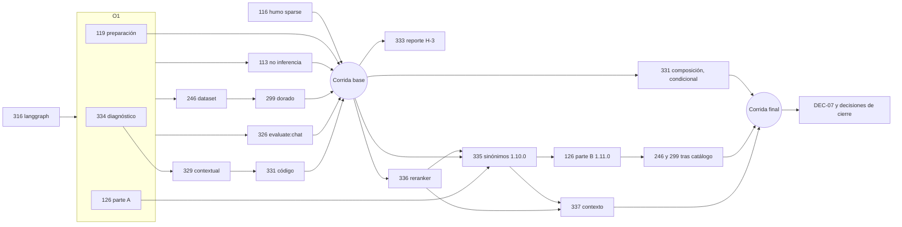

# S7 · Plan de ejecución

> `/sprint-start S7`, sesión principal, 2026-11-22, rama `sprint/S7-planning` desde `main` 502978a9 (#419 mergeado). Refinamiento: [`S7-refinamiento.md`](S7-refinamiento.md). Revisión clínica provisional: [`S7-revision-clinica.md`](S7-revision-clinica.md). Deuda: [`S7-deuda.md`](S7-deuda.md).
> **Objetivo:** solo calidad del RAG. **Plazo:** sin recorte; si no cabe en 1 o 2 días, el sprint se alarga `[S7 resp. 4]`. Meta de cierre: ≥ 80 % de las historias.
> **Compromiso:** 17 historias; ≈ 40 pts de trabajo real (17 nuevos y ≈ 23 de trabajo restante del arrastre, estimación de este plan; el nominal del arrastre es 42).
> **Changes:** 15. Nueve nuevos (4 historias nuevas y 5 residuales de changes ya archivados) y seis `movido-S7` que siguen activos (L1D-113, 116, 119, 126, 246 y 299).
> **Sin change:** DEC-07 (L1D-234; se decide con el reporte de la corrida final) y DEC-11 (L1D-125; sigue sin firma de oncólogo y no pasa a Done).
> **Aparcado:** `l1d-205-adr40-deteccion-pii` sigue activo, pero su historia pasó a Post-MVP el 2026-11-21. No entra al sprint `[S7 resp. 16]`.

## 1. Historias, changes y oleadas

Dos corridas reales con modelos locales `[S7 resp. 2]`: la **corrida base (B)** y la **corrida final (F)**. Las lanza el humano con `run-ai-eval`; ninguna cifra vale sin reporte versionado en `reports/eval/`.

| L1D | US | change | contexto | oleada | depende de (⛔/↪) | lote | pts |
|---|---|---|---|---|---|---|---|
| L1D-316 | US-259 (residual) | `l1d-316-langgraph-upgrade` (sin deltas) | ai-services (dependencia) | **O0, hora 0** | — | — | 1 |
| L1D-334 | US-276 | `l1d-334-diagnostico-etapas-recuperacion` | ai-services (evaluación) · dataset `parafrasis-v1` | **O1** | — | R1 | 2 |
| L1D-126 | US-121 (parte A) | `l1d-126-criterios-aplicabilidad-catalogo` S7.1–S7.4c | clinical-platform · catálogo (sin cambio de versión) | O1 | — | R3 | 1 |
| L1D-119 | US-120 (preparación) | `l1d-119-corpus-ampliado-calibracion` S7.1–S7.6 | ai-services (licencias, configuración) | O1 | — | — | 1 |
| L1D-329 | US-271 (residual) | `l1d-329-segundo-loop-ac9-reporte` | ai-services (evaluación, familia `contextual`) | **O2** | ↪ 334 (mismos archivos de la suite) | R1 | 2 |
| L1D-326 | US-269 (residual) | `l1d-326-evaluate-chat-local` | clinical-platform (CLI de preparación) · ai-services (evaluación) | O2 | — | — | 3 |
| L1D-246 | US-140 (antes de B) | `l1d-246-suite-hasta-3-opciones` S7.1–S7.7, S7.9 | ai-services (evaluación) · dataset `opciones` | O2 | — | — | 1 |
| L1D-331 | US-273 (residual, código) | `l1d-331-cobertura-prostata-segundo-loop` 1.1–1.5, 1.7 | ai-services (evaluación) | **O3** | ⛔ 329 (familia `contextual`) | R1 | 1 |
| L1D-299 | US-233b (antes de B) | `l1d-299-poblacion-dorado-suite` S7.1–S7.3, S7.5–S7.8, S7.11, S7.12 | ai-services (evaluación) · dataset dorado | O3 | ↪ 246 (regla de la marca provisional) | — | 2 |
| L1D-113 | US-116 (antes de B) | `l1d-113-faltantes-desconocido-prompt` S7.1–S7.4 | ai-services (evaluación) | O3 | — | — | 1 |
| L1D-116 | US-117a | `l1d-116-ingesta-reanudable-licencia` S7.1 | ai-services (humo con pesos reales, en la máquina) | antes de B | — | — | 1 |
| — | — | **Corrida base (B)** | humano + `ai-eval-runner` | **B** | O0…O3 en `main` | — | — |
| L1D-119 | US-120 (medición) | S7.7–S7.12: ingesta real, barridos y línea base | ai-services | B | — | — | 2 |
| L1D-333 | US-275 (residual) | `l1d-333-reporte-h3` (sin deltas; solo reporte) | evaluación | B | ↪ 329 | — | 1 |
| L1D-336 | US-278 | `l1d-336-reranker-ventanas-chunk` | ai-services (reranker, suite, fuente `indice`) | **O4** | ↪ 334 (pares), 119 (ingesta) | R2 | 5 |
| L1D-335 | US-277 | `l1d-335-sinonimos-procedimientos-relacion` (catálogo → **1.10.0**) | catálogo · ai-services · clinical-platform | O4 | ↪ 126 parte A; su tarea 4.2 espera el merge de 336 | R2 | 5 |
| L1D-337 | US-279 | `l1d-337-contexto-documento-chunk` | ai-services (ingesta, índice por variante, suite) | **O5** | ↪ 336 (fuente `indice`), 116, 119 | R2 | 5 |
| L1D-126 | US-121 (parte B) | S7.5–S7.14: C-1, C-2, C-4 y C-5 (catálogo → **1.11.0**) | catálogo · ai-services · clinical-platform | O5 | ⛔ 335 (versión del catálogo) | R3 | 2 |
| L1D-246 | US-140 (tras el catálogo) | S7.8 | dataset `opciones` | **O6** | ⛔ 126 parte B | R3 | 1 |
| L1D-299 | US-233b (tras el catálogo) | S7.9, S7.10, S7.10b | dataset dorado | O6 | ⛔ 126 parte B | R3 | 1 |
| L1D-331 | US-273 (composición, condicional) | tarea 1.6, solo si la base lo pide | ai-services · catálogo solo con la opción C | O6 | reporte de B | — | 1 |
| — | — | **Corrida final (F)** | humano + `ai-eval-runner` | **F** | O4…O6 en `main` | — | — |
| L1D-234 | US-017 · DEC-07 | sin change | decisión | cierre | reporte de F | — | 1 |
| L1D-125 | US-021 · DEC-11 | sin change | decisión | no se cierra | firma de oncólogo | — | 0 |

**Paralelismo:** hasta 3 historias a la vez, nunca dos sobre el mismo módulo.

**Órdenes fijos** (salen del Gate 1):
- **Archivos de la suite** (`config_suite.py`, `esquema_suite.py`, `evaluate.py`, `scripts/eval/evaluate.mjs`, `scripts/ci/eval-trigger-paths.yaml`): 334 → 329 → 331 → 336 → 335 → 337. Cada uno rebasa sobre el anterior.
- **Versión del catálogo** (`manifest.json`, ~20 `contracts/examples/*.json`, tests): 126 parte A (sin versión; los tests pasan a leer `manifest.version`) → 335 (1.10.0) → 126 parte B (1.11.0) → 331 solo si se elige su opción C.
- **Marca `revision_provisional`:** una sola definición. En el catálogo, `schemas/comun.schema.json#/$defs/revisionProvisional` (la crea 126 parte A; 335 la referencia). En los datasets, una regla pura en `app/evaluation/` (la crea 246; la usan 299 y 334).

**Qué mide cada corrida:**

| Familia | Corpus `[S7 resp. 10]` | Base | Final |
|---|---|---|---|
| `contextual` (329, 331, 333) | dataset `s5-corpus-ampliado` en memoria | sí | sí |
| `diagnostico` (334) | dataset `s5-corpus-ampliado` en memoria | sí | sí |
| chat (326), faltantes (113), población (299) | ingesta de L1D-119 | sí | sí |
| opciones (246) | corpus propio del dataset, declarado | sí | sí |
| brazos de US-278 y US-279 (336, 337) | ingesta de L1D-119 | — | sí |
| barridos y línea base (119) | dataset `s5-corpus-ampliado` (`s5-calibracion.yaml`) | sí | brazo «umbrales calibrados» |

Base y final corren con los **umbrales actuales**; los calibrados entran en la final como un brazo más y se adoptan, o no, en el cierre `[S7 resp. 11]`.

## 2. Grafo

## 3. Lotes de revisión SOLID/CUPID

| Lote | Changes | Dispara la revisión conjunta |
|---|---|---|
| R1 | 334, 329, 331 (familias nuevas de la suite) | 331 |
| R2 | 336, 335, 337 (recuperación y brazos) | 337 |
| R3 | 126 partes A y B, y lo dependiente de 246 y 299 | el último de O6 |

Sin lote: 316, 326, 113, 116, 119, 333.

## 4. Gate 1 (en lote, 2026-11-22)

`openspec validate --changes --strict`: 16 de 16 válidos (los 15 del sprint y el aparcado).

| Guardián | Vuelta 1 | Vuelta 2 (acotada) |
|---|---|---|
| `privacy-guardian` | FAIL: 0 bloqueantes, 3 mayores, 7 menores | **PASS**: 10 de 10 resueltos, sin contradicciones nuevas |
| `contract-keeper` | FAIL: 1 bloqueante, 4 mayores, 7 menores | **PASS**: todo resuelto, sin dos deltas sobre el mismo requisito |
| `clinical-language-auditor` | FAIL: 1 bloqueante, 5 mayores, 6 menores | FAIL: 10 de 11 resueltos; quedaba 1 mayor y una novedad |

**No verificado por un guardián:** los dos puntos de la vuelta 2 de `clinical-language-auditor` los corrigió la sesión principal después del reporte, sin una tercera vuelta (el máximo son dos):
- `l1d-326`: el escenario «ambos conteos en 0» pasa a comprobarse con adapters falsos; la corrida con modelos locales publica los conteos medidos.
- `l1d-335`: dejan de ser `equivalente` «observación» y *observation* (`mas_amplio`), «tumorectomía», «lumpectomía» y *lumpectomy* (`miembro_de_clase`), «bloqueo androgénico» (`miembro_de_clase`) y «hormonorrefractario» (`mas_amplio`).

**Cambios hechos por el Gate 1:**
- **`l1d-126`** (bloqueante): el bloque `validation` del catálogo ya no atribuye a un oncólogo contenido editado por la IA `[S7 resp. 9]`. Repliegue de C-1 a «Desconocido» (`sin_regla_de_comparacion` o `falta_en_paciente`) cuando M0/M1 no se puede leer. Partición en parte A y parte B.
- **`l1d-113`** (bloqueante): el `422` de `/case/summary` sale del sprint a la deuda D7-01 `[S7 resp. 12]`. Delta nuevo para la métrica de no inferencia.
- **`l1d-335`**: entra `validar-catalogo.ts` de `clinical-api` (sin él, el servicio no arranca con el campo `relacion`); registro de `sinonimos` por tipo de cáncer; relaciones revisadas con la regla S-1; tarea para el brazo de 30 pares; `QUERY_REWRITE_ENABLED` en `eval-trigger-paths.yaml`.
- **`l1d-331`**: su código va antes de la corrida base.
- **`l1d-119`**: umbrales calibrados como brazo de la final `[S7 resp. 11]`; tabla de corpus por familia `[S7 resp. 10]`.
- **`l1d-326`**: `.gitignore` como primera tarea, guarda de base de datos de test, claves semánticas en `hechosPorClave`, umbrales leídos de `Settings`, nombre del reporte.
- **`l1d-336`**: `meta.rerankerModel` no cambia (el modo y el solape van solo en el informe); el reranker recibe siempre el `chunk_text` original.
- **`l1d-337`**: fuente declarada del «inicio del documento» de la variante `llm`.
- **`l1d-246` y `l1d-299`**: misma ventana para los cambios de dataset; supuesto único sobre C-1.
- **Texto:** «Recomendación» pasa a «Propuesta» en `l1d-316`, `l1d-246` y `l1d-119`.

**Hallazgos de la creación de changes que cambian el alcance:**
- `l1d-326`: `chat-local.yaml` no se podía ejecutar; el paso que prepara las peticiones en `clinical-api` nunca se construyó. El residual lo incluye.
- `l1d-329`: `run-ai-eval` no podía producir el reporte del AC-9; el residual añade la familia `contextual`.
- `l1d-336`: un chunk de 1024 tokens necesita unas tres ventanas, no dos. Sube el riesgo de que el modo `maximo` no sea viable frente al tope de 20 s.
- `l1d-316`: `pip-audit` no detecta la alerta #9; la evidencia de cierre es el estado de la alerta en GitHub tras el merge. La ruta vulnerable (`langgraph-sdk`, `RemoteGraph`) no se usa.
- `l1d-119`: las decisiones de licencia H-3 y H-4 ya se habían aplicado el 2026-11-04 con otro texto; se sustituye por el de `[S7 resp. 7]`.

## 5. Respuestas del usuario y preguntas

**Respondidas el 2026-11-22 (Gate 1):**
- **`[S7 resp. 9]`** El bloque `validation` de `aplicabilidad.json` pasa a `status: revision_provisional`, rol `ia`, fecha 2026-11-21. La revisión del asesor del S3 se conserva en `history`, con la huella del contenido que sí cubrió.
- **`[S7 resp. 10]`** Un corpus fijo por familia, el mismo en base y final, registrado en cada reporte (tabla del §1).
- **`[S7 resp. 11]`** Base y final con los umbrales actuales; los calibrados entran en la final como un brazo y se adoptan en el cierre, junto a DEC-07.
- **`[S7 resp. 12]`** El `422 faltante_no_catalogado` de `/case/summary` sale del S7 a deuda Post-MVP (D7-01).

**Respondidas en la aprobación (2026-11-22):**
- **`[S7 resp. 13]`** Plan aprobado: oleadas O0…O6, hasta 3 historias en paralelo, merges **por oleada**.
- **`[S7 resp. 14]`** `l1d-336`: entran la fuente `indice` de la suite (lee una colección de Milvus en solo lectura; la reutiliza `l1d-337`) **y** el brazo de chunks de 512, con su ingesta en colección propia (tarea 2.5b). Añade una ingesta, un índice en disco y tiempo a la corrida final.
- **`[S7 resp. 15]`** NCCN y ESMO: se enmienda `CLAUDE.md` (se admite la mención en referencias de terceros con licencia abierta; nunca un documento suyo como fuente) y el test de datos sobre `source_name` es obligatorio en `l1d-119` (S7.2).
- **`[S7 resp. 16]`** `l1d-205-adr40-deteccion-pii` queda aparcado: activo y fuera del sprint.

**Supuestos que quedan en los changes, válidos salvo objeción:**
1. `l1d-316`: objetivo `langgraph==1.2.14` (la mínima corregida, una línea). Si rompe la suite, el descarte de la alerta #9 lo hace el humano con el texto de `design.md` D3. Commit `fix(deps)`, sin pareja `test`/`feat`.
2. `l1d-334`: los datos por etapa salen de observadores de la suite sobre los puertos, no de campos nuevos en los eventos de log; categoría aparte `sin_asignar` para pérdidas de generación.
3. `l1d-335`: `relacion` vive en cada sinónimo; `revision_provisional` en snake_case; meta `paraphrase_evidence_min_ratio` inicial 0,80; quedan `equivalente`, como dudas para expertos (Q-5), «radioterapia intersticial», *partial mastectomy*, «impotencia» y «ganglio centinela».
4. `l1d-336`: solape inicial de ventanas de 64 tokens; el brazo alternativo usa `RERANKER_MAX_LENGTH` 1024; con el brazo de 512, la corrida final necesita espacio para un índice más (4 con los 3 de US-279).
5. `l1d-337`: el prefijo determinista no incluye la sección (hoy todos los chunks tienen `texto_completo`); la reindexación crea una colección por variante con los mismos `chunk_id`.
6. `l1d-329` y `l1d-331`: casos `mama-completo`, `prostata-con-grado` y `prostata-con-psa-y-hrr` (180 consultas). El test del AC-3 de `l1d-331` puede nacer en verde porque el comportamiento es del S6; se acepta con una mutación local como evidencia.
7. `l1d-333`: se corre también el brazo de 12 pares; el «14,7 s» del AC-2 queda como antecedente sin reporte.
8. `l1d-326`: la medición del chat se repite en la corrida final; el turno AC06 se mide sin la rehidratación de Backend 1, como limitación declarada.
9. `l1d-126`: C-1 con dos códigos (no metastásica y metastásica); C-4 y C-5 no cambian el estado calculado en el MVP; «IHC 2+ sin ISH» no entra en `datos-criticos.json` (espera a DEC-01); G2.4 y G2.6 se implementan.
10. `l1d-299`: fixture nuevo de estados de próstata, no el catálogo real.

**Pendiente en el backlog (no se toca sin tu aprobación):**
- ~~US-121 AC-1 solo nombra `estado_her2` y `estado_castracion` como excluyentes; C-1 añade `extension`.~~ Actualizado el 2026-11-22 `[S7 resp. 18]`.
- US-120 AC-5 y AC-6 dicen que los umbrales «quedan fijados»; con `[S7 resp. 11]` dependen de la adopción en el cierre.
- Requisito archivado de faltantes de US-269 (AC-4, D6-51): sigue en `openspec/specs/` sin implementar; el reporte publica esas métricas como `null`.

## 6. Aprobación

Aprobado por el usuario (hatrickmario) el 2026-11-22, en la sesión principal de `/sprint-start S7`: orden por oleadas, hasta 3 historias en paralelo, merges por oleada y las respuestas `[S7 resp. 9]`…`[S7 resp. 16]` del §5. Los supuestos del §5 quedan aceptados salvo objeción posterior.

**Confirmaciones del 2026-11-22, tras el merge del plan (#420):**
- **`[S7 resp. 17]`** Los diez supuestos del §5 quedan **aceptados** expresamente.
- **`[S7 resp. 18]`** El AC-1 de US-121 se actualiza con `extension` como excluyente (C-1), primero en `backlog/features/FEAT-08b-aplicabilidad.md` y después en Linear (L1D-126). Los AC-5 y AC-6 de US-120 no se tocan.
- **Inicio del sprint:** el usuario lanza `/sprint-run S7` a mano, en una sesión nueva, el 2026-11-22 a las 20:41 (hora de Bogotá).

El humano mergea el PR de este plan antes de `/sprint-run S7`.
