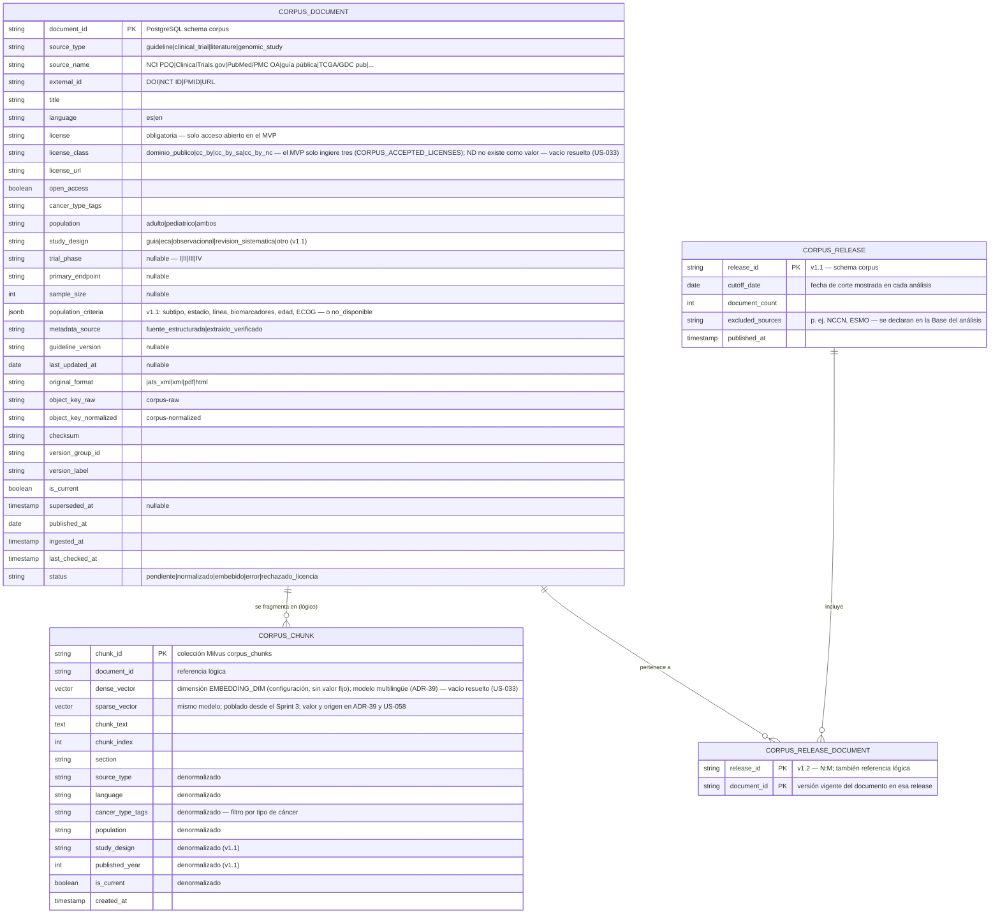

# Modelo de datos de OncoLens

> **Fuente única del modelo de datos** (US-033, L1D-55). Contiene el DDL por schema, la colección de Milvus, el diagrama, la matriz de permisos y el aislamiento del rol `rag_corpus`. El readme §3.1 solo enlaza a este documento. Lo implementan US-038 (Prisma y migración inicial) y US-058 (Alembic y Milvus) **sin decidir nada nuevo**: cualquier cambio de modelo se hace aquí, en su propio change, antes de la migración.
>
> Las decisiones de origen: ADR-6, ADR-17, ADR-21, ADR-24, ADR-32, ADR-33 (readme §3.3), DEC-05 (`docs/decisions/DEC-05-tnm-isup.md`) y las del refinamiento del Pre-S1 (`[Pre-S1 resp. …]`). Cada diferencia respecto del readme v1.3 lleva la marca **vacío resuelto (US-033)** y su origen (sección 10).

## 1. Cómo leer este documento

- **Dos modelos, dos dueños** (regla de ownership, readme §2): el relacional (PostgreSQL y `clinical-minio`) es de Backend 1 `clinical-api`; el del corpus (Milvus, el schema `corpus` de PostgreSQL y el MinIO de Milvus) es de Backend 2 `rag-orchestrator`. No hay FKs reales entre ambos, solo referencias lógicas. El proyecto usa **solo dos motores de base de datos: PostgreSQL y Milvus**.
- **Nomenclatura:** `snake_case` en la base de datos; `camelCase` en la API (los contratos `openapi.yaml`). Los valores de los enums van en español.
- **Columnas:** la columna *Nota* conserva la anotación del diagrama del readme (por ejemplo, "nullable") y los valores de los enums. La nulabilidad no anotada y los `CHECK` los fija la migración de acuerdo con este documento: el tipo y la nota mandan.
- **Tipos:** los del diagrama (`string`, `int`, `float`, `bytes`, `timestamp`) se materializan como `text`, `integer`, `double precision`, `bytea` y `timestamptz`.

| Schema | Tablas | Dueño |
|---|---|---|
| `auth` | `user`, `role`, `permission`, `role_permission`, `session` | Backend 1 |
| `identity` | `patient_identity`, `legal_representative` (cifradas) | Backend 1 |
| `clinical` | `patient`, `care_episode`, `care_team_member`, `patient_opt_out`, `intake_draft`, `diagnosis`, `diagnosis_grading`, `clinical_note`, `exam`, `biomarker`, `document`, `treatment`, `prior_treatment`, `clinical_event`, `clinical_attribute`, `clinical_data_source`, `ai_analysis_record`, `analysis_follow_up`, `analysis_feedback`, `research_subject_map` | Backend 1 |
| `audit` | `audit_log` | Backend 1 |
| `research` | `episode_snapshot` (rol de solo inserción) | Backend 1 |
| `corpus` | `corpus_document`, `corpus_release`, `corpus_release_document` y el estado de ingesta; Prisma lo excluye | Backend 2 (rol `rag_corpus`) |
| Milvus | colección `corpus_chunks` | Backend 2 |

## 2. Diagrama — PostgreSQL clínico (Backend 1)

```mermaid
erDiagram
    USER {
        uuid id PK
        string email UK
        string password_hash "Argon2id"
        string full_name
        uuid role_id FK
        string account_status "pendiente|activo|desactivado|rechazado — vacío resuelto (US-033), reemplaza a is_active"
        int failed_login_count
        timestamp locked_until "nullable"
        timestamp created_at
        timestamp updated_at
    }
    ROLE {
        uuid id PK
        string name UK "doctor, admin"
        string description
    }
    PERMISSION {
        uuid id PK
        string code UK "código concreto de la matriz de permisos, sin comodines — vacío resuelto (US-033)"
        string description
    }
    ROLE_PERMISSION {
        uuid role_id PK "también FK"
        uuid permission_id PK "también FK"
    }
    SESSION {
        uuid id PK
        uuid user_id FK
        string token_hash UK
        timestamp expires_at "absoluto (8 h, configurable)"
        timestamp last_seen_at "inactividad (30 min, configurable)"
        string ip_address
        string user_agent
        boolean revoked
        timestamp created_at
    }
    PATIENT {
        uuid id PK "identificador interno usado por FKs y API"
        string data_origin "sintetico|real_anonimizado|real_identificado"
        string source_dataset
        string agreement_reference "convenio o contrato marco"
        int birth_year
        string sex
        string population "adulto|pediatrico (derivado)"
        string lifecycle_status "activo|egresado (derivado)"
        date retention_start "aceptación del contrato o primera cita"
        date retention_until "inicio + 10 años"
        date retention_max "inicio + 20 años"
        boolean requires_ratification "cumplió la mayoría de edad"
        timestamp created_at
    }
    PATIENT_IDENTITY {
        uuid patient_id PK "también FK — schema identity"
        string id_type "cedula_ciudadania|tarjeta_identidad|cedula_extranjeria|pasaporte|seudonimo|sintetico"
        string issuing_country "nullable"
        bytes national_id_ciphertext "AES-256-GCM"
        string national_id_hmac "índice ciego; UK con id_type+país"
        bytes full_name_ciphertext
        int key_version
    }
    LEGAL_REPRESENTATIVE {
        uuid id PK "schema identity"
        uuid patient_id FK
        string relationship "madre|padre|tutor_legal"
        string id_type
        bytes national_id_ciphertext
        string national_id_hmac
        bytes full_name_ciphertext
        timestamp registered_at "la firma reposa en el sistema externo (v1.2)"
        date valid_from
        date valid_until "nullable"
    }
    CARE_EPISODE {
        uuid id PK
        uuid patient_id FK
        timestamp opened_at
        timestamp closed_at "nullable — un solo episodio abierto"
        string closure_reason "catálogo validado con el oncólogo"
        uuid opened_by FK
        uuid closed_by FK "tratante principal o admin"
    }
    CARE_TEAM_MEMBER {
        uuid id PK
        uuid patient_id FK
        uuid doctor_id FK
        string care_role "oncologo|cirujano|radiooncologo|otro"
        boolean is_primary "uno por paciente"
        boolean is_active
        timestamp assigned_at
        timestamp unassigned_at "nullable"
    }
    PATIENT_OPT_OUT {
        uuid id PK "v1.2 — reemplaza a PATIENT_CONSENT"
        uuid patient_id FK
        string opt_out_type "analisis_ia|investigacion"
        string action "registrado|revocado"
        string external_reference "documento en el sistema externo de consentimientos"
        string reason_code "catálogo (TBD-21)"
        uuid recorded_by FK "solo admin"
        timestamp recorded_at
    }
    INTAKE_DRAFT {
        uuid id PK
        uuid document_id FK
        jsonb suggested_fields "con confianza por campo; la identidad sugerida nunca se guarda en claro (cifrada o aparte en identity hasta la confirmación) — vacío resuelto (US-033), dueño FEAT-01c"
        string status "pendiente|confirmado|descartado|expirado"
        uuid created_by FK
        timestamp expires_at
    }
    DIAGNOSIS {
        uuid id PK
        uuid patient_id FK
        uuid episode_id FK
        uuid source_document_id FK "nullable"
        string entry_method "ocr|manual|manual_correction|seed"
        string cancer_type "catálogo, incluye subtipo"
        string icd10_code "CIE-10, nullable si no_mapeado"
        string mapping_status "mapeado|no_mapeado"
        string histology "v1.2 — tipo histológico (catálogo)"
        string histology_code "nullable — código del catálogo"
        string grade "nullable; texto canónico DERIVADO de la gradación de referencia (diagnosis_grading), nunca escrito a mano — vacío resuelto (US-033)"
        string staging_system "TNM_8|riesgo_LLA|..."
        string stage_value
        string performance_scale "ECOG|Karnofsky|Lansky"
        int performance_value
        date diagnosed_at
        boolean is_active "vigente vs. histórico"
        float extraction_score "nullable"
        string extraction_confidence "alta|media|baja|n_a"
        string review_status "auto_aceptado|requiere_revision|verificado|corregido|rechazado|reemplazado"
        uuid conflicts_with_id "nullable"
        uuid reviewed_by "nullable"
        timestamp reviewed_at "nullable"
        timestamp created_at
    }
    CLINICAL_NOTE {
        uuid id PK
        uuid patient_id FK
        uuid episode_id FK
        uuid source_document_id FK "nullable"
        uuid created_by FK
        string note_type "antecedente|comorbilidad|alergia|antecedente_familiar|nota_libre (tratamientos previos → PRIOR_TREATMENT)"
        string entry_method
        text content
        date recorded_at
        boolean is_active
        string extraction_confidence
        string review_status
        timestamp created_at
    }
    EXAM {
        uuid id PK
        uuid patient_id FK
        uuid episode_id FK
        uuid source_document_id FK "nullable"
        string exam_type
        string source_lab "nullable"
        string entry_method
        date performed_at
        timestamp created_at
    }
    BIOMARKER {
        uuid id PK
        uuid exam_id FK
        string name "término canónico del catálogo"
        string original_name "texto tal como aparece en el documento"
        string loinc_code "LOINC, nullable si no_mapeado"
        string mapping_status "mapeado|no_mapeado"
        string value
        string unit "nullable"
        string normalized_unit "nullable — para detectar duplicados"
        string reference_range "del propio documento"
        string result_type "cuantitativo|cualitativo"
        string clinical_significance "normal|alterado|relevante|crítico"
        string significance_source "documento|regla|inferido_ia"
        float extraction_score "nullable"
        string extraction_confidence
        string review_status
        uuid conflicts_with_id "nullable"
        jsonb source_span "página, bbox, offset"
        uuid reviewed_by "nullable"
        timestamp reviewed_at "nullable"
        timestamp created_at
    }
    DOCUMENT {
        uuid id PK
        uuid patient_id FK "nullable mientras es IntakeDraft"
        uuid episode_id FK "nullable"
        string document_type "historia_clinica|examen"
        string object_storage_key "clinical-minio"
        string checksum "SHA-256; único por paciente"
        string original_filename "puede contener identidad: cifrado o enmascarado, nunca en logs ni hacia Backend 2 — vacío resuelto (US-033), dueño FEAT-01b"
        string mime_type
        string ocr_status "pendiente|procesando|completado|error|cuarentena_pii|requiere_revision_identidad"
        string pii_finding_types "nullable — sin valores"
        int attempts
        timestamp processing_started_at "nullable"
        uuid uploaded_by FK
        timestamp uploaded_at
        timestamp extracted_at "nullable"
    }
    TREATMENT {
        uuid id PK
        uuid patient_id FK
        uuid episode_id FK
        uuid based_on_analysis_id FK "nullable"
        uuid decided_by FK
        string description
        string atc_codes "ATC, lista; nullable si no_mapeado"
        string mapping_status "mapeado|no_mapeado (v1.2)"
        string status "activo|completado|suspendido"
        date started_at
        date ended_at "nullable"
        timestamp created_at
    }
    PRIOR_TREATMENT {
        uuid id PK "v1.1 — línea recibida antes o fuera de OncoLens"
        uuid patient_id FK
        uuid episode_id FK
        uuid source_document_id FK "nullable"
        int line_number "nullable"
        string setting "neoadyuvante|adyuvante|primera_linea_metastasica|...|desconocido"
        string regimen_name
        string atc_codes "ATC, lista"
        string cups_code "CUPS — radioterapia/cirugía, nullable"
        string mapping_status "mapeado|no_mapeado (v1.2)"
        date started_at "nullable"
        date ended_at "nullable"
        boolean ongoing
        string end_reason "progresion|toxicidad|completado|otro|desconocido"
        string best_response "nullable"
        string entry_method "ocr|manual|manual_correction|seed"
        string extraction_confidence
        string review_status
        jsonb source_span "nullable"
        timestamp created_at
    }
    CLINICAL_EVENT {
        uuid id PK "v1.1 — solo tipos sin tabla propia (v1.2, ADR #32)"
        uuid patient_id FK
        uuid episode_id FK
        uuid source_document_id FK "nullable"
        string event_type "cirugia|procedimiento|respuesta|progresion|toxicidad|recaida|evolucion"
        date event_date "nullable"
        string date_precision "dia|mes|anio|incierta"
        string description "texto corto, enmascarable"
        string icd10_code "nullable"
        string cups_code "nullable — procedimientos"
        string mapping_status "mapeado|no_mapeado|n_a (v1.2)"
        string toxicity_grade "nullable"
        uuid prior_treatment_id FK "nullable"
        uuid treatment_id FK "nullable"
        uuid analysis_id FK "nullable"
        string entry_method
        string extraction_confidence
        string review_status
        jsonb source_span "nullable"
        uuid recorded_by FK "nullable — sistema"
        timestamp created_at
    }
    CLINICAL_ATTRIBUTE {
        uuid id PK "v1.2 — atributos del catálogo sin tabla propia (ADR #32, RN-29)"
        uuid patient_id FK
        uuid episode_id FK
        uuid source_document_id FK "nullable"
        string attribute_key "clave del catálogo: estado_menopausico|estado_castracion|sitios_metastasicos|..."
        string value "valor o lista codificada según el catálogo"
        date observed_at "nullable"
        string date_precision "dia|mes|anio|incierta"
        string entry_method
        string extraction_confidence
        string review_status
        jsonb source_span "nullable"
        timestamp created_at
    }
    CLINICAL_DATA_SOURCE {
        uuid id PK "v1.1 — un dato con varias fuentes (duplicados fusionados)"
        string data_type "biomarker|diagnosis|clinical_event|prior_treatment|clinical_attribute"
        uuid data_id
        uuid document_id FK
        jsonb source_span
        timestamp created_at
    }
    AI_ANALYSIS_RECORD {
        uuid id PK
        uuid patient_id FK
        uuid episode_id FK
        uuid requested_by FK
        string analysis_type "analisis_evidencia|resumen_caso"
        string trace_id
        text query_text "enmascarado si tenía PII; null en resumen_caso"
        string question_template_id "nullable"
        string query_language
        string response_language
        jsonb sources_selected
        jsonb filters_applied
        jsonb synthesis "agreements[], discrepancies[] con causa y citas"
        jsonb applicability "por fuente: criterios, estados, conteo, poblacion_no_comparable"
        jsonb evidence_options "option, applicability_summary, relevance_score, rationale, warnings, cited_sources[snapshot]"
        jsonb discarded_options "discard_reason, afirmaciones sin soporte"
        jsonb case_summary "nullable — solo resumen_caso; afirmaciones con enlaces"
        jsonb analysis_basis "Base del análisis (PRD FR-27)"
        jsonb agent_steps "v1.2 — sub-consultas del agente acotado (FR-30)"
        int omitted_claims "v1.2 — afirmaciones omitidas por falta de soporte"
        jsonb missing_critical_data
        boolean continued_with_warning
        uuid_array prior_analyses_used "memoria (no citable)"
        jsonb patient_data_links "rN → entidad del paciente; solo Backend 1 — vacío resuelto (US-033)"
        float top_relevance_score "nullable — null si no hubo evidencia"
        string status "con_evidencia|sin_evidencia|tipo_no_habilitado"
        jsonb clinical_context_snapshot "desidentificado, con etiquetas"
        string context_fingerprint "hash de los datos usados — detecta 'Desactualizado: datos del paciente' (y la cascada por memoria)"
        uuid rerun_of_analysis_id FK "nullable"
        string data_classification
        string llm_provider
        string llm_model
        string embedding_model
        string reranker_model
        string nli_model
        string prompt_version
        string corpus_release "fecha de corte y versión"
        string catalog_version
        jsonb retrieval_params
        timestamp created_at
    }
    ANALYSIS_FEEDBACK {
        uuid id PK "v1.1 — VM-4 / VM-5"
        uuid analysis_id FK
        uuid user_id FK
        int usefulness_rating "1–5"
        boolean missing_data_warning_correct "nullable — VM-5 (v1.2)"
        boolean missing_data_warning_useful "nullable — VM-5"
        timestamp created_at
    }
    RESEARCH_SUBJECT_MAP {
        uuid patient_id PK "también FK"
        uuid research_subject_id UK "aleatorio"
    }
    EPISODE_SNAPSHOT {
        uuid id PK "schema research — solo inserción"
        uuid research_subject_id
        int episode_seq
        int snapshot_schema_version "v2 = longitudinal (v1.1)"
        jsonb snapshot "longitudinal: líneas, respuestas, progresiones, decisiones; códigos normalizados; sin identidad, sin texto libre, fechas relativas"
        timestamp created_at
    }
    AUDIT_LOG {
        uuid id PK
        uuid user_id FK "nullable — acciones de sistema"
        string action
        string entity_type
        uuid entity_id "UUID, nunca identidad"
        jsonb metadata "sin PHI"
        string ip_address
        timestamp created_at
    }
    DIAGNOSIS_GRADING {
        uuid id PK "vacío resuelto (US-033) — DEC-05 y Nottingham"
        uuid diagnosis_id FK
        string grading_system "gleason_isup|nottingham"
        string specimen_type "biopsia|prostatectomia — nullable"
        string grade_scope "nucleo_sitio|peor|global — nullable"
        int gleason_primary_pattern "3–5, nullable según el sistema"
        int gleason_secondary_pattern "3–5, nullable según el sistema"
        int gleason_score "6–10, siempre derivado de los patrones; nullable según el sistema"
        int isup_grade_group "1–5, siempre derivado; nullable según el sistema"
        int nottingham_grade "1–3, nullable según el sistema"
        boolean is_reference "la gradación de la que se deriva Diagnosis.grade"
        uuid source_document_id FK "nullable"
        string entry_method "ocr|manual|manual_correction|seed"
        float extraction_score "nullable"
        string extraction_confidence "alta|media|baja|n_a"
        string review_status "auto_aceptado|requiere_revision|verificado|corregido|rechazado|reemplazado"
        uuid reviewed_by "nullable"
        timestamp reviewed_at "nullable"
        timestamp created_at
    }
    ANALYSIS_FOLLOW_UP {
        uuid id PK "vacío resuelto (US-033) — FR-31"
        uuid analysis_id FK
        int turn_number "único por análisis"
        text question_text "enmascarado si tenía PII; sin pseudoPatientId ni identidad"
        string status "con_evidencia|sin_evidencia|fuera_de_contexto"
        jsonb answer "afirmaciones validadas (SupportedClaim[])"
        jsonb cited_sources "citas del turno, con is_new_source"
        int omitted_claims
        jsonb patient_data_links "rN → entidad del paciente"
        string llm_model
        string embedding_model "nullable"
        string reranker_model "nullable"
        string nli_model
        string prompt_version
        string catalog_version
        string trace_id "nuevo por turno"
        timestamp created_at
    }

    ROLE ||--o{ USER : "asignado a"
    ROLE ||--o{ ROLE_PERMISSION : tiene
    PERMISSION ||--o{ ROLE_PERMISSION : otorga
    USER ||--o{ SESSION : tiene
    PATIENT ||--|| PATIENT_IDENTITY : "identidad cifrada"
    PATIENT ||--o{ LEGAL_REPRESENTATIVE : "representado por (menor)"
    PATIENT ||--o{ CARE_EPISODE : tiene
    PATIENT ||--o{ CARE_TEAM_MEMBER : "atendido por"
    USER ||--o{ CARE_TEAM_MEMBER : "integra equipo"
    PATIENT ||--o{ PATIENT_OPT_OUT : "marcas de opt-out"
    PATIENT ||--o| RESEARCH_SUBJECT_MAP : "seudónimo de investigación"
    DOCUMENT ||--o| INTAKE_DRAFT : "origina (registro asistido)"
    PATIENT ||--o{ DIAGNOSIS : tiene
    PATIENT ||--o{ CLINICAL_NOTE : tiene
    PATIENT ||--o{ EXAM : tiene
    EXAM ||--o{ BIOMARKER : reporta
    PATIENT ||--o{ DOCUMENT : sube
    DOCUMENT |o--o{ DIAGNOSIS : "origina (OCR)"
    DOCUMENT |o--o{ CLINICAL_NOTE : "origina (OCR)"
    DOCUMENT |o--o{ EXAM : "origina (OCR)"
    CARE_EPISODE ||--o{ AI_ANALYSIS_RECORD : contiene
    CARE_EPISODE ||--o{ DOCUMENT : contiene
    PATIENT ||--o{ TREATMENT : recibe
    AI_ANALYSIS_RECORD |o--o{ TREATMENT : "puede originar"
    USER ||--o{ AI_ANALYSIS_RECORD : solicita
    USER |o--o{ AUDIT_LOG : genera
    PATIENT ||--o{ PRIOR_TREATMENT : "recibió (antes de OncoLens)"
    PATIENT ||--o{ CLINICAL_EVENT : "timeline"
    DOCUMENT |o--o{ PRIOR_TREATMENT : "origina (OCR)"
    DOCUMENT |o--o{ CLINICAL_EVENT : "origina (OCR)"
    PATIENT ||--o{ CLINICAL_ATTRIBUTE : "atributos"
    DOCUMENT |o--o{ CLINICAL_ATTRIBUTE : "origina (OCR)"
    PRIOR_TREATMENT |o--o{ CLINICAL_EVENT : "evoluciona en"
    TREATMENT |o--o{ CLINICAL_EVENT : "decisión y evolución"
    AI_ANALYSIS_RECORD |o--o{ CLINICAL_EVENT : "origina evolución (el análisis se deriva en el timeline)"
    AI_ANALYSIS_RECORD |o--o{ AI_ANALYSIS_RECORD : "re-ejecución de"
    DOCUMENT ||--o{ CLINICAL_DATA_SOURCE : "fuente adicional"
    AI_ANALYSIS_RECORD ||--o{ ANALYSIS_FEEDBACK : "calificado en"
    DIAGNOSIS ||--o{ DIAGNOSIS_GRADING : "se grada en"
    DOCUMENT |o--o{ DIAGNOSIS_GRADING : "origina (OCR)"
    AI_ANALYSIS_RECORD ||--o{ ANALYSIS_FOLLOW_UP : "se pregunta en"
```

## 3. Diagrama — corpus científico (Backend 2)

> Modelo lógico: Milvus no impone FKs. `corpus_document` vive en el schema `corpus` de PostgreSQL (catálogo con transacciones), migrado y accedido solo por Backend 2 con el rol `rag_corpus`; Milvus guarda solo los chunks.



**Aislamiento de almacenamiento:** `clinical-minio` (bucket `clinical-documents`) es una **instancia separada**, propiedad de Backend 1. El MinIO de Milvus guarda solo datos de Milvus y los buckets `corpus-raw` y `corpus-normalized`. Backend 2 no tiene credenciales ni red hacia `clinical-minio`.

## 4. Schemas y tablas

### 4.1 Schema `auth`

#### `auth.user`

| Columna | Tipo | Clave | Nota |
|---|---|---|---|
| `id` | uuid | PK |  |
| `email` | text | UK |  |
| `password_hash` | text |  | Argon2id |
| `full_name` | text |  |  |
| `role_id` | uuid | FK |  |
| `account_status` | text |  | pendiente\|activo\|desactivado\|rechazado — vacío resuelto (US-033), reemplaza a is_active |
| `failed_login_count` | integer |  |  |
| `locked_until` | timestamptz |  | nullable |
| `created_at` | timestamptz |  |  |
| `updated_at` | timestamptz |  |  |

#### `auth.role`

| Columna | Tipo | Clave | Nota |
|---|---|---|---|
| `id` | uuid | PK |  |
| `name` | text | UK | doctor, admin |
| `description` | text |  |  |

#### `auth.permission`

| Columna | Tipo | Clave | Nota |
|---|---|---|---|
| `id` | uuid | PK |  |
| `code` | text | UK | código concreto de la matriz de permisos, sin comodines — vacío resuelto (US-033) |
| `description` | text |  |  |

#### `auth.role_permission`

| Columna | Tipo | Clave | Nota |
|---|---|---|---|
| `role_id` | uuid | PK | también FK |
| `permission_id` | uuid | PK | también FK |

#### `auth.session`

| Columna | Tipo | Clave | Nota |
|---|---|---|---|
| `id` | uuid | PK |  |
| `user_id` | uuid | FK |  |
| `token_hash` | text | UK |  |
| `expires_at` | timestamptz |  | absoluto (8 h, configurable) |
| `last_seen_at` | timestamptz |  | inactividad (30 min, configurable) |
| `ip_address` | text |  |  |
| `user_agent` | text |  |  |
| `revoked` | boolean |  |  |
| `created_at` | timestamptz |  |  |

**Cuentas (`account_status`)** — vacío resuelto (US-033), `[Pre-S1 resp. 16]`, E-03:

| `account_status` | Inicia sesión | Notas |
|---|---|---|
| `pendiente` | no | Solicitud de cuenta sin resolver (US-221) |
| `activo` | sí | Único estado con sesión |
| `desactivado` | no | Pasar a `desactivado` **revoca las sesiones vivas** (`session.revoked = true`) |
| `rechazado` | no | Solicitud rechazada |

`pendiente` y `rechazado` no inician sesión; el login responde igual `401 CREDENCIALES_INVALIDAS` para toda cuenta no activa (anti-enumeración). `account_status` reemplaza a `is_active` en `auth.user`: esa columna no existe.

### 4.2 Schema `identity`

#### `identity.patient_identity`

| Columna | Tipo | Clave | Nota |
|---|---|---|---|
| `patient_id` | uuid | PK | también FK — schema identity |
| `id_type` | text |  | cedula_ciudadania\|tarjeta_identidad\|cedula_extranjeria\|pasaporte\|seudonimo\|sintetico |
| `issuing_country` | text |  | nullable |
| `national_id_ciphertext` | bytea |  | AES-256-GCM |
| `national_id_hmac` | text |  | índice ciego; UK con id_type+país |
| `full_name_ciphertext` | bytea |  |  |
| `key_version` | integer |  |  |

#### `identity.legal_representative`

| Columna | Tipo | Clave | Nota |
|---|---|---|---|
| `id` | uuid | PK | schema identity |
| `patient_id` | uuid | FK |  |
| `relationship` | text |  | madre\|padre\|tutor_legal |
| `id_type` | text |  |  |
| `national_id_ciphertext` | bytea |  |  |
| `national_id_hmac` | text |  |  |
| `full_name_ciphertext` | bytea |  |  |
| `registered_at` | timestamptz |  | la firma reposa en el sistema externo (v1.2) |
| `valid_from` | date |  |  |
| `valid_until` | date |  | nullable |

Documento y nombres se cifran en la aplicación (AES-256-GCM); `national_id_hmac` es el índice ciego HMAC-SHA256 para la búsqueda exacta. Las claves solo existen en `clinical-api`. Ninguna columna de `identity` contiene el dato en claro.

### 4.3 Schema `clinical`

#### `clinical.patient`

| Columna | Tipo | Clave | Nota |
|---|---|---|---|
| `id` | uuid | PK | identificador interno usado por FKs y API |
| `data_origin` | text |  | sintetico\|real_anonimizado\|real_identificado |
| `source_dataset` | text |  |  |
| `agreement_reference` | text |  | convenio o contrato marco |
| `birth_year` | integer |  |  |
| `sex` | text |  |  |
| `population` | text |  | adulto\|pediatrico (derivado) |
| `lifecycle_status` | text |  | activo\|egresado (derivado) |
| `retention_start` | date |  | aceptación del contrato o primera cita |
| `retention_until` | date |  | inicio + 10 años |
| `retention_max` | date |  | inicio + 20 años |
| `requires_ratification` | boolean |  | cumplió la mayoría de edad |
| `created_at` | timestamptz |  |  |

#### `clinical.care_episode`

| Columna | Tipo | Clave | Nota |
|---|---|---|---|
| `id` | uuid | PK |  |
| `patient_id` | uuid | FK |  |
| `opened_at` | timestamptz |  |  |
| `closed_at` | timestamptz |  | nullable — un solo episodio abierto |
| `closure_reason` | text |  | catálogo validado con el oncólogo |
| `opened_by` | uuid | FK |  |
| `closed_by` | uuid | FK | tratante principal o admin |

#### `clinical.care_team_member`

| Columna | Tipo | Clave | Nota |
|---|---|---|---|
| `id` | uuid | PK |  |
| `patient_id` | uuid | FK |  |
| `doctor_id` | uuid | FK |  |
| `care_role` | text |  | oncologo\|cirujano\|radiooncologo\|otro |
| `is_primary` | boolean |  | uno por paciente |
| `is_active` | boolean |  |  |
| `assigned_at` | timestamptz |  |  |
| `unassigned_at` | timestamptz |  | nullable |

#### `clinical.patient_opt_out`

| Columna | Tipo | Clave | Nota |
|---|---|---|---|
| `id` | uuid | PK | v1.2 — reemplaza a PATIENT_CONSENT |
| `patient_id` | uuid | FK |  |
| `opt_out_type` | text |  | analisis_ia\|investigacion |
| `action` | text |  | registrado\|revocado |
| `external_reference` | text |  | documento en el sistema externo de consentimientos |
| `reason_code` | text |  | catálogo (TBD-21) |
| `recorded_by` | uuid | FK | solo admin |
| `recorded_at` | timestamptz |  |  |

#### `clinical.intake_draft`

| Columna | Tipo | Clave | Nota |
|---|---|---|---|
| `id` | uuid | PK |  |
| `document_id` | uuid | FK |  |
| `suggested_fields` | jsonb |  | con confianza por campo. La identidad sugerida por el OCR nunca se guarda en claro: va cifrada con la clave de identidad, o aparte en `identity` hasta la confirmación del doctor — vacío resuelto (US-033), dueño FEAT-01c |
| `status` | text |  | pendiente\|confirmado\|descartado\|expirado |
| `created_by` | uuid | FK |  |
| `expires_at` | timestamptz |  |  |

#### `clinical.diagnosis`

| Columna | Tipo | Clave | Nota |
|---|---|---|---|
| `id` | uuid | PK |  |
| `patient_id` | uuid | FK |  |
| `episode_id` | uuid | FK |  |
| `source_document_id` | uuid | FK | nullable |
| `entry_method` | text |  | ocr\|manual\|manual_correction\|seed |
| `cancer_type` | text |  | catálogo, incluye subtipo |
| `icd10_code` | text |  | CIE-10, nullable si no_mapeado |
| `mapping_status` | text |  | mapeado\|no_mapeado |
| `histology` | text |  | v1.2 — tipo histológico (catálogo) |
| `histology_code` | text |  | nullable — código del catálogo |
| `grade` | text |  | nullable; texto canónico DERIVADO de la gradación de referencia (diagnosis_grading), nunca escrito a mano — vacío resuelto (US-033) |
| `staging_system` | text |  | TNM_8\|riesgo_LLA\|... |
| `stage_value` | text |  |  |
| `performance_scale` | text |  | ECOG\|Karnofsky\|Lansky |
| `performance_value` | integer |  |  |
| `diagnosed_at` | date |  |  |
| `is_active` | boolean |  | vigente vs. histórico |
| `extraction_score` | double precision |  | nullable |
| `extraction_confidence` | text |  | alta\|media\|baja\|n_a |
| `review_status` | text |  | auto_aceptado\|requiere_revision\|verificado\|corregido\|rechazado\|reemplazado |
| `conflicts_with_id` | uuid |  | nullable |
| `reviewed_by` | uuid |  | nullable |
| `reviewed_at` | timestamptz |  | nullable |
| `created_at` | timestamptz |  |  |

#### `clinical.clinical_note`

| Columna | Tipo | Clave | Nota |
|---|---|---|---|
| `id` | uuid | PK |  |
| `patient_id` | uuid | FK |  |
| `episode_id` | uuid | FK |  |
| `source_document_id` | uuid | FK | nullable |
| `created_by` | uuid | FK |  |
| `note_type` | text |  | antecedente\|comorbilidad\|alergia\|antecedente_familiar\|nota_libre (tratamientos previos → PRIOR_TREATMENT) |
| `entry_method` | text |  |  |
| `content` | text |  |  |
| `recorded_at` | date |  |  |
| `is_active` | boolean |  |  |
| `extraction_confidence` | text |  |  |
| `review_status` | text |  |  |
| `created_at` | timestamptz |  |  |

#### `clinical.exam`

| Columna | Tipo | Clave | Nota |
|---|---|---|---|
| `id` | uuid | PK |  |
| `patient_id` | uuid | FK |  |
| `episode_id` | uuid | FK |  |
| `source_document_id` | uuid | FK | nullable |
| `exam_type` | text |  |  |
| `source_lab` | text |  | nullable |
| `entry_method` | text |  |  |
| `performed_at` | date |  |  |
| `created_at` | timestamptz |  |  |

#### `clinical.biomarker`

| Columna | Tipo | Clave | Nota |
|---|---|---|---|
| `id` | uuid | PK |  |
| `exam_id` | uuid | FK |  |
| `name` | text |  | término canónico del catálogo |
| `original_name` | text |  | texto tal como aparece en el documento |
| `loinc_code` | text |  | LOINC, nullable si no_mapeado |
| `mapping_status` | text |  | mapeado\|no_mapeado |
| `value` | text |  |  |
| `unit` | text |  | nullable |
| `normalized_unit` | text |  | nullable — para detectar duplicados |
| `reference_range` | text |  | del propio documento |
| `result_type` | text |  | cuantitativo\|cualitativo |
| `clinical_significance` | text |  | normal\|alterado\|relevante\|crítico |
| `significance_source` | text |  | documento\|regla\|inferido_ia |
| `extraction_score` | double precision |  | nullable |
| `extraction_confidence` | text |  |  |
| `review_status` | text |  |  |
| `conflicts_with_id` | uuid |  | nullable |
| `source_span` | jsonb |  | página, bbox, offset |
| `reviewed_by` | uuid |  | nullable |
| `reviewed_at` | timestamptz |  | nullable |
| `created_at` | timestamptz |  |  |

#### `clinical.document`

| Columna | Tipo | Clave | Nota |
|---|---|---|---|
| `id` | uuid | PK |  |
| `patient_id` | uuid | FK | nullable mientras es IntakeDraft |
| `episode_id` | uuid | FK | nullable |
| `document_type` | text |  | historia_clinica\|examen |
| `object_storage_key` | text |  | clinical-minio |
| `checksum` | text |  | SHA-256; único por paciente |
| `original_filename` | text |  | puede contener identidad: se guarda cifrado o enmascarado, nunca en logs ni hacia Backend 2 (a Backend 2 viaja un nombre neutro) — vacío resuelto (US-033), dueño FEAT-01b |
| `mime_type` | text |  |  |
| `ocr_status` | text |  | pendiente\|procesando\|completado\|error\|cuarentena_pii\|requiere_revision_identidad |
| `pii_finding_types` | text |  | nullable — sin valores |
| `attempts` | integer |  |  |
| `processing_started_at` | timestamptz |  | nullable |
| `uploaded_by` | uuid | FK |  |
| `uploaded_at` | timestamptz |  |  |
| `extracted_at` | timestamptz |  | nullable |

#### `clinical.treatment`

| Columna | Tipo | Clave | Nota |
|---|---|---|---|
| `id` | uuid | PK |  |
| `patient_id` | uuid | FK |  |
| `episode_id` | uuid | FK |  |
| `based_on_analysis_id` | uuid | FK | nullable |
| `decided_by` | uuid | FK |  |
| `description` | text |  |  |
| `atc_codes` | text |  | ATC, lista; nullable si no_mapeado |
| `mapping_status` | text |  | mapeado\|no_mapeado (v1.2) |
| `status` | text |  | activo\|completado\|suspendido |
| `started_at` | date |  |  |
| `ended_at` | date |  | nullable |
| `created_at` | timestamptz |  |  |

#### `clinical.prior_treatment`

| Columna | Tipo | Clave | Nota |
|---|---|---|---|
| `id` | uuid | PK | v1.1 — línea recibida antes o fuera de OncoLens |
| `patient_id` | uuid | FK |  |
| `episode_id` | uuid | FK |  |
| `source_document_id` | uuid | FK | nullable |
| `line_number` | integer |  | nullable |
| `setting` | text |  | neoadyuvante\|adyuvante\|primera_linea_metastasica\|...\|desconocido |
| `regimen_name` | text |  |  |
| `atc_codes` | text |  | ATC, lista |
| `cups_code` | text |  | CUPS — radioterapia/cirugía, nullable |
| `mapping_status` | text |  | mapeado\|no_mapeado (v1.2) |
| `started_at` | date |  | nullable |
| `ended_at` | date |  | nullable |
| `ongoing` | boolean |  |  |
| `end_reason` | text |  | progresion\|toxicidad\|completado\|otro\|desconocido |
| `best_response` | text |  | nullable |
| `entry_method` | text |  | ocr\|manual\|manual_correction\|seed |
| `extraction_confidence` | text |  |  |
| `review_status` | text |  |  |
| `source_span` | jsonb |  | nullable |
| `created_at` | timestamptz |  |  |

#### `clinical.clinical_event`

| Columna | Tipo | Clave | Nota |
|---|---|---|---|
| `id` | uuid | PK | v1.1 — solo tipos sin tabla propia (v1.2, ADR #32) |
| `patient_id` | uuid | FK |  |
| `episode_id` | uuid | FK |  |
| `source_document_id` | uuid | FK | nullable |
| `event_type` | text |  | cirugia\|procedimiento\|respuesta\|progresion\|toxicidad\|recaida\|evolucion |
| `event_date` | date |  | nullable |
| `date_precision` | text |  | dia\|mes\|anio\|incierta |
| `description` | text |  | texto corto, enmascarable |
| `icd10_code` | text |  | nullable |
| `cups_code` | text |  | nullable — procedimientos |
| `mapping_status` | text |  | mapeado\|no_mapeado\|n_a (v1.2) |
| `toxicity_grade` | text |  | nullable |
| `prior_treatment_id` | uuid | FK | nullable |
| `treatment_id` | uuid | FK | nullable |
| `analysis_id` | uuid | FK | nullable |
| `entry_method` | text |  |  |
| `extraction_confidence` | text |  |  |
| `review_status` | text |  |  |
| `source_span` | jsonb |  | nullable |
| `recorded_by` | uuid | FK | nullable — sistema |
| `created_at` | timestamptz |  |  |

#### `clinical.clinical_attribute`

| Columna | Tipo | Clave | Nota |
|---|---|---|---|
| `id` | uuid | PK | v1.2 — atributos del catálogo sin tabla propia (ADR #32, RN-29) |
| `patient_id` | uuid | FK |  |
| `episode_id` | uuid | FK |  |
| `source_document_id` | uuid | FK | nullable |
| `attribute_key` | text |  | clave del catálogo: estado_menopausico\|estado_castracion\|sitios_metastasicos\|... |
| `value` | text |  | valor o lista codificada según el catálogo |
| `observed_at` | date |  | nullable |
| `date_precision` | text |  | dia\|mes\|anio\|incierta |
| `entry_method` | text |  |  |
| `extraction_confidence` | text |  |  |
| `review_status` | text |  |  |
| `source_span` | jsonb |  | nullable |
| `created_at` | timestamptz |  |  |

#### `clinical.clinical_data_source`

| Columna | Tipo | Clave | Nota |
|---|---|---|---|
| `id` | uuid | PK | v1.1 — un dato con varias fuentes (duplicados fusionados) |
| `data_type` | text |  | biomarker\|diagnosis\|clinical_event\|prior_treatment\|clinical_attribute |
| `data_id` | uuid |  |  |
| `document_id` | uuid | FK |  |
| `source_span` | jsonb |  |  |
| `created_at` | timestamptz |  |  |

#### `clinical.ai_analysis_record`

| Columna | Tipo | Clave | Nota |
|---|---|---|---|
| `id` | uuid | PK |  |
| `patient_id` | uuid | FK |  |
| `episode_id` | uuid | FK |  |
| `requested_by` | uuid | FK |  |
| `analysis_type` | text |  | analisis_evidencia\|resumen_caso |
| `trace_id` | text |  |  |
| `query_text` | text |  | enmascarado si tenía PII; null en resumen_caso |
| `question_template_id` | text |  | nullable |
| `query_language` | text |  |  |
| `response_language` | text |  |  |
| `sources_selected` | jsonb |  |  |
| `filters_applied` | jsonb |  |  |
| `synthesis` | jsonb |  | agreements[], discrepancies[] con causa y citas |
| `applicability` | jsonb |  | por fuente: criterios, estados, conteo, poblacion_no_comparable |
| `evidence_options` | jsonb |  | option, applicability_summary, relevance_score, rationale, warnings, cited_sources[snapshot] |
| `discarded_options` | jsonb |  | discard_reason, afirmaciones sin soporte |
| `case_summary` | jsonb |  | nullable — solo resumen_caso; afirmaciones con enlaces |
| `analysis_basis` | jsonb |  | Base del análisis (PRD FR-27) |
| `agent_steps` | jsonb |  | v1.2 — sub-consultas del agente acotado (FR-30) |
| `omitted_claims` | integer |  | v1.2 — afirmaciones omitidas por falta de soporte |
| `missing_critical_data` | jsonb |  |  |
| `continued_with_warning` | boolean |  |  |
| `prior_analyses_used` | uuid[] |  | memoria (no citable) |
| `patient_data_links` | jsonb |  | rN → entidad del paciente; solo Backend 1 — vacío resuelto (US-033) |
| `top_relevance_score` | double precision |  | nullable — null si no hubo evidencia |
| `status` | text |  | con_evidencia\|sin_evidencia\|tipo_no_habilitado |
| `clinical_context_snapshot` | jsonb |  | desidentificado, con etiquetas |
| `context_fingerprint` | text |  | hash de los datos usados — detecta 'Desactualizado: datos del paciente' (y la cascada por memoria) |
| `rerun_of_analysis_id` | uuid | FK | nullable |
| `data_classification` | text |  |  |
| `llm_provider` | text |  |  |
| `llm_model` | text |  |  |
| `embedding_model` | text |  |  |
| `reranker_model` | text |  |  |
| `nli_model` | text |  |  |
| `prompt_version` | text |  |  |
| `corpus_release` | text |  | fecha de corte y versión |
| `catalog_version` | text |  |  |
| `retrieval_params` | jsonb |  |  |
| `created_at` | timestamptz |  |  |

#### `clinical.analysis_feedback`

| Columna | Tipo | Clave | Nota |
|---|---|---|---|
| `id` | uuid | PK | v1.1 — VM-4 / VM-5 |
| `analysis_id` | uuid | FK |  |
| `user_id` | uuid | FK |  |
| `usefulness_rating` | integer |  | 1–5 |
| `missing_data_warning_correct` | boolean |  | nullable — VM-5 (v1.2) |
| `missing_data_warning_useful` | boolean |  | nullable — VM-5 |
| `created_at` | timestamptz |  |  |

#### `clinical.research_subject_map`

| Columna | Tipo | Clave | Nota |
|---|---|---|---|
| `patient_id` | uuid | PK | también FK |
| `research_subject_id` | uuid | UK | aleatorio |

#### `clinical.diagnosis_grading`

| Columna | Tipo | Clave | Nota |
|---|---|---|---|
| `id` | uuid | PK | vacío resuelto (US-033) — DEC-05 y Nottingham |
| `diagnosis_id` | uuid | FK |  |
| `grading_system` | text |  | gleason_isup\|nottingham |
| `specimen_type` | text |  | biopsia\|prostatectomia — nullable |
| `grade_scope` | text |  | nucleo_sitio\|peor\|global — nullable |
| `gleason_primary_pattern` | integer |  | 3–5, nullable según el sistema |
| `gleason_secondary_pattern` | integer |  | 3–5, nullable según el sistema |
| `gleason_score` | integer |  | 6–10, siempre derivado de los patrones; nullable según el sistema |
| `isup_grade_group` | integer |  | 1–5, siempre derivado; nullable según el sistema |
| `nottingham_grade` | integer |  | 1–3, nullable según el sistema |
| `is_reference` | boolean |  | la gradación de la que se deriva Diagnosis.grade |
| `source_document_id` | uuid | FK | nullable |
| `entry_method` | text |  | ocr\|manual\|manual_correction\|seed |
| `extraction_score` | double precision |  | nullable |
| `extraction_confidence` | text |  | alta\|media\|baja\|n_a |
| `review_status` | text |  | auto_aceptado\|requiere_revision\|verificado\|corregido\|rechazado\|reemplazado |
| `reviewed_by` | uuid |  | nullable |
| `reviewed_at` | timestamptz |  | nullable |
| `created_at` | timestamptz |  |  |

#### `clinical.analysis_follow_up`

| Columna | Tipo | Clave | Nota |
|---|---|---|---|
| `id` | uuid | PK | vacío resuelto (US-033) — FR-31 |
| `analysis_id` | uuid | FK |  |
| `turn_number` | integer |  | único por análisis |
| `question_text` | text |  | enmascarado si tenía PII; sin pseudoPatientId ni identidad |
| `status` | text |  | con_evidencia\|sin_evidencia\|fuera_de_contexto |
| `answer` | jsonb |  | afirmaciones validadas (SupportedClaim[]) |
| `cited_sources` | jsonb |  | citas del turno, con is_new_source |
| `omitted_claims` | integer |  |  |
| `patient_data_links` | jsonb |  | rN → entidad del paciente |
| `llm_model` | text |  |  |
| `embedding_model` | text |  | nullable |
| `reranker_model` | text |  | nullable |
| `nli_model` | text |  |  |
| `prompt_version` | text |  |  |
| `catalog_version` | text |  |  |
| `trace_id` | text |  | nuevo por turno |
| `created_at` | timestamptz |  |  |

### 4.4 Schema `audit`

#### `audit.audit_log`

| Columna | Tipo | Clave | Nota |
|---|---|---|---|
| `id` | uuid | PK |  |
| `user_id` | uuid | FK | nullable — acciones de sistema |
| `action` | text |  |  |
| `entity_type` | text |  |  |
| `entity_id` | uuid |  | UUID, nunca identidad |
| `metadata` | jsonb |  | sin PHI |
| `ip_address` | text |  |  |
| `created_at` | timestamptz |  |  |

### 4.5 Schema `research`

#### `research.episode_snapshot`

| Columna | Tipo | Clave | Nota |
|---|---|---|---|
| `id` | uuid | PK | schema research — solo inserción |
| `research_subject_id` | uuid |  |  |
| `episode_seq` | integer |  |  |
| `snapshot_schema_version` | integer |  | v2 = longitudinal (v1.1) |
| `snapshot` | jsonb |  | longitudinal: líneas, respuestas, progresiones, decisiones; códigos normalizados; sin identidad, sin texto libre, fechas relativas |
| `created_at` | timestamptz |  |  |

### 4.6 Schema `corpus` (Backend 2)

#### `corpus.corpus_document`

| Columna | Tipo | Clave | Nota |
|---|---|---|---|
| `document_id` | text | PK | PostgreSQL schema corpus |
| `source_type` | text |  | guideline\|clinical_trial\|literature\|genomic_study |
| `source_name` | text |  | NCI PDQ\|ClinicalTrials.gov\|PubMed/PMC OA\|guía pública\|TCGA/GDC pub\|... |
| `external_id` | text |  | DOI\|NCT ID\|PMID\|URL |
| `title` | text |  |  |
| `language` | text |  | es\|en |
| `license` | text |  | obligatoria — solo acceso abierto en el MVP |
| `license_class` | text |  | dominio_publico\|cc_by\|cc_by_sa\|cc_by_nc — el MVP solo ingiere tres (CORPUS_ACCEPTED_LICENSES); ND no existe como valor — vacío resuelto (US-033) |
| `license_url` | text |  |  |
| `open_access` | boolean |  |  |
| `cancer_type_tags` | text |  |  |
| `population` | text |  | adulto\|pediatrico\|ambos |
| `study_design` | text |  | guia\|eca\|observacional\|revision_sistematica\|otro (v1.1) |
| `trial_phase` | text |  | nullable — I\|II\|III\|IV |
| `primary_endpoint` | text |  | nullable |
| `sample_size` | integer |  | nullable |
| `population_criteria` | jsonb |  | v1.1: subtipo, estadio, línea, biomarcadores, edad, ECOG — o no_disponible |
| `metadata_source` | text |  | fuente_estructurada\|extraido_verificado |
| `guideline_version` | text |  | nullable |
| `last_updated_at` | date |  | nullable |
| `original_format` | text |  | jats_xml\|xml\|pdf\|html |
| `object_key_raw` | text |  | corpus-raw |
| `object_key_normalized` | text |  | corpus-normalized |
| `checksum` | text |  |  |
| `version_group_id` | text |  |  |
| `version_label` | text |  |  |
| `is_current` | boolean |  |  |
| `superseded_at` | timestamptz |  | nullable |
| `published_at` | date |  |  |
| `ingested_at` | timestamptz |  |  |
| `last_checked_at` | timestamptz |  |  |
| `status` | text |  | pendiente\|normalizado\|embebido\|error\|rechazado_licencia |

#### `corpus.corpus_release`

| Columna | Tipo | Clave | Nota |
|---|---|---|---|
| `release_id` | text | PK | v1.1 — schema corpus |
| `cutoff_date` | date |  | fecha de corte mostrada en cada análisis |
| `document_count` | integer |  |  |
| `excluded_sources` | text |  | p. ej. NCCN, ESMO — se declaran en la Base del análisis |
| `published_at` | timestamptz |  |  |

#### `corpus.corpus_release_document`

| Columna | Tipo | Clave | Nota |
|---|---|---|---|
| `release_id` | text | PK | v1.2 — N:M; también referencia lógica |
| `document_id` | text | PK | versión vigente del documento en esa release |

**Licencia del corpus** — vacío resuelto (US-033), `[Pre-S1 resp. 21]`, ADR-36, RN-21: `corpus_document.license_class` tiene **exactamente cuatro valores**, los mismos del enum `licenseClass` del contrato (`dominio_publico | cc_by | cc_by_sa | cc_by_nc`), como `CHECK` o tipo enumerado. CC0 se registra como `dominio_publico`. **El MVP solo acepta tres clases en la ingesta**, por configuración (`CORPUS_ACCEPTED_LICENSES`); `cc_by_nc` existe como valor para que habilitarla después no cambie el esquema ni el contrato. Las licencias ND no existen como valor: la ingesta rechaza todo documento sin licencia registrada o con una licencia no aceptada.

### 4.7 Colección Milvus `corpus_chunks` (Backend 2)

#### `milvus.corpus_chunk`

| Columna | Tipo | Clave | Nota |
|---|---|---|---|
| `chunk_id` | string | PK | colección Milvus corpus_chunks |
| `document_id` | string |  | referencia lógica |
| `dense_vector` | vector |  | dimensión EMBEDDING_DIM (configuración, sin valor fijo); modelo multilingüe (ADR-39) — vacío resuelto (US-033) |
| `sparse_vector` | vector |  | mismo modelo; poblado desde el Sprint 3; valor y origen en ADR-39 y US-058 |
| `chunk_text` | text |  |  |
| `chunk_index` | int |  |  |
| `section` | string |  |  |
| `source_type` | string |  | denormalizado |
| `language` | string |  | denormalizado |
| `cancer_type_tags` | string |  | denormalizado — filtro por tipo de cáncer |
| `population` | string |  | denormalizado |
| `study_design` | string |  | denormalizado (v1.1) |
| `published_year` | int |  | denormalizado (v1.1) |
| `is_current` | boolean |  | denormalizado |
| `created_at` | timestamp |  |  |

Vacío resuelto (US-033), `[Pre-S1 resp. 3]`: se congela la **estructura** de la colección con `dense_vector` de dimensión **`EMBEDDING_DIM`** (configuración, sin valor fijo en este documento). El valor de la dimensión, el modelo de *embeddings* y el origen del vector *sparse* los fija el ADR-39 y los aplica US-058 en el S1. La colección se crea con su esquema final desde el Sprint 1. Campos denormalizados para filtrar sin consultar el catálogo: `source_type`, `language`, `cancer_type_tags`, `population`, `study_design`, `published_year` e `is_current` (ADR-10, RN-05, RN-22).

## 5. Índices y restricciones clave

- `identity.patient_identity (id_type, issuing_country, national_id_hmac)`: único.
- `care_team_member (patient_id, doctor_id) WHERE is_active`: único; `(patient_id) WHERE is_active AND is_primary`: único.
- `care_episode (patient_id) WHERE closed_at IS NULL`: único.
- `document (patient_id, checksum)`: único; `document (ocr_status, uploaded_at)`.
- `diagnosis (patient_id, is_active)`; `clinical_note (patient_id, note_type, recorded_at)`; `exam (patient_id, performed_at)`.
- Índices por `review_status` para el contador de pendientes.
- `patient_opt_out (patient_id, opt_out_type, recorded_at DESC)`; `ai_analysis_record (patient_id, created_at)`; `patient (retention_until)`.
- v1.1: `clinical_event (patient_id, event_date)`; `prior_treatment (patient_id, line_number)`; `clinical_data_source (data_type, data_id)`; `biomarker (exam_id, loinc_code)`; índices por `mapping_status` para la revisión de términos no mapeados; `clinical_attribute (patient_id, attribute_key, observed_at)`; `ai_analysis_record (patient_id, analysis_type, created_at)`.
- FKs del schema `clinical` con `onDelete: Restrict`. El borrado solo lo ejecuta el proceso de retención o de baja total, que borra la identidad y seudonimiza.
- `diagnosis_grading (diagnosis_id) WHERE is_reference`: único; `diagnosis_grading (diagnosis_id)`. Vacío resuelto (US-033).
- `analysis_follow_up (analysis_id, turn_number)`: único; `analysis_follow_up (analysis_id, created_at)`. Vacío resuelto (US-033).
- `auth.user (account_status)` para la cola de solicitudes pendientes. Vacío resuelto (US-033).

## 6. Gradación del diagnóstico: `clinical.diagnosis_grading`

Vacío resuelto (US-033), DEC-05, `[Pre-S1 resp. 1, 2, 18, 29]`. El modelo de diagnóstico sigue siendo **genérico** (ADR-21): `staging_system` y `stage_value` cubren el TNM (mama y próstata). La **gradación** vive en una tabla hija 1:N, porque un diagnóstico puede tener varias (biopsia y prostatectomía). `Diagnosis.grade` es **texto canónico derivado** de la gradación de referencia y **nunca se escribe a mano**; el registro manual envía un `grading` estructurado.

```sql
CREATE TABLE clinical.diagnosis_grading (
  id                        uuid PRIMARY KEY,
  diagnosis_id              uuid NOT NULL REFERENCES clinical.diagnosis (id) ON DELETE RESTRICT,
  grading_system            text NOT NULL,
  specimen_type             text,
  grade_scope               text,
  gleason_primary_pattern   integer,
  gleason_secondary_pattern integer,
  gleason_score             integer,
  isup_grade_group          integer,
  nottingham_grade          integer,
  is_reference              boolean NOT NULL DEFAULT false,
  source_document_id        uuid REFERENCES clinical.document (id),
  entry_method              text NOT NULL,
  extraction_score          double precision,
  extraction_confidence     text NOT NULL,
  review_status             text NOT NULL,
  reviewed_by               uuid REFERENCES auth."user" (id),
  reviewed_at               timestamptz,
  created_at                timestamptz NOT NULL,

  -- CHECK por sistema
  CONSTRAINT diagnosis_grading_system_ck CHECK (grading_system IN ('gleason_isup', 'nottingham')),
  CONSTRAINT diagnosis_grading_specimen_ck CHECK (specimen_type IS NULL OR specimen_type IN ('biopsia', 'prostatectomia')),
  CONSTRAINT diagnosis_grading_scope_ck CHECK (grade_scope IS NULL OR grade_scope IN ('nucleo_sitio', 'peor', 'global')),
  CONSTRAINT diagnosis_grading_gleason_ck CHECK (
    grading_system <> 'gleason_isup' OR (
      specimen_type IS NOT NULL AND grade_scope IS NOT NULL
      AND gleason_primary_pattern BETWEEN 3 AND 5
      AND gleason_secondary_pattern BETWEEN 3 AND 5
      AND gleason_score = gleason_primary_pattern + gleason_secondary_pattern
      AND isup_grade_group = CASE
            WHEN gleason_score = 6 THEN 1
            WHEN gleason_score = 7 AND gleason_primary_pattern = 3 THEN 2
            WHEN gleason_score = 7 AND gleason_primary_pattern = 4 THEN 3
            WHEN gleason_score = 8 THEN 4
            WHEN gleason_score IN (9, 10) THEN 5
          END
      AND nottingham_grade IS NULL)),
  CONSTRAINT diagnosis_grading_nottingham_ck CHECK (
    grading_system <> 'nottingham' OR (
      nottingham_grade BETWEEN 1 AND 3
      AND specimen_type IS NULL AND grade_scope IS NULL
      AND gleason_primary_pattern IS NULL AND gleason_secondary_pattern IS NULL
      AND gleason_score IS NULL AND isup_grade_group IS NULL))
);
CREATE UNIQUE INDEX diagnosis_grading_reference_uq ON clinical.diagnosis_grading (diagnosis_id) WHERE is_reference;
```

- **Dos sistemas:** `gleason_isup` (próstata) y `nottingham` (mama, grado 1 a 3). Los puntajes parciales de Nottingham (túbulos, pleomorfismo, mitosis) quedan fuera de alcance, anotados para FEAT-03b.
- **Coherencia** (validación de dominio y `CHECK`): `gleason_score = gleason_primary_pattern + gleason_secondary_pattern`; el grupo ISUP se deriva de los patrones: 3+3 → 1, 3+4 → 2, 4+3 → 3, score 8 → 4, score 9 o 10 → 5 (DEC-05). `gleason_score` e `isup_grade_group` **se guardan siempre derivados** de los patrones; en la entrada manual son opcionales y, si llegan y no cuadran, la API responde `422 GRADACION_INCOHERENTE`.
- **Procedencia y estado de revisión propios:** cada gradación tiene su `entry_method`, su confianza de extracción y **un único** `review_status`; no existe un segundo estado de revisión (el contrato lo expone como `provenance.reviewStatus`).
- **Gradación de referencia** (`is_reference`, una por diagnóstico) para `Diagnosis.grade` y para el checklist: en próstata, la de prostatectomía con alcance `global`; si no existe, la `peor` de la biopsia. En mama, la más reciente verificada (**asumido**; lo confirma US-110).
- **Formato canónico de `Diagnosis.grade`:** próstata `"Gleason 4+3=7 · ISUP 3"`; mama `"Nottingham grado 2"`. El seed (US-039) y la extracción (FEAT-01b) escriben con este mismo formato.
- **Validación clínica pendiente:** el destino y el formato los valida el oncólogo asesor antes de US-038 (`docs/decisions/DEC-05-tnm-isup.md`); si los rechaza, se escala a Ingeniería antes de la migración.

## 7. Preguntas de seguimiento: `clinical.analysis_follow_up`

Vacío resuelto (US-033), FR-31, `[Pre-S1 resp. 14, 19, 23, 29]`. Cada pregunta de seguimiento sobre un análisis es un turno de esta tabla. La respuesta se valida completa y se persiste **antes** de mostrarse (RN-06). La tabla es inmutable (sin `updated_at`), **sin pseudoPatientId ni identidad**: el seudónimo de cada turno es efímero (RN-10, RN-11).

```sql
CREATE TABLE clinical.analysis_follow_up (
  id                 uuid PRIMARY KEY,
  analysis_id        uuid NOT NULL REFERENCES clinical.ai_analysis_record (id) ON DELETE RESTRICT,
  turn_number        integer NOT NULL CHECK (turn_number >= 1),
  question_text      text NOT NULL,           -- enmascarado si tenía PII, como query_text
  status             text NOT NULL CHECK (status IN ('con_evidencia', 'sin_evidencia', 'fuera_de_contexto')),
  answer             jsonb NOT NULL,          -- afirmaciones validadas (SupportedClaim[])
  cited_sources      jsonb NOT NULL,          -- citas del turno, con is_new_source
  omitted_claims     integer NOT NULL DEFAULT 0,
  patient_data_links jsonb NOT NULL,          -- rN -> entidad del paciente
  llm_model          text NOT NULL,
  embedding_model    text,
  reranker_model     text,
  nli_model          text NOT NULL,
  prompt_version     text NOT NULL,
  catalog_version    text NOT NULL,
  trace_id           text NOT NULL,           -- nuevo por turno
  created_at         timestamptz NOT NULL,
  UNIQUE (analysis_id, turn_number)
);
```

- `turn_number` es único por análisis; el límite por análisis es `ANALYSIS_FOLLOWUP_MAX` (configuración, RN-22) y el exceso responde `409 LIMITE_SEGUIMIENTO`.
- `question_text` guarda la versión **enmascarado si tenía PII**, igual que `ai_analysis_record.query_text`; el contrato devuelve esa misma versión en `FollowUpTurn.question`.
- Las columnas de `meta` (`llm_model`, `embedding_model`, `reranker_model`, `nli_model`, `prompt_version`, `catalog_version`) y `trace_id` hacen el turno reproducible (RN-06). `is_new_source` (dentro de `cited_sources`) lo calcula Backend 1 al comparar los `chunkId` del turno con los del análisis persistido.
- `rag-orchestrator` no guarda turnos ni memoria entre llamadas: toda la persistencia es de Backend 1.
- Vacío anotado para US-218: si los turnos previos del mismo análisis viajan como elementos de `analysisMemory` y si un turno `fuera_de_contexto` cuenta para el límite.

## 8. Matriz de permisos (RBAC)

Vacío resuelto (US-033), `[Pre-S1 resp. 24, 27, 29]`, E-04, PRD B-03. En el MVP la autorización es **solo RBAC** (qué acciones); el segundo plano, `care_team_member` (sobre qué pacientes), pasa a Post-MVP. Cada operación de `clinical-api` declara en `x-permission` uno o varios códigos de esta matriz, concretos y sin comodines; `publico` solo se admite en el login. El rol `admin` **no lee datos clínicos ni análisis** (mínimo privilegio): lectura clínica, documentos, análisis, seguimiento y resumen del caso responden `403` para él.

| Código | `doctor` | `admin` | Operaciones del contrato |
|---|---|---|---|
| `session:logout` | sí | sí | `POST /platform/auth/logout` |
| `accounts:manage` | no | sí | Gestión de cuentas (CLI en el MVP; US-045, US-221, US-222) |
| `patients:create` | sí | sí | Alta de pacientes (US-047) |
| `patients:lookup` | sí | sí | `GET /platform/patients`, `POST /platform/patients/search`, `GET /platform/patients/{patientId}` (junto con `clinical:read`) |
| `opt_outs:write` | no | sí | Marcas de opt-out (CLI en el MVP, B-05) |
| `clinical:read` | sí | no | Ficha clínica, vista de caso, serie de biomarcadores |
| `clinical:write` | sí | no | `POST …/biomarkers`, `POST …/diagnoses` |
| `documents:read` | sí | no | Listado, estado y visor de documentos |
| `documents:upload` | sí | no | `POST /platform/patients/{patientId}/documents` |
| `intake_drafts:read` | sí | no | Borradores del registro asistido |
| `intake_drafts:write` | sí | no | Creación y confirmación de borradores |
| `ai_analysis:create` | sí | no | `POST /platform/evidence-analyses` |
| `ai_analysis:read` | sí | no | Historial y lectura de análisis |
| `follow_ups:create` | sí | no | `POST …/evidence-analyses/{analysisId}/follow-ups` |
| `follow_ups:read` | sí | no | `GET …/evidence-analyses/{analysisId}/follow-ups` |
| `case_summary:create` | sí | no | `POST …/case-summary` |
| `case_summary:read` | sí | no | Lectura del resumen del caso |
| `audit:read_patient` | no | no | Sin lector hasta que una historia lo pida |

- **Identidad del paciente y administrador:** con `patients:lookup`, el `admin` recibe la **identificación enmascarada** (`PatientAdminSummary`: tipo de documento, documento enmascarado, estado y fecha de alta), sin datos clínicos. El **descifrado completo** de la identidad para registrar un opt-out **solo ocurre por la CLI** (B-05) y se registra en `audit`. La matriz no incluye un permiso de revelación de identidad: lo añadirá US-222 en el S6 como cambio aditivo.
- **Vista por permiso:** `GET /platform/patients/{patientId}` responde `PatientSummary` con `clinical:read` y `PatientAdminSummary` en caso contrario (`x-view-by-permission`).
- `403` por opt-out de `analisis_ia` existe desde el S6 en toda generación con IA; antes de eso la autorización deja el punto de enganche preparado.

## 9. Aislamiento del rol `rag_corpus`

Vacío resuelto (US-033), `[Pre-S1 resp. 29]`, readme §2.5 y OL-01. `rag-orchestrator` es el límite de seguridad del sistema y **no accede a datos clínicos**. Seis medidas, que implementa US-038 (y prueban en ejecución los tests de *permission denied*, que llegan con ella):

```sql
-- 1. USAGE y DML solo sobre el schema corpus.
GRANT USAGE ON SCHEMA corpus TO rag_corpus;
GRANT SELECT, INSERT, UPDATE, DELETE ON ALL TABLES IN SCHEMA corpus TO rag_corpus;

-- 2. REVOKE ALL sobre los schemas clínicos.
REVOKE ALL ON SCHEMA auth, identity, clinical, audit, research FROM rag_corpus;
REVOKE ALL ON ALL TABLES IN SCHEMA auth, identity, clinical, audit, research FROM rag_corpus;
REVOKE ALL ON ALL SEQUENCES IN SCHEMA auth, identity, clinical, audit, research FROM rag_corpus;

-- 3. Privilegios por defecto: las tablas que cree el rol de migraciones tampoco le dan acceso
--    (cubre clinical.diagnosis_grading, clinical.analysis_follow_up y toda tabla futura).
ALTER DEFAULT PRIVILEGES FOR ROLE <rol de migraciones> IN SCHEMA auth, identity, clinical, audit, research REVOKE ALL ON TABLES FROM rag_corpus;
ALTER DEFAULT PRIVILEGES FOR ROLE <rol de migraciones> IN SCHEMA auth, identity, clinical, audit, research REVOKE ALL ON SEQUENCES FROM rag_corpus;

-- 4. Nada heredado por PUBLIC.
REVOKE ALL ON SCHEMA public FROM PUBLIC;

-- Atributos del rol: sin privilegios de administración y con límite de conexiones y de tiempo (valores configurables).
ALTER ROLE rag_corpus NOSUPERUSER NOCREATEDB NOCREATEROLE NOREPLICATION NOBYPASSRLS CONNECTION LIMIT <límite configurable>;
```

```conf
# 5. pg_hba.conf: rag_corpus solo entra desde corpus-db-net, con TLS; ninguna otra regla lo admite.
hostssl  <base de datos>  rag_corpus  <subred de corpus-db-net>  scram-sha-256
# Cualquier otro origen o conexión sin TLS del rol: rechazo explícito (la primera regla que casa manda).
host     all                rag_corpus  all                          reject
```

6. **Sin acceso a `clinical-minio`:** `rag-orchestrator` no tiene credenciales ni ruta de red hacia `clinical-minio`; recibe los PDF en el cuerpo del request y no los persiste.

Además: `CONNECTION LIMIT` y *timeouts* para `rag_corpus`; el rol de `research` es de solo inserción; ningún rol de aplicación comparte credenciales con otro. **Riesgo residual aceptado** (readme §2.5): Backend 2 comparte servidor con los datos clínicos, así que un escalamiento de privilegios en PostgreSQL podría exponerlos; se mitiga con los tests, el `preflight` y PostgreSQL actualizado.

## 10. Vacíos resueltos respecto del readme v1.3

Cada diferencia respecto de readme §3.1 y su origen (la marca se repite en la sección que la implementa):

1. Vacío resuelto (US-033): **`clinical.diagnosis_grading`** (Gleason/ISUP y Nottingham), con `CHECK` por sistema, gradación de referencia y `Diagnosis.grade` derivado: DEC-05, `[Pre-S1 resp. 1, 2, 18, 29]` (sección 6).
2. Vacío resuelto (US-033): **`clinical.analysis_follow_up`** para FR-31: `[Pre-S1 resp. 14, 19, 23, 29]` (sección 7).
3. Vacío resuelto (US-033): **`auth.user.account_status`** reemplaza a `is_active`: `[Pre-S1 resp. 16]`, E-03 (sección 4.1).
4. Vacío resuelto (US-033): **matriz de permisos** con códigos concretos y sí/no por rol; `audit:read_patient` no/no: `[Pre-S1 resp. 17, 24, 27, 29]` (sección 8).
5. Vacío resuelto (US-033): **`corpus_document.license_class`** con cuatro valores y la nota de `CORPUS_ACCEPTED_LICENSES`: `[Pre-S1 resp. 21]` (sección 4.6).
6. Vacío resuelto (US-033): **`corpus_chunks.dense_vector`** con dimensión `EMBEDDING_DIM` sin valor fijo: `[Pre-S1 resp. 3]` (sección 4.7).
7. Vacío resuelto (US-033): **aislamiento de `rag_corpus`** con `ALTER DEFAULT PRIVILEGES FOR ROLE <rol de migraciones>`, `REVOKE ALL ON SCHEMA public FROM PUBLIC` y `pg_hba`: `[Pre-S1 resp. 29]`, readme §2.5 (sección 9).
8. Vacío resuelto (US-033): **`ai_analysis_record.patient_data_links`** guarda la resolución de las referencias opacas `r1…rN` de la respuesta (contrato `EvidenceAnalysis.patientDataLinks`): `[Pre-S1 resp. 29]`.
9. Vacío resuelto (US-033): **el DDL y el diagrama se mueven** del readme §3.1 a este documento, que es la única fuente: `[Pre-S1 resp. 29]`.
10. Vacío resuelto (US-033): **`permission.code`** pasa a ser un código concreto de la matriz (sin los ejemplos con comodines del readme): `[Pre-S1 resp. 29]`.
