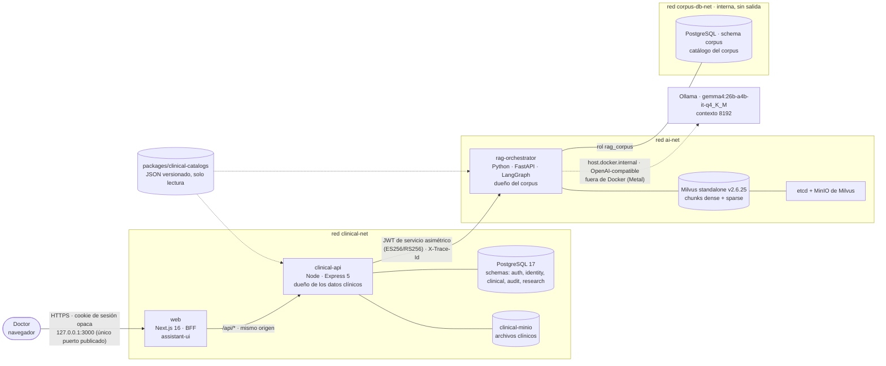
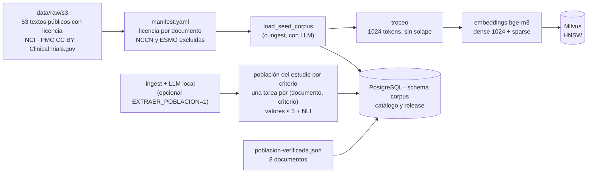
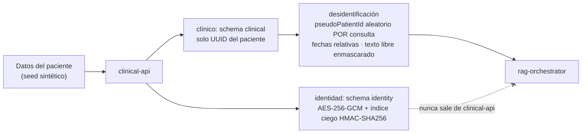
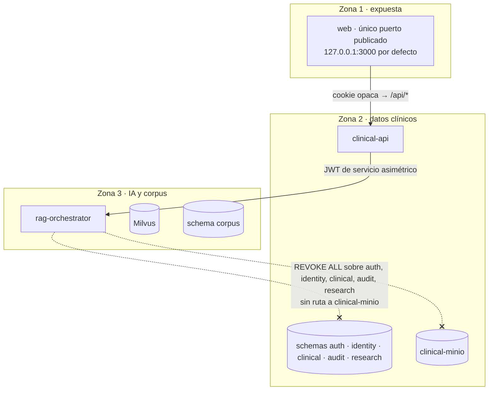

# Arquitectura y seguridad de OncoLens: versión de la Demo 6

> Alcance: la versión de `Demo6/OncoLens-Lab` (commit `ac8b2343`, `main` tras #397), a nivel alto-medio.
> Fuentes: `docker-compose.yml`, `ADR-39` (bloque de decisión de modelos), `ADR-47`, `ADR-51`, `ADR-52`, `.env.example` y `CLAUDE.md`. Todo es **sintético**; no hay datos reales (RN-13, RN-14).
> Los diagramas son Mermaid: se ven en GitHub, VS Code (con extensión) y en la mayoría de visores de Markdown.
> Lo que describe cómo *debe* ser (invariantes) viene de las reglas del proyecto; lo que no he comprobado en el código lo señalo.

---

## 1. Vista general

Un doctor conversa con un asistente sobre un paciente sintético y recibe: el caso reconstruido, la información que falta y la **evidencia científica** del corpus con citas. El producto entrega un *análisis de evidencia*, **no recomendaciones** (D-01).



**Nota:** `pg` (clinical) y `pgc` (corpus) son la **misma instancia PostgreSQL**, conectada a dos redes. Quién puede entrar a cada schema lo decide el rol de base de datos (§5).

---

## 2. Componentes

| Componente | Tecnología | Qué hace | Redes |
|---|---|---|---|
| **web** | Next.js 16 (Turbopack), React 19, assistant-ui | Interfaz del doctor y **BFF**: el navegador solo habla con él. El análisis y el chat van por Route Handler (`app/api/...`), no por Server Action | `clinical-net` |
| **clinical-api** (Backend 1) | Node, Express 5, Zod, Prisma | Dueño de PostgreSQL y de `clinical-minio`. Autenticación y RBAC, pacientes, cifrado de identidad, desidentificación, normalización terminológica, historial de conversación, `AIAnalysisRecord` | `clinical-net`, `ai-net` |
| **rag-orchestrator** (Backend 2) | Python, FastAPI, Pydantic, **LangGraph** | Dueño de Milvus y del schema `corpus`. Recupera, re-rankea, genera, valida citas y soporte NLI. **No accede a datos clínicos** | `ai-net`, `corpus-db-net` |
| **PostgreSQL 17** | `postgres:17.11-alpine` | Datos clínicos y catálogo del corpus. Un solo servidor, schemas aislados por rol | `clinical-net`, `corpus-db-net` |
| **clinical-minio** | MinIO | Archivos clínicos. Solo `clinical-api` llega a él | `clinical-net` |
| **Milvus standalone** | `milvusdb/milvus:v2.6.25` + etcd + MinIO propios | Índice vectorial de los chunks del corpus (dense y sparse) | `ai-net` |
| **LLM local** | Ollama (nativo en macOS, fuera de Docker) | Generación y clasificación; Docker en macOS no expone Metal | host |
| **clinical-catalogs** | JSON versionado (datos, no código) | Datos críticos, criterios de aplicabilidad, sinónimos, subconjuntos CIE-10/LOINC/CUPS/ATC, léxico de preguntas. Montado de solo lectura en ambos backends; versión distinta entre backends → `409` | volumen `ro` |
| **clinical-seed / corpus-migrate** | Jobs de un solo uso | Seed sintético (14 pacientes) y migraciones del schema `corpus` | `clinical-net` / `corpus-db-net` |

---

## 3. Modelos y parámetros (ADR-39 y `.env.example`)

Todo corre **local**; no hay llamadas a la nube ni *fallback* a ella con datos del sistema (RN-12). Los pesos viven en `~/adr39-modelos` y se verifican por SHA-256.

### Modelos

| Rol | Modelo | Cuantización | Notas |
|---|---|---|---|
| **Embeddings** | `BAAI/bge-m3` | int8 | 1024 dimensiones; produce además el vector **sparse** (pesos de `sparse_linear.npz`) |
| **Reranker** | `BAAI/bge-reranker-v2-m3` | int8 | `RERANKER_MAX_LENGTH=512` |
| **NLI** | `MoritzLaurer/mDeBERTa-v3-base-xnli-multilingual-nli-2mil7` | **fp32** | Verifica que cada afirmación esté soportada por su cita |
| **LLM** | `gemma4:26b-a4b-it-q4_K_M` (Ollama) | q4_K_M | Contexto **8192**, `OLLAMA_FLASH_ATTENTION=1`, `LLM_TEMPERATURE=0`; presupuesto ≤ 21 GB |

### Parámetros de recuperación y verificación

| Parámetro | Valor | Qué controla |
|---|---|---|
| `RETRIEVAL_MODE` | `dense` | Búsqueda densa (la híbrida quedó medida pero no activada) |
| `RETRIEVAL_TOP_K` | 30 | Candidatos que devuelve Milvus |
| `RERANKER_MAX_PAIRS` | **20** | Pares (consulta, chunk) que entran al reranker; corte previo por puntaje de recuperación. Enmienda de ADR-39 (antes 12) |
| `RERANK_TOP_N` | 10 | Chunks que sobreviven tras el reranker |
| `RELEVANCE_THRESHOLD` | 0,30 | Por debajo, el chunk no cuenta; sin ninguno sobre el umbral → «sin evidencia» (`topRelevanceScore = null`) |
| `NLI_ENTAILMENT_THRESHOLD` | 0,7 | Mínimo de *entailment* para mostrar una afirmación; si no, se omite y suma a `omittedClaims` |
| `QUERY_CONTEXT_EXPANSION_ENABLED` | `true` | Segundo loop contextual (ADR-52) |

### Chunking e índice

| Parámetro | Valor |
|---|---|
| Estrategia | tamaño fijo, `CORPUS_CHUNK_SIZE=1024` tokens, sin solape |
| Índice vectorial | HNSW (`M=16`, `efConstruction=200`, `ef=64`), recall ≥ 0,99 frente a búsqueda exhaustiva |
| Margen de selección | `CHUNK_SELECTION_MARGIN=0,02` |

### Presupuestos

- Memoria: stack ≤ ~30 GB sin swap, con el LLM ≤ 21 GB (equipo de referencia: MacBook Pro M5 de 32 GB).
- Latencia por etapa (p95): embeddings ≤ 500 ms, reranker ≤ 4500 ms, NLI ≤ 1500 ms.
- **Objetivo del turno completo:** p95 ≤ **20 s**, con techo condicionado de 25 s (decisión del 2026-11-07). Medido: 17,05 s y 18,3 s con 20 pares y expansión activa; casos puntuales de 23-25 s.

---

## 4. Flujos de datos

### 4.1 Un turno del chat

```mermaid
sequenceDiagram
  autonumber
  participant D as Doctor (navegador)
  participant W as web (BFF)
  participant C as clinical-api
  participant R as rag-orchestrator (LangGraph)
  participant M as Milvus
  participant L as LLM local (Ollama)

  D->>W: pregunta (cookie de sesión)
  W->>C: /api/... (mismo origen; valida sesión, CSRF y Origin)
  C->>C: RBAC · opt-out de análisis de IA → 403<br/>desidentifica y enmascara · thread_id aleatorio
  C->>R: JWT de servicio + datos desidentificados (X-Trace-Id)
  R->>R: enrutar: reglas → si no alcanzan, clasificación con el LLM
  alt intención "caso" o "faltantes"
    R->>R: verbalización determinista + NLI de las afirmaciones
  else intención "evidencia"
    R->>M: búsqueda densa (top_k 30, solo chunks vigentes)
    R->>R: reranker (20 pares, ≤ 512 tokens) · umbral 0,30 · top_n 10
    opt sin chunks sobre el umbral y la pregunta es genérica
      R->>M: UN segundo loop con términos del caso (ADR-52)
    end
    alt nada supera el umbral
      R-->>C: "sin evidencia" (sin invocar al LLM de generación)
    else hay evidencia
      R->>L: generar con los fragmentos recuperados
      R->>R: valida citas (solo del corpus) + NLI ≥ 0,7 sobre la respuesta COMPLETA
    end
  end
  R-->>C: respuesta validada (+ avisos, omittedClaims)
  C->>C: persiste ConversationTurn y AIAnalysisRecord ANTES de responder
  C-->>W: respuesta
  W-->>D: tarjetas con citas, enlaces al dato y avisos de IA
```

Reglas que se cumplen en el flujo:
- **Nunca se emiten tokens del LLM sin validar**: la validación (citas y NLI) se hace sobre la respuesta completa. Si hay streaming, es de progreso, no de contenido.
- Toda opción o afirmación mostrada tiene ≥ 1 cita a un chunk **recuperado en esa consulta** (o enlace a un dato del paciente) **y** pasa el NLI. Sin soporte → se descarta u omite.
- Un análisis previo entra solo como memoria rotulada y **nunca es citable**.
- Cada turno muestra «Generado por IA; requiere validación clínica independiente por el oncólogo tratante» y «Uso académico/investigación» (RN-19), con el encabezado «Opciones descritas en la evidencia» (sin lenguaje prescriptivo, RN-23).
- El estado del hilo en Backend 2 es **efímero** (`InMemorySaver` con TTL, `CHAT_THREAD_TTL_SECONDS`): no se persiste en PostgreSQL ni en disco. Backend 1 guarda el registro y rehidrata.

### 4.2 Ingesta del corpus



- **Sin llamadas de red en la consulta:** los textos están en local y el corpus se construye en la ingesta.
- **Población del estudio (ADR-47):** se extrae **en la ingesta**, no en la consulta: una tarea corta por documento y criterio, con lista acotada y verificada con NLI. En la consulta, el estado de aplicabilidad se calcula con **reglas puras** (sin LLM) y solo con los fragmentos que cita la opción.
- **Solo los chunks `is_current` se recuperan**; el histórico del corpus nunca se borra.
- En la demo, la población verificada cubre 8 de los 53 documentos, salvo que se corra `EXTRAER_POBLACION=1`.

### 4.3 Ruta de un dato clínico



---

## 5. Seguridad

### 5.1 Zonas y fronteras



### 5.2 Controles

| Control | Cómo se aplica |
|---|---|
| **El navegador solo habla con `web`** | `web` es el único servicio que publica puerto, ligado a `127.0.0.1` por defecto (`WEB_BIND_ADDRESS`); `clinical-api` y `rag-orchestrator` no publican nada al host |
| **La sesión del doctor no llega a Backend 2** | Cookie opaca (no JWT) hasta `clinical-api`; **JWT de servicio asimétrico** (ES256/RS256) de ahí en adelante. No son intercambiables |
| **`rag-orchestrator` no accede a datos clínicos** | Capas: rol `rag_corpus` limitado al schema `corpus`; `REVOKE ALL` sobre los demás schemas; red `corpus-db-net` **interna** (sin salida); `pg_hba` restringido; sin credenciales ni ruta a `clinical-minio`; tests de CI de *permission denied*. Recibe los PDFs en el cuerpo del request y los procesa en memoria sin persistirlos |
| **La identidad no sale de `clinical-api`** | Cifrada con AES-256-GCM en la aplicación (schema `identity`), índice ciego HMAC-SHA256 para búsqueda exacta; las claves solo existen ahí. Nunca llega a IA, histórico, logs ni auditoría |
| **Desidentificación siempre** | `pseudoPatientId` aleatorio por consulta (nunca en el prompt), fechas relativas, texto libre enmascarado, también en eventos, tratamientos previos, faltantes y análisis previos. Detección de PII (ADR-40): patrones e identidad exacta en el MVP |
| **Modelos locales, sin nube** | Aplicado por código en ambos backends y verificado por test (RN-12). El LLM corre en Ollama local |
| **Autorización** | Solo RBAC en el MVP (*qué acciones*): `admin` gestiona cuentas, altas y opt-out pero **no lee datos clínicos ni análisis**; `doctor` ve los datos clínicos. La autorización por paciente (`CareTeamMember`) pasa a Post-MVP |
| **Consentimiento** | Presunto con opt-out del administrador (RN-15): con opt-out de `analisis_ia`, toda generación con IA responde **403** (análisis, resumen del caso, re-ejecución, búsqueda complementaria) |
| **Logs** | Nunca registran identidad, PHI, secretos ni contenido o URL de documentos; pacientes por UUID, `traceId` por `X-Trace-Id` |
| **Secretos** | Claves ES256, cifrado/HMAC, roles de PostgreSQL y TLS se generan en `scripts/` y nunca se versionan; el repositorio es público y la CI escanea secretos y PII |
| **Lenguaje y avisos** | Sin términos prescriptivos (lista prohibida, RN-23); avisos de IA en toda salida (RN-19) |
| **Web** | Cabeceras de seguridad y CSP con nonce (L1D-266), CSRF y validación de `Origin` |
| **Datos reales** | Ninguno entra antes del gate G-piloto (RN-13); `clinical-api` no arranca con `REAL_*_ENABLED=true` si falla un prerrequisito |

### 5.3 Lo que esta versión **no** incluye todavía (para decirlo con honestidad en la demo)

- **Auditoría completa, gate G-piloto, medición de valor y piloto con datos reales:** pasan a Post-MVP; la demo es solo sintética.
- **Autorización por paciente** (equipo tratante), OCR de documentos clínicos y job de retención: Post-MVP.
- **Transporte en la demo:** el navegador habla con `web` en `127.0.0.1` sobre el puerto 3000. TLS, VPN y *backups* son parte de la fase de piloto, no de esta demo (no lo he verificado en el Compose; confírmalo si lo vas a afirmar).
- La fidelidad NLI medida es 0,822 (meta 0,90): por eso el sistema omite afirmaciones sin soporte en vez de mostrarlas.

---

## 6. Resumen en una frase por capa

- **Presentación:** `web` (Next.js) es la única superficie expuesta y habla solo con `clinical-api`.
- **Datos clínicos:** `clinical-api` es dueño de PostgreSQL y MinIO, cifra la identidad y desidentifica antes de hablar con la IA.
- **IA y corpus:** `rag-orchestrator` ve solo datos desidentificados y su propio corpus; recupera con bge-m3, re-rankea con bge-reranker-v2-m3 (20 pares), genera con gemma4 local y valida cada afirmación con NLI (umbral 0,7).
- **Garantías:** ningún token se muestra sin validar; toda afirmación tiene cita o enlace; sin evidencia, el sistema lo dice en vez de inventar; todo es local y sintético.
