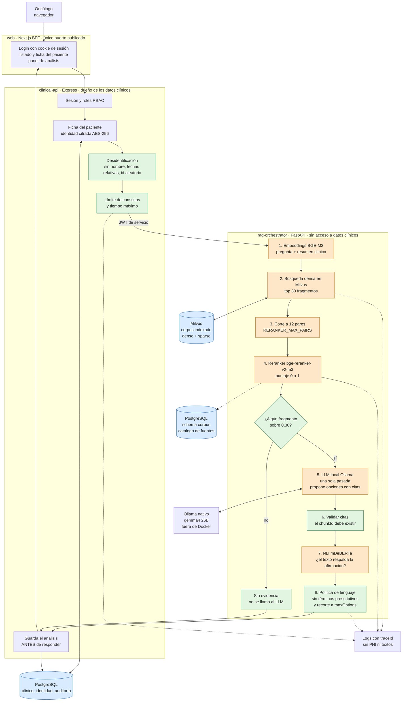

# Flujo del análisis de evidencia (S1 y S2 implementados)

Diagrama de alto nivel para la Demo 2. Muestra los componentes que intervienen desde que el oncólogo inicia sesión hasta que ve el resultado. Naranja: pasos con modelos de IA · verde: reglas deterministas · azul: almacenes de datos.

## Qué contar
- **Una sola pasada del LLM.** El segundo loop con reescritura de consulta (US-238) está planificado para el S4.
- **Sin evidencia no se llama al LLM:** si ningún fragmento supera 0,30 (`RELEVANCE_THRESHOLD`), la respuesta es corta y sin costo de generación (RN-02).
- **El reranker solo ve 12 de los 30 candidatos** (`RERANKER_MAX_PAIRS`, ADR-39): una errata en la pregunta cambia qué 12 entran.
- **El análisis se guarda antes de responder** (RN-06).
- **La identidad nunca sale de `clinical-api`:** el servicio de IA solo recibe datos desidentificados (RN-10, RN-11).
- **Una consulta a la vez en la demo.** Tres análisis simultáneos tumbaron `rag-orchestrator` por memoria; lo cubre US-239 (S4).

## Parámetros
`RETRIEVAL_TOP_K=30` · `RERANKER_MAX_PAIRS=12` · `RERANK_TOP_N=10` · `RELEVANCE_THRESHOLD=0.30` · modelos: BGE-M3, bge-reranker-v2-m3, mDeBERTa NLI, gemma4 26B (Ollama).

Estado a 2026-10-23. Cuando cambie el flujo (S3 en adelante), este diagrama se actualiza.
