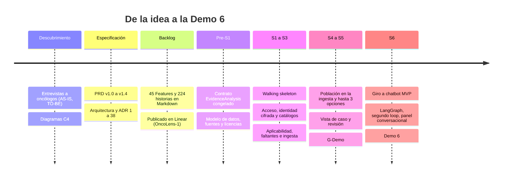
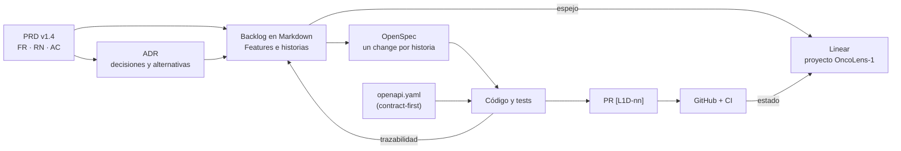
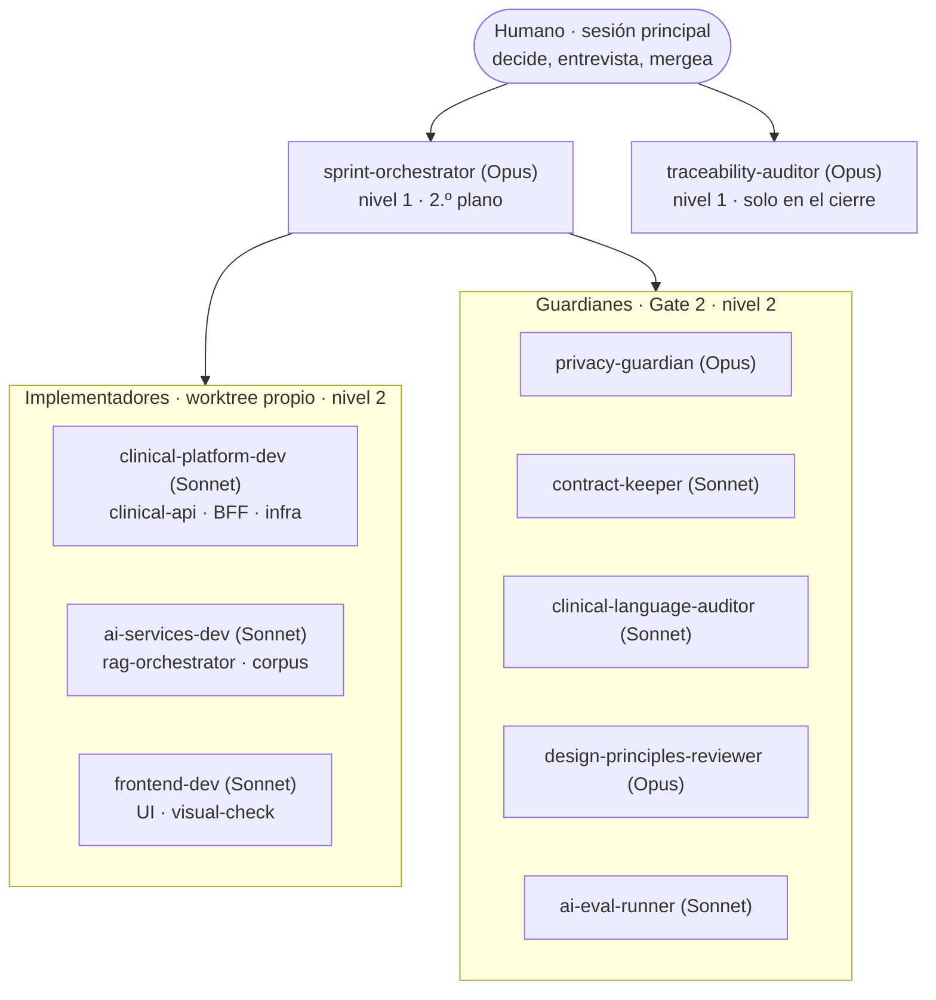
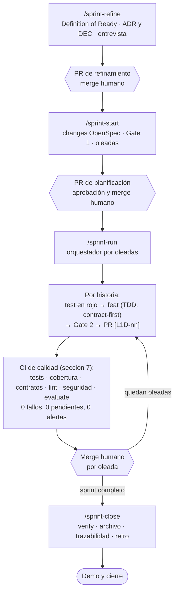
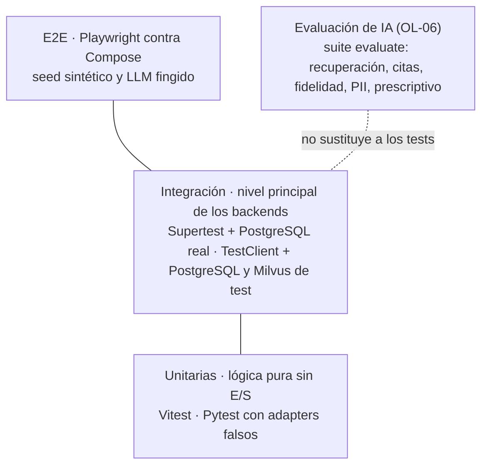
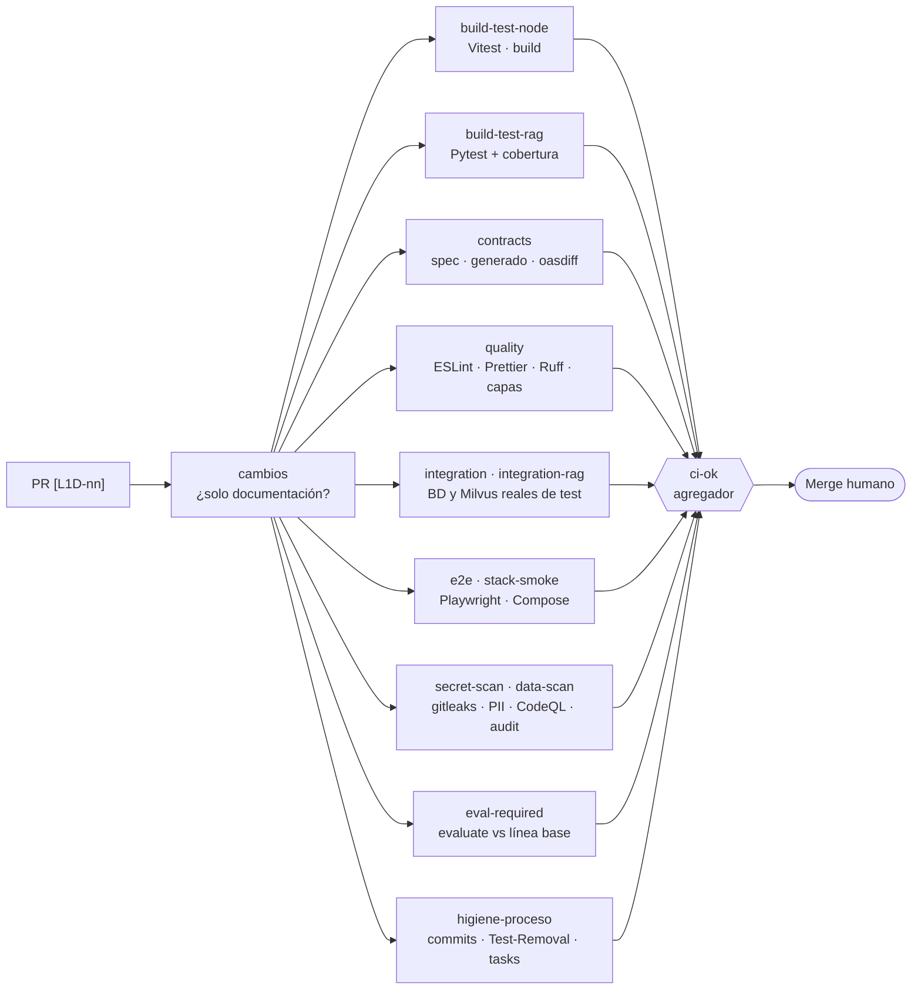
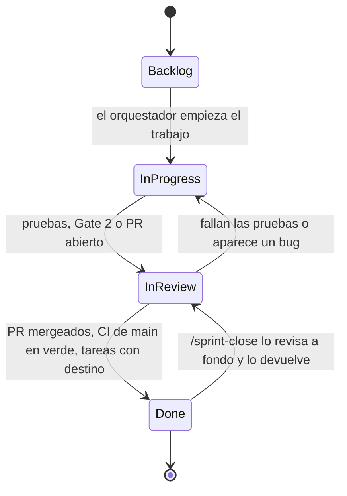
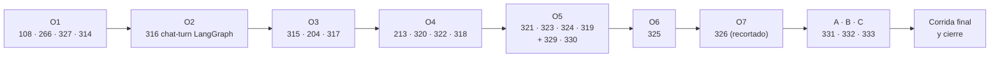

# Proceso de desarrollo de OncoLens: de la idea a la Demo 6

> Resumen para la Demo 6. Cubre desde el descubrimiento y la arquitectura hasta el cierre del S6.
> Fuentes: `CLAUDE.md`, `.claude/README.md`, `docs/process/definition-of-done.md`, `docs/process/ci.md`, `.claude/skills/sprint-refine/SKILL.md`, `backlog/sprints/*` y lo ocurrido en esta sesión.
> Los diagramas son Mermaid. Lo que describe cifras de sprints anteriores (S1 a S5) viene de las notas del proyecto y de los ficheros de cierre; lo marco cuando no lo verifiqué en esta sesión.

---

## 1. En una página

OncoLens es un asistente de **análisis de evidencia** para oncólogos (mama y próstata, uso académico, solo datos sintéticos). Se construyó con un proceso donde **personas deciden y agentes de IA implementan, revisan y registran**, con el repositorio como memoria compartida:

1. **Se descubre y se especifica** (entrevistas, PRD versionado, arquitectura con ADR).
2. **Se descompone en un backlog trazable** (Markdown como fuente; Linear como espejo).
3. **Cada sprint** pasa por refinamiento (Definition of Ready), planificación (Gate 1), ejecución por oleadas con agentes (Gate 2, TDD, contract-first) y cierre (verificación, archivo y trazabilidad), con **merges siempre humanos**.
4. **La calidad se verifica en capas:** TDD proporcional al riesgo, pruebas unitarias, de integración y E2E, contratos, lint y capas de arquitectura, escaneos de seguridad, evaluación de la IA y una CI que bloquea el merge (sección 7).
5. **Un orquestador** reparte las historias entre implementadores por contexto (clínico, IA, frontend) y **guardianes** revisan privacidad, contratos, lenguaje clínico, diseño y calidad de IA.
6. **La Demo 6** muestra el resultado: un chatbot sobre el paciente que reconstruye el caso, señala lo que falta y cita evidencia del corpus, sin recomendar tratamientos.

---

## 2. Fuentes de verdad

El principio: **el Markdown del repositorio es la fuente; Linear es el espejo**. Lo que solo se dijo en el chat no existe para los agentes: se escribe en el repo.

| Fuente | Qué contiene |
|---|---|
| `docs/PRD.md` | Requisitos (FR-01…FR-30), reglas de negocio (RN-01…RN-30), objetivos, métricas, roadmap, criterios de aceptación del MVP. Versionado con registro de cambios (v1.1 a v1.4 y entradas E-01…E-19) |
| `readme.md` | Árbol objetivo del monorepo, tickets OL-01…OL-06, ADR ya decididos y sus alternativas descartadas |
| `docs/architecture/adr/` | Decisiones de arquitectura en formato MADR, con opciones descartadas |
| `docs/architecture/data-model.md` | Modelo de datos (PostgreSQL y Milvus); la migración inicial lo implementa entero |
| `apps/*/openapi.yaml` + `contracts/` | **Contratos** de ambos backends; fuente única de las APIs. Los tipos y clientes se generan de ahí |
| `backlog/` | Product Backlog en Markdown: Features, historias con AC Given/When/Then, trazabilidad, auditoría |
| `openspec/` | Un *change* por historia (propuesta, diseño, deltas y tareas) y las specs archivadas |
| `backlog/sprints/` | Refinamiento, plan, deuda, trazabilidad y cierre de cada sprint |
| `docs/process/` | Definition of Done y CI |
| `CLAUDE.md` | Reglas del proyecto que leen los agentes |
| `packages/clinical-catalogs/` | Datos clínicos versionados (catálogos de criterios, sinónimos, subconjuntos CIE-10, LOINC, CUPS y ATC) |

**Cómo se resuelven las discrepancias:** si `readme.md` y `PRD.md` difieren, manda el PRD más reciente. Los IDs publicados (`US-xxx`, `ADR-n`, `DEC-nn`) son **inmutables**.

---

## 3. Arquitectura y ADR

### Decisiones estructurales (resumen; detalle en `ARQUITECTURA-Y-SEGURIDAD-DEMO6.md`)

- **Regla de ownership:** `web` (BFF) → `clinical-api` (dueño de los datos clínicos) → `rag-orchestrator` (dueño del corpus, **sin acceso a datos clínicos**) → LLM local fuera de Docker.
- **Contract-first y provider-driven:** el `openapi.yaml` del proveedor cambia antes que el código; un cambio incompatible rompe el build.
- **Encuadre D-01:** el producto entrega un *análisis de evidencia*, no recomendaciones; lenguaje no prescriptivo (RN-23).

### ADR que marcaron el rumbo

| ADR | Decisión |
|---|---|
| **ADR-26** | Cambios de contrato: compatibilidad declarada y verificada con oasdiff |
| **ADR-33** | Backend 2 *propone* códigos terminológicos con confianza; Backend 1 es dueño de la normalización final |
| **ADR-34** | Afirmaciones sobre datos del paciente: verbalización determinista + NLI |
| **ADR-36** | Fuentes y licencias del corpus (solo acceso abierto con licencia aceptada; NCCN y ESMO excluidas) |
| **ADR-39** | Modelos locales: bge-m3, bge-reranker-v2-m3, mDeBERTa NLI y el LLM; topes de memoria; enmienda de `RERANKER_MAX_PAIRS` a 20 |
| **ADR-40** | Detección de PII: patrones e identidad exacta en el MVP |
| **ADR-47** | La población del estudio se extrae en la ingesta (una tarea por documento y criterio), no en la consulta |
| **ADR-51** | El chat se orquesta con LangGraph en Backend 2, con estado efímero; Backend 1 guarda el registro |
| **ADR-52** | Segundo loop contextual para preguntas genéricas |

**Cómo se decide un ADR:** con tres propuestas y exploración solo si revertir es caro. La decisión del humano queda escrita en la historia (`Decidido (usuario, fecha)`), con las opciones descartadas y su motivo. Un ADR o DEC sin esa decisión registrada no se da por cerrado.

---

## 4. Los agentes y cómo interactúan

Jerarquía de hasta 3 niveles (`CLAUDE_CODE_MAX_SUBAGENT_SPAWN_DEPTH=3`):

| Agente | Rol |
|---|---|
| **sprint-orchestrator** | Ejecuta el sprint por oleadas, lanza implementadores y guardianes, **mantiene Linear sincronizado** y vuelve a la sesión principal para pedir merges o ante una situación crítica |
| **clinical-platform-dev · ai-services-dev · frontend-dev** | Implementan por contexto, cada uno en su propio *worktree* de git |
| **privacy-guardian** | PII, desidentificación, aislamiento de Backend 2, secretos y OWASP web |
| **contract-keeper** | Contract-first: spec antes que el código, nada generado a mano, cambios incompatibles |
| **clinical-language-auditor** | Lenguaje no prescriptivo, avisos de IA, citas y orden por aplicabilidad |
| **design-principles-reviewer** | SOLID y CUPID; propone el refactor mínimo |
| **ai-eval-runner** | Suite de evaluación de IA (OL-06) contra la línea base y las metas |
| **traceability-auditor** | Historia ↔ change ↔ spec ↔ PRD ↔ test ↔ PR; revisa a fondo lo marcado Done |
| **Fase de backlog** (requirements-analyst, architecture-advisor, backlog-writer, backlog-auditor) | Descomponen el PRD en el backlog y lo auditan |

**Reglas de convivencia**
- Los implementadores trabajan en paralelo en contextos distintos, **nunca dos en el mismo módulo**.
- Los guardianes son de **solo lectura**: reportan, no corrigen.
- **`gh pr merge` está denegado** para los agentes: los merges los hace el humano, por oleada.
- Ante una situación crítica (gate fallido dos veces, invariante RN, ambigüedad de la spec, cambio de alcance, seguridad o datos reales, bloqueo externo), el orquestador se pausa y la sesión principal entrevista al humano.

---

## 5. Skills, comandos y hooks

### Comandos del ciclo del sprint (skills, solo invocación manual)

| Comando | Fase | Qué produce |
|---|---|---|
| `/sprint-refine S<n>` | 1 a 3 | Definition of Ready, ADR y DEC del sprint, entrevista al humano, stack, diseño en `docs/ux/` |
| `/sprint-start S<n>` | 4 (apertura) | Changes de OpenSpec por historia, **Gate 1**, grafo de dependencias y oleadas, plan con aprobación humana |
| `/sprint-run S<n>` | 4 (ejecución) | Lanza o reanuda al orquestador |
| `/sprint-close S<n>` | 5 | Demo, `/opsx:verify` global, archivo de changes, trazabilidad, `/security-review`, retro |

### Skills de apoyo

`backlog-to-change` (historia → change), `implement-story` (una historia hasta el PR), `gate-review` (guardianes en paralelo), `sync-contracts` (spec → validar → oasdiff → generar), `run-ai-eval`, `visual-check` (loop visual en navegador real), `decompose-prd` (descomposición del PRD) y la familia `opsx:*` / `openspec-*` (propuesta, tareas, verificación, archivo).

### Hooks (`.claude/hooks/`)

| Hook | Para qué |
|---|---|
| `pre-commit-gate`, `require-active-change` | No se escribe código sin un change activo; se valida OpenSpec |
| `guard-generated`, `guard-sensitive-paths`, `guard-npm-symlink`, `guard-visual-loop` | No editar a mano lo generado; proteger rutas sensibles (p. ej. `reports/eval/`, `.env.example`, Compose para los agentes) |
| `pr-checks-reminder`, `vigilar-pr` | Esperar a que la CI termine antes de pedir un merge |
| `session-context` | Contexto del proyecto al iniciar la sesión |

---

## 6. El ciclo de un sprint

### Definition of Ready (antes de entrar al sprint)

Una historia entra si cumple: sin refinamiento pendiente; **AC verificables** (Given/When/Then); dependencias resueltas; decisiones tomadas; estimación en puntos; **tamaño ≤ 5 pts y ≤ 8 AC** (una de 8 se parte; 13 no se acepta); y, si toca UI, referencia de diseño en `docs/ux/`.

### Gates de calidad

| Gate | Cuándo | Qué revisa |
|---|---|---|
| **Gate 1** | En `/sprint-start`, antes de escribir código | Artefactos del change (propuesta, diseño, deltas) con los guardianes en lote |
| **Gate 2** | Antes de cada PR | Diff de la rama: guardianes elegidos según los paths tocados; máximo dos reintentos |

### Definition of Done (`docs/process/definition-of-done.md`)

- **Común a todo PR:** título `[L1D-nn]`; Gate 2 en verde; `openspec validate --strict` y `/opsx:verify`; `tasks.md` conciliado (cada tarea `[x]` con evidencia o diferida con su ID destino); ningún dato real ni secreto; `evaluate` con reporte si toca modelo, prompt, umbral, catálogo o corpus; `visual-check` en PASS si toca la UI; sin tests desactivados; `ci-ok` en verde.
- **Historia nueva:** contract-first (primer commit `contract(L1D-nn)`), un test de aceptación por AC en rojo antes del `feat`, y el patrón de capas de cada backend.
- **Bug:** test que reproduce el fallo en rojo y en su propio commit, luego el fix, y un análisis 5-whys.
- **Refactor:** la cobertura del módulo no baja y el comportamiento observable no cambia.
- **ADR o DEC:** formato MADR, decisión del humano registrada, opciones descartadas con su motivo.

### Política de pruebas (TDD proporcional al riesgo)

| Tipo de código | Disciplina |
|---|---|
| Reglas de negocio, services, endpoints, desidentificación, cifrado, autorización | **TDD estricto**, doble bucle: commit `test` en rojo antes del `feat` |
| Componentes y Route Handlers simples de `web` | Test del AC primero (Testing Library + MSW) y `visual-check` |
| Prompts, umbrales, modelos, catálogo y corpus | Sin TDD: suite `evaluate` (OL-06) |
| Migraciones, Compose, CI y scripts | Test después, en el mismo PR |

Mocks solo en los bordes arquitectónicos (HTTP saliente, LLM, embeddings, reranker, NLI, OCR, Milvus, MinIO). La BD es real en integración. Nunca se borra ni debilita un test para que la suite pase (`Test-Removal:` obligatorio si un AC cambió).

---

## 7. Calidad del código y QA

La calidad no es una fase al final: se construye en cada historia y se **comprueba en la CI antes de pedir cada merge**. Esta sección resume qué se prueba, con qué herramientas y qué evidencia queda.

### 7.1 Pirámide de pruebas

| Nivel | `web` | `clinical-api` | `rag-orchestrator` |
|---|---|---|---|
| **Unitario** (lógica pura) | Vitest + Testing Library | Vitest, solo lógica pura (completitud, reconciliación, cifrado, orden, desidentificación) | Pytest con adapters falsos en los puertos |
| **Integración** (nivel principal) | Vitest + MSW sobre `/api/*` | Supertest + **PostgreSQL real de test** + MSW hacia rag y MinIO | `TestClient` + PostgreSQL `corpus` real + `respx`; Milvus y LLM fingidos en su puerto; job `integration-rag` con Milvus real de test |
| **E2E** (recorridos del PRD) | Playwright contra Compose con seed sintético y **LLM fingido** (respuestas fijas de `contracts/examples/`) | ← | ← |

**Reglas de las pruebas**
- **Mocks solo en los bordes arquitectónicos** (HTTP saliente, LLM, embeddings, reranker, NLI, OCR, Milvus, MinIO). Nunca se mockean módulos propios ni Prisma; la BD es real en integración (los tests de cifrado, índice ciego y del rol `rag_corpus` lo exigen).
- **Los mocks nacen del contrato:** los handlers de MSW y `respx` se construyen desde `contracts/examples/` (249 ejemplos JSON): un mock no puede divergir del contrato.
- **Determinismo:** el reloj y los generadores de IDs se inyectan y los tests los congelan; nada de `Date.now()` ni `Math.random()` en dominio.
- **Nombres que describen comportamiento** en español y el **test de aceptación** de cada AC lleva la etiqueta `[US-xxx AC-n]`, que enlaza la prueba con el requisito.
- **Un test inestable es un bug del sprint:** se arregla o se quita con `Test-Removal:`; nunca cuarentena ni reintentos silenciosos (Playwright con `retries: 1` solo en CI y con *trace*).
- **Nunca se debilita un test para que pase:** están prohibidos `.skip`, `.only`, `xit`, `xfail` y las aserciones relajadas; la CI lo comprueba.

### 7.2 Herramientas y frameworks

| Categoría | Herramientas |
|---|---|
| **Pruebas backend Node** | Vitest, Supertest, MSW, Prisma (BD real de test) |
| **Pruebas frontend** | Vitest, Testing Library (React), MSW |
| **Pruebas E2E y visuales** | Playwright (E2E en CI); `visual-check` con Playwright MCP y Chrome DevTools MCP: estados de la UI, consola (CSP, hidratación), red (solo `/api/*` del mismo origen), accesibilidad, teclado, rendimiento y capturas a 375 y 1280 px |
| **Pruebas rag-orchestrator** | Pytest, pytest-cov, respx, `TestClient` de FastAPI |
| **Contratos** | OpenAPI 3.1 como fuente única, `oasdiff` (cambios incompatibles), generadores de tipos, Zod y Pydantic; `contracts:check` y verificación del proveedor |
| **Lint y formato** | ESLint (`--max-warnings 0`), Prettier, `tsc`, Ruff |
| **Arquitectura** | `dependency-cruiser` (capas de Node: `controller-sin-acceso-a-datos`, `web-solo-por-bff`, `componentes-sin-datos`, `sin-ciclos`) e `import-linter` (hexagonal de Python) |
| **Seguridad** | gitleaks (secretos, en el árbol y en cada commit del PR), escáner propio de PII y de clase de datos, CodeQL, `npm audit` y `pip-audit`, `/security-review` al cierre, tests de *permission denied* del rol `rag_corpus` |
| **Evaluación de IA** | Suite `evaluate` (OL-06), `adr39_measure`, datasets sintéticos en `data/eval/` y línea base versionada |
| **Proceso** | OpenSpec (`validate --strict`, `/opsx:verify`), verificación del orden de commits `test → feat`, conciliación de `tasks.md` |

### 7.3 TDD y evidencia de calidad

- **TDD estricto en lo que cuesta caro equivocarse** (reglas de negocio, services, endpoints, desidentificación, cifrado, autorización): doble bucle con el test de aceptación en rojo en su propio commit `test(L1D-nn)` antes del `feat`. El rojo debe fallar en la aserción, no en un import.
- **Contract-first:** el primer commit de una historia con API es `contract(L1D-nn)`; el orden de commits es `contract → test → feat → refactor`.
- **La evidencia es el historial de commits:** el script `verificar-commits-tdd` y el Gate 2 comprueban el orden `test → feat`. El plugin TDD Guard se retiró en el cierre del Pre-S1 porque esa evidencia ya es auditable.
- **Cobertura:** de las **líneas cambiadas** de cada PR, como alerta (`changedLinesWarn` = 80 %), no como umbral global ni bloqueo. La mide `cobertura-rag` y `reports/quality/latest.json`; `design-principles-reviewer` la lee buscando lógica sin test y aserciones débiles. **Excepción:** en un *refactor* la cobertura del módulo no puede bajar respecto de `main` y **sí bloquea**.
- **Límites de código** en `quality-thresholds.json` (RN-22): 40 líneas por función, complejidad 10, componentes de web con alerta a 100 líneas y error a 150. Las excepciones preexistentes caducan (máximo 90 días) y llevan historia asociada; las reglas de capas y de seguridad no se pueden exceptuar.

### 7.4 La CI como puerta de calidad

- **`ci-ok` falla si cualquier job no termina en `success`** (fallido, cancelado u omitido) y lo nombra. Un PR de documentación pura omite los jobs pesados, pero sigue pasando por `secret-scan`, `data-scan` y `higiene-proceso`.
- **Repositorio público:** la CI no usa secretos del repositorio, corre en `pull_request`, fija las acciones por SHA y sus escáneres nunca imprimen el valor detectado.
- **No se pide un merge hasta tener 0 fallos, 0 pendientes y 0 alertas abiertas**; el orquestador y el vigilante de PR lo comprueban.

### 7.5 Evaluación de la IA (OL-06)

Es **obligatoria en cada PR que cambie modelo, prompt, umbral, catálogo o corpus**. Mide, entre otras cosas:

| Métrica | Meta inicial |
|---|---|
| recall@10 (es→en) | ≥ 0,80 (≥ 0,70) |
| MRR | ≥ 0,60 |
| Fidelidad (NLI) | ≥ 0,90 |
| Precisión de citas | ≥ 0,90 |
| «Sin evidencia» correcto | ≥ 0,90 |
| PII y mapeo terminológico | ≥ 0,95 |
| Salidas prescriptivas mostradas | = 0 |

En el S6 se midió con modelos locales reales: recall@10 de 0,906 y MRR de 0,887, precisión de citas de 1,00, 0 violaciones de RN-02, 0 términos prohibidos mostrados, **fidelidad NLI de 0,822 (bajo la meta, deuda D6-58)** y p95 de 17,05 s y 18,3 s (tope 20 s).

### 7.6 Magnitud de las pruebas

Conteo de archivos de prueba en `Demo6/OncoLens-Lab` (medido en esta sesión) y cifras que reportaron los agentes durante el S6 (no se volvieron a ejecutar para este documento):

| Área | Archivos de prueba | Cifras reportadas en el S6 |
|---|---|---|
| `rag-orchestrator` (Pytest) | 463 | ~5.100 tests en verde (`pytest` de rag, al aplicar H-1) |
| `clinical-api` (Vitest + Supertest) | 317 | integración de `clinical-api` verificada en CI (199 tests en la medición de L1D-277) |
| `web` (Vitest + Testing Library) | 135 | 874 tests en 130 archivos (L1D-325) |
| E2E (Playwright) | 25 specs | 77 pasan en local y 75 specs en CI (L1D-325, L1D-324) |
| Scripts y CI | 104 | pruebas de los propios escáneres y de la infraestructura |
| Contratos | 249 ejemplos JSON | base de los mocks de MSW y `respx` |

### 7.7 Qué quedó fuera o con deuda (sin maquillar)

- **No hay pruebas de mutación todavía** (StrykerJS sobre autenticación, autorización y cifrado): está planificado y figura en el backlog de Post-MVP.
- **El chat de próstata no tiene E2E** (D6-49) y el E2E del chat se redujo al camino feliz de mama; AC-4 de L1D-326 y la evaluación `chat-local` con modelos locales quedaron diferidos (D6-50 a D6-52).
- **Tests de plazo 504 inestables** en la CI (D6-36): se corregirán con reloj o plazo inyectado, sin reintentos silenciosos.
- **Fidelidad NLI 0,822** (meta 0,90) y **13 casos del dataset sin revisión clínica** (D6-53).
- **Cobertura:** solo alerta sobre líneas cambiadas; no hay umbral global.
- **Las pruebas con LLM fingido** validan el cableado y el contrato, no la calidad de la respuesta; esa la mide `evaluate` con modelos reales, que se ejecutó una vez al final del S6.
- **Rojos reales que solo aparecen en CI:** varios fallos de L1D-324 y L1D-325 (formato, `pii-scan`, lista de `COPY` del Dockerfile de web, specs E2E) no se veían sin Docker local; se corrigieron sin debilitar ningún test.

---

## 8. Linear, el repositorio y GitHub

- **El Markdown manda:** cada Feature e historia lleva su `> Linear: L1D-NN` y los cambios se hacen primero en el Markdown y luego en Linear.
- **Un solo proyecto:** `OncoLens-1` (equipo `L1D`); no se crean otros. Hoy: 45 Features (`L1D-5`…`L1D-49`) y las historias `L1D-50`… hasta las añadidas en S6 (`L1D-329` a `L1D-333`).
- **Quién mueve el estado:** el orquestador durante el sprint; `/sprint-close` revisa a fondo los *Done* y puede devolverlos. La integración Linear–GitHub también mueve issues al mencionarlos en un PR, y el orquestador lo reconcilia.
- **Trazabilidad:** `backlog/03-trazabilidad.md` y `S<n>-trazabilidad.md` enlazan historia, change, spec archivada, requisito del PRD, tests y PR.
- **PR y CI:** título `[L1D-nn]`; la CI corre en cada PR (build y tests, contratos, escaneo de secretos y PII, clase de datos, *smoke* del stack, E2E). **No se pide un merge hasta tener 0 fallos, 0 pendientes y 0 alertas.** El repositorio es público: la CI nunca imprime valores detectados.
- **Deuda explícita:** lo que no cabe en un sprint se registra con ID en `S<n>-deuda.md` y se traslada a una historia destino. Nada se da por hecho sin evidencia.

---

## 9. Los sprints, de Pre-S1 a S6

| Sprint | Tema | Hito |
|---|---|---|
| **Pre-S1** | Decisiones: contrato `EvidenceAnalysis` y esquema congelados, protocolo de métricas de valor, capacidad, términos LOINC/CUPS/ATC, fuentes del corpus; DoD y DoR definidas | Cierre del 2026-10-13 |
| **S1** | *Walking skeleton*: sesión mínima y análisis *dense* con una opción citada sobre el paciente semilla | Primera demo de punta a punta |
| **S2** | Acceso, identidad cifrada, ficha, catálogos, Base del análisis, suite `evaluate` en la DoD | Umbrales de calidad en la CI |
| **S3** | Aplicabilidad (criterios y cálculo), faltantes, ingesta del corpus y metadatos de población | Pacientes sintéticos sembrados |
| **S4** | Población del estudio en la ingesta (ADR-47), hasta 3 opciones ordenadas con aplicabilidad, segundo loop de RN-02, búsqueda híbrida medida | Demo 4 cerrada (61 de 61 pasos, según mis notas) |
| **S5** | Vista de caso, revisión y registro manual, seguimiento, avisos de datos sin verificar | **G-Demo**; en el cierre del S5, 17 de 25 historias mergeadas (según mis notas) |
| **S6** | **Giro a chatbot MVP**: LangGraph efímero, panel conversacional, segundo loop contextual, relevancia del dato, contradicciones, fuentes y limitaciones | **Demo 6** |

### El S6 en detalle

- **Origen:** tras la Demo 5 se reprioritizó el S6 a *solo RAG + chatbot MVP*; el resto pasó a Post-MVP con aprobación.
- **Plan:** 18 changes en 7 oleadas, con altas durante el sprint (L1D-329 y L1D-330 como US-271 y US-272; luego A, B y C como L1D-331 a L1D-333).
- **Compromiso final:** 83 puntos tras el recorte de L1D-326 al mínimo crítico; meta ≥ 80 % cerrado.
- **Decisiones de producto tomadas por el usuario durante el sprint:** tope de p95 de 20 s con techo condicionado de 25 s, `RERANKER_MAX_PAIRS=20`, expansión contextual activa por defecto, `traceId` fuera del error del turno (se mantiene el AC-5), hueco de CaseView a Post-MVP, y `MAX_PAIRS=30` autorizado pero con su medición en Post-MVP.
- **Medición:** búsqueda híbrida frente a densa (recomendación: mantener `dense`) y una corrida final real con el LLM local (p95 de 17,05 s y 18,3 s).

---

## 10. Lecciones del proceso en el S6

| Lección | Qué pasó | Cómo se manejó |
|---|---|---|
| **El presupuesto de tokens manda** | El uso semanal llegó al 89 % y luego al 96 % | Recortes ordenados (primero la corrida final, luego C, B, A), L1D-326 reducida al camino feliz, pausa segura y trabajo opcional fuera |
| **Aislamiento de worktrees** | Los implementadores no podían operar en worktrees huérfanos de otro agente | El orquestador rescató el trabajo con commits `wip` empujados y relanzó desde `origin` |
| **Un agente no levanta una condición que fijó el humano** | Un runner se negó a usar Docker porque su tarea lo prohibía y el permiso venía de otro agente | La autorización explícita del usuario se escribió en la tarea del runner nuevo |
| **Medir antes de decidir** | La corrida final mostró que `MAX_PAIRS=20` con expansión subía el p95 a 17-18 s y que A colapsaba la evidencia en próstata | El usuario recalibró el tope (20 s) y la deuda quedó registrada con cifras |
| **Los hooks protegen** | Rutas como `reports/eval/`, `.env.example` y Compose están protegidas para los agentes | Esos cambios van como tareas H-n que aplica el humano (H-1, H-3, H-6) |
| **Evidencia antes de `[x]`** | Se prohibió marcar tareas sin evidencia ejecutada | `tasks.md` conciliado: cada tarea con evidencia o con ID destino |
| **Flakes** | Tests de plazo 504 inestables en la CI | Se registran como deuda (D6-36) y se arreglarán con reloj o plazo inyectado, sin reintentos silenciosos |
| **Rojos que solo ve la CI** | Fallos de L1D-324 y L1D-325 (formato, `pii-scan`, `COPY` del Dockerfile de web, specs E2E) invisibles sin Docker local | Se corrigieron en el PR sin debilitar tests; el E2E y el `visual-check` con Docker pasaron a ser parte de la verificación de las historias de UI |
| **Cobertura y calidad sin sobredimensionar** | Cobertura solo como alerta de líneas cambiadas; límites de tamaño y complejidad en un único fichero | Las excepciones caducan y llevan historia; las reglas de capas y de seguridad no se exceptúan |
| **Honestidad en las demos** | Lo no medido (chat con modelos locales, E2E de próstata) | Se declara en la guía de la demo como límite conocido |

---

## 11. Qué mostrar de este proceso en la Demo 6

1. **Una historia de punta a punta:** la historia en el Markdown y en Linear, su change de OpenSpec, el commit `test` en rojo antes del `feat`, el PR `[L1D-nn]` con la CI en verde y el Gate 2.
2. **Los guardianes en acción:** un hallazgo real de privacidad, contrato, lenguaje o diseño y cómo se resolvió.
3. **La evidencia de QA:** un PR con la CI en verde (los jobs de la sección 7.4), un commit `test` en rojo seguido de su `feat`, el informe de `evaluate` y el resumen de cobertura de líneas cambiadas.
4. **El tablero de Linear** con los estados y el espejo del Markdown.
5. **El recorte con criterio:** L1D-326 reducida al camino feliz y la decisión del tope de latencia con sus cifras.
6. **Las garantías del producto:** ninguna afirmación sin cita o enlace, «sin evidencia» cuando no hay, lenguaje no prescriptivo, datos solo sintéticos.
7. **Lo que queda abierto, dicho sin rodeos:** auditoría completa y G-piloto, pruebas de mutación, E2E de próstata, fidelidad NLI en 0,822 frente a la meta de 0,90, metadatos de población de 45 documentos, y el criterio de AC-2 de L1D-331 en próstata.
